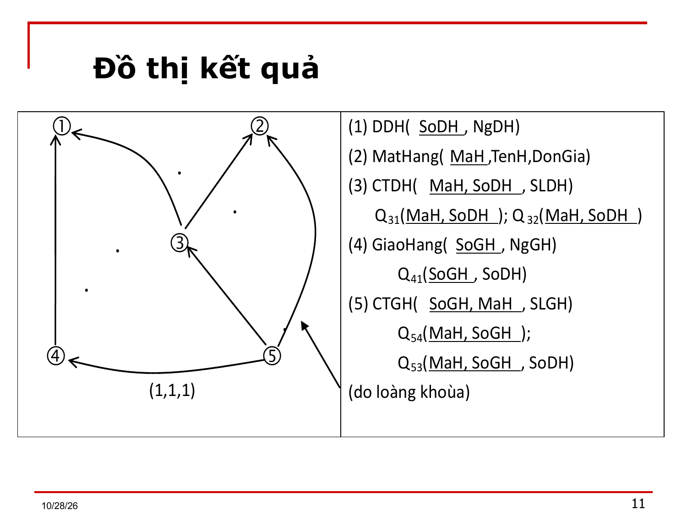
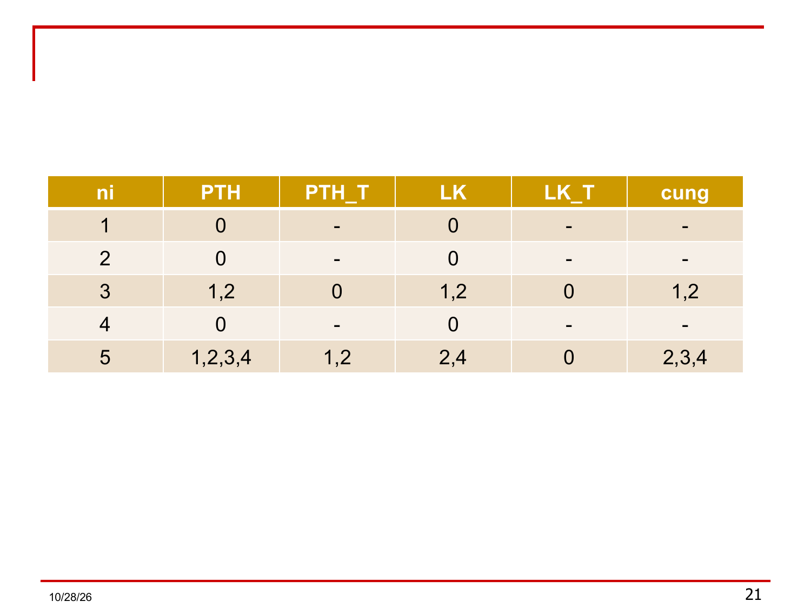
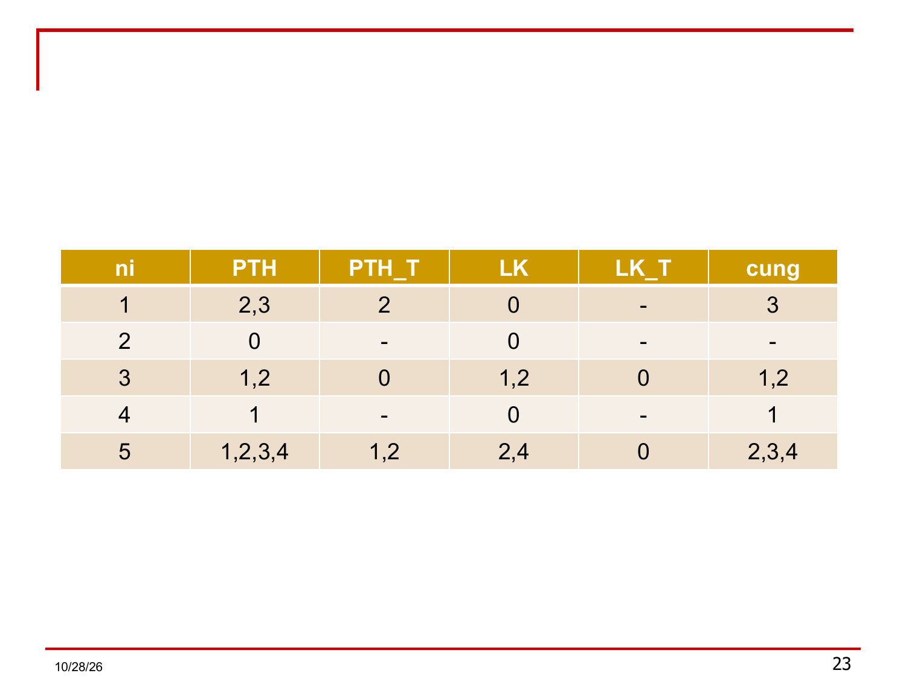

# Bài 10 — Thuật toán biểu diễn một cấu trúc CSDL quan hệ sang đồ thị quan hệ

> Bản chuyển lại từ `Bai 10.ppt` (25 slide), thay cho `Bai 10.md` bị lỗi ký hiệu.
> Quy ước: ký hiệu Wingdings/Symbol đã đổi về Unicode (`→ ∈ ∪ ∩ ⊃ ∅ ∀ ∃`); chỉ số dưới viết `ᵢ ⱼ ₖ ₕ` (riêng chỉ số `bl` viết thường: Nbl, Qbl); dấu cộng bao đóng viết `⁺`; ký hiệu bao hàm `⊃` đúng như thầy dùng (trên slide là ⊃, nghĩa "chứa, có thể bằng").
> Câu chữ giữ nguyên theo slide; chỉ sửa lỗi chính tả rõ ràng ('sảy' → 'xảy' ở slide 19, 'loàng khoùa' ở slide 11). Chỗ nào ghi `[Ghi chú]` là của người chuyển, không phải của thầy.

---

## Slide 1 — Tên bài

**Bài 10: THUẬT TOÁN BIỂU DIỄN MỘT CẤU TRÚC CSDL QUAN HỆ SANG ĐỒ THỊ QUAN HỆ**

## Slide 2 — Mục đích của thuật toán

- Đối với quan hệ có nhiều khóa, tất cả các khóa đều được gán cho một vai trò ngang nhau; thật vậy, việc đánh giá ưu tiên cho khóa nào trong số các khóa của một quan hệ thuộc về lãnh vực cài đặt, và sẽ được cân nhắc ở giai đoạn thiết kế vật lý. Điều này giải thích bước thứ nhất của thuật toán.
- Làm nổi bật những tập thuộc tính chung của mỗi cặp quan hệ, vì đó là cơ sở của phép kết.

## Slide 3 — Các bước của thuật toán (B1)

**Input:** Một phân rã C = {Qᵢ}, mỗi Qᵢ có tập khóa {Kᵢ}.
**Output:** Đồ thị quan hệ tương ứng với C.

**Bắt đầu:**

**B1: Biến C thành một phân rã đồng nhất Cd:**

- 1.1 Với mọi quan hệ con Qᵢ, Qⱼ, có khóa là Kᵢ và Kⱼ, nếu Kᵢ ↔ Kⱼ thì gộp Qᵢ, Qⱼ lại thành một quan hệ con.
  - Ví dụ: Q1(A, C); Q2(B, D); Q3(A, B) ⟹ Q123(A B C D)
  - Q4(E H), Q5(E K) ⟹ Q45(E H K)
- 1.2 Với mỗi Qᵢ, nếu Qᵢ⁺ có chứa một khóa Kⱼ của Qⱼ, thì Qᵢ⁺ phải chứa tất cả các khóa của Qⱼ. (Để nhìn rõ các phụ thuộc hàm)
  - Ví dụ: Q4(G A) chứa khóa A của Q123 ⟹ Q4(G A B)

> [Ghi chú] Slide viết `Ki <--> Kj`: đọc là Kᵢ ↔ Kⱼ (hai khóa suy ra nhau, tức cùng một lớp tương đương). Ví dụ Q123: A → B và B → A theo ví dụ của thầy.

## Slide 4 — B2, B3

**B2: Tạo nút và quan hệ nút:** Mỗi quan hệ Qᵢ là một nút Nᵢ với Q_Nᵢ = Qᵢ.

**B3: Tạo nút bản lề và quan hệ (nút) bản lề:** Mục đích làm nổi bật các thuộc tính xuất hiện trên nhiều quan hệ nút.

- 3.1. ∀Qᵢ, Qⱼ ∈ Cd; Qᵢⱼ = Qᵢ ∩ Qⱼ. // chỉ tính các tt khóa
- 3.2. Chừng nào Qᵢⱼ⁺ ≠ ∅ thì:
  - Xác định tất cả khóa của Qᵢⱼ;
  - Ký hiệu KQᵢⱼ⁺ là tập thuộc tính khóa của Qᵢⱼ.
  - Nếu ¬∃ Qₕ ∈ Cd sao cho 1 khóa của Qₕ là một khóa của Qᵢⱼ thì tạo 1 nút bản lề Nbl với quan hệ Qbl = KQᵢⱼ⁺
  - Cuối Nếu
  - Tính lại thuộc tính: Qᵢⱼ⁺ = Qᵢⱼ⁺ − KQᵢⱼ⁺.

> [Ghi chú] Slide gốc viết `Qij+ <> ∅` và `!∃`; dịch là "Qᵢⱼ⁺ ≠ ∅" và "không tồn tại".

## Slide 5 — B4: Tạo cung và quan hệ cung

**4.1.** ∀ nút Nᵢ ứng với quan hệ Qᵢ, xác định: tập các nút PTH vào nút Nᵢ

- PTH(Nᵢ) = {Nⱼ với Qⱼ sao cho Qᵢ⁺ ⊃ KQⱼ⁺}
- Loại bỏ các nút có quan hệ bắc cầu vào các nút khác:
- PTH_Thừa(Nᵢ) = {Nⱼ ∈ PTH(Nᵢ): ∃Nₕ ∈ PTH(Nᵢ) với Qₕ sao cho KQₕ⁺ ⊃ KQⱼ⁺}
- Lồng_khóa(Nᵢ) = {Nⱼ với Qⱼ sao cho KQᵢ⁺ ⊃ KQⱼ⁺}
- Lồng_khóa_thừa(Nᵢ) = {Nⱼ ∈ lồng_khóa(Nᵢ): ∃Nₕ ∈ lồng_khóa(Nᵢ) với Qₕ sao cho KQₕ⁺ ⊃ KQⱼ⁺}
- **Cung(Nᵢ) = (PTH(Nᵢ) − PTH_Thừa(Nᵢ)) ∪ (Lồng_khóa(Nᵢ) − Lồng_khóa_thừa(Nᵢ))**

**4.2.** ∀Nⱼ ∈ Cung(Nᵢ) thì:

- Tạo 1 cung có hướng cᵢⱼ từ Nᵢ → Nⱼ.
- Qᵢⱼ = Qᵢ[KQᵢ⁺ ∪ KQⱼ⁺]

## Slide 6 — B5, B6

**B5: Hủy những nút bản lề thừa**

∀Nₖ (Nₖ là nút bản lề) sao cho:
- Qₖ có 1 khóa duy nhất là Kₖ, không có thuộc tính nào khác ngoài khóa;
- Chỉ có một cung vào Nₖ, xuất phát từ nút Nᵢ;

thì: // vai trò bản lề của Nₖ không còn cần thiết nữa
- Nhập Nₖ vào Nᵢ.
- Hủy cung cᵢₖ.

**B6: Mịn hóa các quan hệ nút:**

∀Nᵢ với Qᵢ thì:
- ∀Nⱼ ∈ Cung(Nᵢ) với Qⱼ thì: hủy khỏi Qᵢ⁺ những thuộc tính khóa của Qⱼ mà không phải là thuộc tính khóa của Qᵢ.

## Slide 7 — B7

**B7: Tạo cung vô hướng:**

∀Nₖ sao cho:
- Qₖ⁺ = KQₖ⁺ (nghĩa là Qₖ không có thuộc tính không khóa);
- Chỉ có 2 cung ra khỏi Nₖ (không có cung vào), đến Nᵢ, Nⱼ với Qᵢ, Qⱼ sao cho: Qₖ = KQₖ = KQᵢ ∪ KQⱼ

thì:
- Tạo 1 cung vô hướng nối Nᵢ, Nⱼ với Qᵢⱼ = Qₖ.
- Hủy nút Nₖ.
- Hủy 2 cung xuất phát từ Nₖ.

**Chú ý:** Nếu toàn những cung vô hướng thì không làm B7.

**Kết thúc.**

## Slide 8 — Ví dụ

Hãy biến đổi một LĐCSDL sau sang đồ thị quan hệ:

1. DDH(<u>SoDH</u>, NgDH)
2. MatHang(<u>MaH</u>, TenH, DonGia)
3. CTDH(<u>SoDH, MaH</u>, SLDH)
4. GiaoHang(<u>SoGH</u>, SoDH, NgGH)
5. CTGH(<u>SoGH, MaH</u>, SLGH, SoDH)

> [Ghi chú] Gạch chân khóa do người chuyển thêm theo đồ thị ở slide 11; slide 8 gốc không gạch.

## Slide 9 — Giải (B1–B3)

- B1: C là phân rã đồng nhất.
- B2: Tạo nút và quan hệ nút.
- B3: Tạo nút bản lề và quan hệ (nút) bản lề:
  - Q12 = ∅
  - Q13 = SoDH ⟹ Q[SoDH]: không tạo, vì trùng khóa Q1.
  - Q35 = MaH, SoDH ⟹ Q[MaH, SoDH]: không tạo.
  - Q45 = SoGH, SoDH ⟹ Khóa của Q45 là SoGH, lại là khóa của 4; còn lại SoDH lại là khóa của 1.
  - Thực hiện tương tự.
- **Kết luận: Không tạo nút bản lề nào.**

## Slide 10 — B4: bảng tạo cung của ví dụ

| Nút | PTH(Nᵢ) | PTH_Thừa(Nᵢ) | LK(Nᵢ) | LK_Thừa(Nᵢ) | Cung(Nᵢ) |
|---|---|---|---|---|---|
| 1. DDH | ∅ | - | - | - | ∅ |
| 2. MatHang | ∅ | - | - | - | ∅ |
| 3. CTDH | 1, 2 | ∅ | 1, 2 | ∅ | 1, 2 |
| 4. GiaoHang | 1 | ∅ | ∅ | - | 1 |
| 5. CTGH | 1, 2, 3, 4 | 1, 2 | 2, 4 | ∅ | 2, 3, 4 |

(LK = Lồng_khóa; ảnh: `hinh_so_do/Bai10_Slide10_Bang_tao_cung_ViDuMau.png`)

## Slide 11 — Đồ thị kết quả

Nội dung bên phải đồ thị (đọc từ ảnh):

- (1) DDH(<u>SoDH</u>, NgDH)
- (2) MatHang(<u>MaH</u>, TenH, DonGia)
- (3) CTDH(<u>MaH, SoDH</u>, SLDH); Q₃₁(<u>MaH, SoDH</u>); Q₃₂(<u>MaH, SoDH</u>)
- (4) GiaoHang(<u>SoGH</u>, NgGH); Q₄₁(<u>SoGH</u>, SoDH)
- (5) CTGH(<u>SoGH, MaH</u>, SLGH); Q₅₄(<u>MaH, SoGH</u>); Q₅₃(<u>MaH, SoGH</u>, SoDH) (do lồng khóa)

Trên đồ thị: các cung 5→4, 5→3, 5→2, 3→1, 3→2, 4→1; nhãn (1,1,1) ở cung 5→4.

> [Ghi chú] Slide gốc có chữ "do loàng khoùa" (lỗi font); đã sửa thành "do lồng khóa".

## Slide 12 — Các quan hệ cung, B5–B7

- Các quan hệ cung:
  - Q₃₁(MaH, SoDH); Q₃₂(MaH, SoDH); Q₄₁(SoGH, SoDH)
  - Q₅₂(MaH, SoGH); Q₅₃(MaH, SoGH, SoDH) và Q₅₄(MaH, SoGH)
- B5: Không thực hiện, vì không có nút bản lề thừa.
- B6: Mịn hóa.
- B7: Không tạo cung vô hướng nào cả.

## Slide 13 — Nhận xét

- Có 2 mạch đi khác nhau cùng xuất phát từ nút 5 đến nút 1 là: 5 → 4 → 1 và 5 → 3 → 1; 2 mạch đi này giúp kiểm tra rằng nếu 1 chi tiết giao hàng liên quan đến 1 chi tiết của 1 DDH (mạch đi 5 → 3 → 1) và liên quan đến 1 đợt giao hàng thì đợt giao hàng này phải của cùng DDH đã biết (mạch đi 5 → 4 → 1).
- Với 2 mạch đi này ta có thể truy xuất thông tin: "Liệt kê các chi tiết giao hàng gồm các thông tin: SốGH, MaH, SLGH, SoDH, NgayDH", nghĩa là thực hiện phép chiếu sau: Q[SốGH, MaH, SLGH, SoDH, NgayDH].
- Quan hệ này có thể truy xuất bằng 1 trong 2 chuỗi kết gốc là 5: 5 → 3 → 2 và 5 → 2: hiện tượng này do có sự lồng khóa giữa các quan hệ 3 – 2 và 5 – 2.

## Slide 14 — Biến đổi ngược từ đồ thị quan hệ sang cấu trúc CSDL quan hệ

- **Mục tiêu:** kiểm chứng xem cấu trúc quan hệ được biểu diễn qua đồ thị quan hệ có hoàn toàn tương đương với cấu trúc CSDL C ban đầu hay không (tương đương ở đây được hiểu theo nghĩa bảo toàn thông tin – BTTT và bảo toàn phụ thuộc hàm – BTPTH).
- **Thuật toán:**
  - Gọi C₁ = {Qᵢ} ∪ {Qᵢⱼ}, Qᵢ là quan hệ nút; Qᵢⱼ là quan hệ cung.
  - Gộp các quan hệ có cùng khóa lại thành một quan hệ.
  - Ta nhận thấy C₁ = C ban đầu, điều này được bảo đảm do chính nội dung thuật toán.

## Slide 15 — Trường hợp cần lưu ý: Trường hợp 1

Cho cấu trúc quan hệ phổ quát như sau:

C = {⟨Q(MaSV, TenSV, MaGV, MaCD, P, N, G, TenGV, TenCD)⟩,
FQ = {MaSV → TenSV, MaGV, MaCD;
 MaGV, MaCD → P, N, G;
 MaGV → TenGV;
 MaCD → TenCD}}

Trong giai đoạn phân tích quan niệm ta được:

C₁ = {⟨Q₁(MaSV, TenSV, MaGV, MaCD); F₁ = {f₁}⟩,
 ⟨Q₂(MaGV, MaCD, P, N, G); F₂ = {f₂}⟩,
 ⟨Q₃(MaGV, TenGV); F₃ = {f₃}⟩,
 ⟨Q₄(MaCD, TenCD); F₄ = {f₄}⟩}

## Slide 16 — Trường hợp 1 (tt): 4 cách biểu diễn

Có 4 cách biểu diễn khác nhau của C₁ ở dạng đồ thị quan hệ:

- ĐT 1: 4 ← 2 → 3
- ĐT 2: 1 → 3
- ĐT 3: 1 → 2 → 3
- ĐT 4: 1 → 2 → 4

Giải thích:

- Với ĐT 1: Mỗi SV khi đăng ký phải có yêu cầu về GV và CĐ; nếu không dùng đồ thị quan hệ trên mà dùng C₁ thì phải nêu thêm 1 RBTV để thể hiện yêu cầu này.
- Với ĐT 2: Một SV khi đăng ký học CĐ mà không cần biết GV có phụ trách chuyên đề đó hay không.

## Slide 17 — Trường hợp 1 (tt)

- Với ĐT 3: Một SV khi đăng ký học CĐ sau đó chọn lớp, thông qua lớp mới biết được tên giáo viên.
- Với ĐT 4: Một SV khi đăng ký học ở 1 GV sau đó chọn lớp, thông qua lớp mới biết được tên chuyên đề.
- Về ý nghĩa khai thác: **ĐT 1 chặt chẽ nhất** (không có phụ thuộc bắc cầu).
- Việc truy xuất đến danh sách các lớp có thể tổ chức: đối với đồ thị 1, 3, 4 thì có thể truy xuất tại Q₂, nhưng với đồ thị 2 thì phải thực hiện như sau:

  (Q₁₄ ⋈ Q₁₃)[MaCD, MaGV] ∪ Q₂[MaCD, MaGV]

- **Thuật toán cho ra đồ thị 1.**

## Slide 18 — Trường hợp 2

Cho quan hệ sau:

C = ⟨Q(ABCDEXYZ),
FQ = {CDE → X; AE → CDB; AD → CY; C → AB; AB → CZ}⟩

Trong giai đoạn phân tích quan niệm ta được:

C₁ = {⟨Q₁(CEDABX); F₁ = {CDE → ABX; AE → CDB; C → AB; AB → C}⟩,
 ⟨Q₂(CDAY); F₂ = {CD → AY; AD → CY; C → A}⟩,
 ⟨Q₃(CABZ); F₃ = {C → ABZ; AB → CZ}⟩}

## Slide 19 — Trường hợp 2 (tt)

- Việc loại bỏ cung có thể xảy ra do sự lồng khóa CDE ⊃ CD ⊃ C trong khi đó còn có những khóa chưa xét đến (điều đó do thuật toán xem các khóa có độ ưu tiên ngang nhau).
- Khi cài đặt cần chọn ra 1 khóa ưu tiên nhất trong trường hợp nhiều khóa.
- Nếu chọn khóa ưu tiên: KQ₁ = {EA}; KQ₂ = {DA}; KQ₃ = {AB} thì không có sự lồng khóa nên có thể đưa vào thêm cung, nhưng phải lưu ý vì: AEX → DAY → ABZ nhưng AEX → AB'Z' (không cần thiết).
- **Chọn khóa ưu tiên sao cho không bị mất cung do lồng khóa.**

## Slide 20 — Bài tập 1

Cho cơ sở dữ liệu (CSDL) sau:

- Q1(A, D)
- Q2(B, E, G)
- Q3(A, B, G, H) // 1NF do B → G
- Q4(C, M)
- Q5(B, C, N, A)

a) CSDL trên có trùng lắp thông tin không? Giải thích?
b) Hãy vẽ đồ thị quan hệ của CSDL đã cho?

## Slide 21 — Bảng tạo cung của Bài tập 1

| nᵢ | PTH | PTH_T | LK | LK_T | cung |
|---|---|---|---|---|---|
| 1 | 0 | - | 0 | - | - |
| 2 | 0 | - | 0 | - | - |
| 3 | 1, 2 | 0 | 1, 2 | 0 | 1, 2 |
| 4 | 0 | - | 0 | - | - |
| 5 | 1, 2, 3, 4 | 1, 2 | 2, 4 | 0 | 2, 3, 4 |

> [Ghi chú] "0" trong bảng của thầy = tập rỗng ∅.

## Slide 22 — Bài tập 2

Cho CSDL sau:

- Q1(A, M, B)
- Q2(B, N, H)
- Q3(A, B, E)
- Q4(C, A, G)
- Q5(C, B, D, A, M)

a) CSDL trên có trùng lắp thông tin không? Giải thích?
b) Hãy vẽ đồ thị quan hệ của CSDL đã cho.

## Slide 23 — Bảng tạo cung của Bài tập 2

| nᵢ | PTH | PTH_T | LK | LK_T | cung |
|---|---|---|---|---|---|
| 1 | 2, 3 | 2 | 0 | - | 3 |
| 2 | 0 | - | 0 | - | - |
| 3 | 1, 2 | 0 | 1, 2 | 0 | 1, 2 |
| 4 | 1 | - | 0 | - | 1 |
| 5 | 1, 2, 3, 4 | 1, 2 | 2, 4 | 0 | 2, 3, 4 |

> [Ghi chú] Bảng chép theo ảnh slide (văn bản trích từ file `.ppt` ở slide này bị lệch thứ tự ô nên không dùng). Chưa kiểm tính lại các dòng so với Q1…Q5 ở slide 22; cần tính lại bằng tay trước khi dùng làm đáp án.

## Slide 24 — Bài tập 3

Cho phân rã sau:

| | |
|---|---|
| Q1(ABX1) | Q6(CEX6) |
| Q2(AX2) | Q7(EHX7) |
| Q3(ABCX3DEG) | Q8(HX8) |
| Q4(BDEX4) | Q9(HG) |
| Q5(CEGX5) | Q10(ABCH) |

1) Hãy biến đổi sang đồ thị quan hệ.
2) Hãy chỉ ra các con đường truy xuất.

(Ảnh tham khảo: `hinh_so_do/Bai10_Slide24_Luoc_do_10_quan_he.png`)

## Slide 25

Slide trống (chỉ có ngày và số trang).
