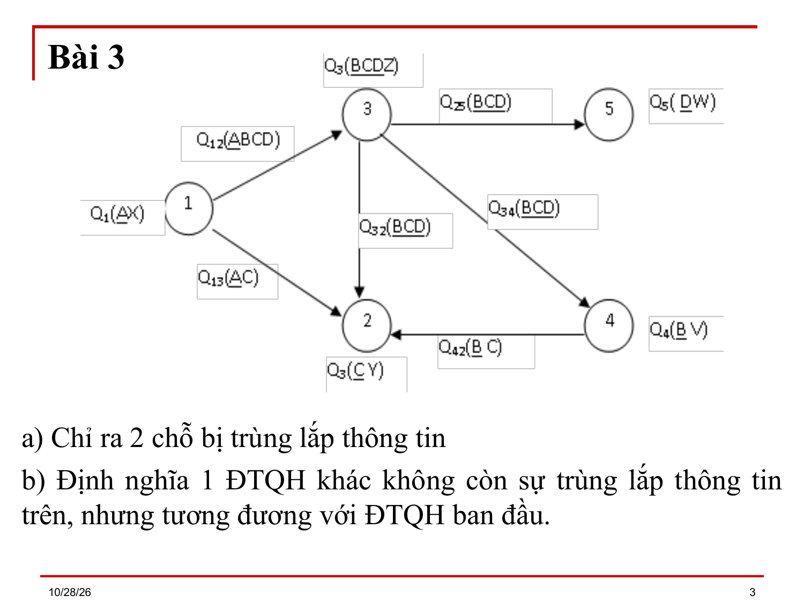
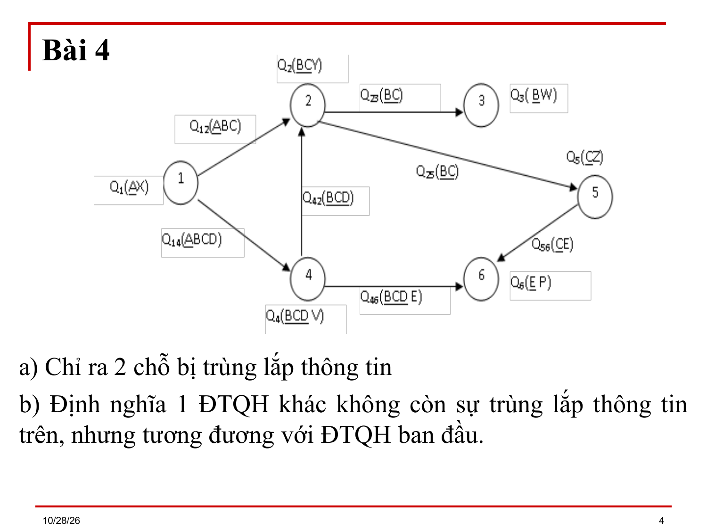
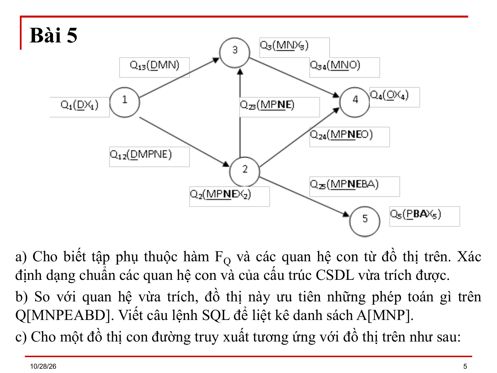
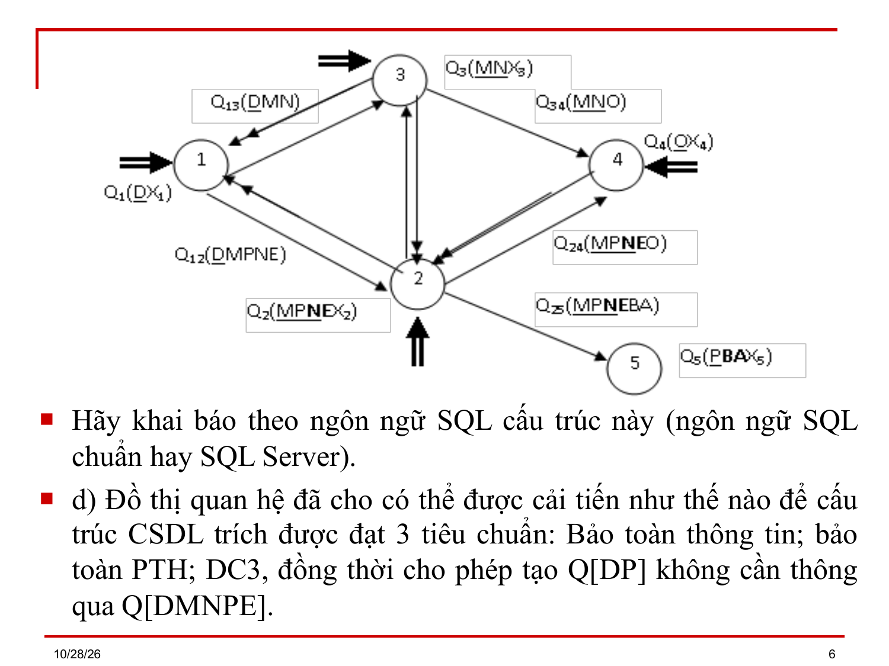
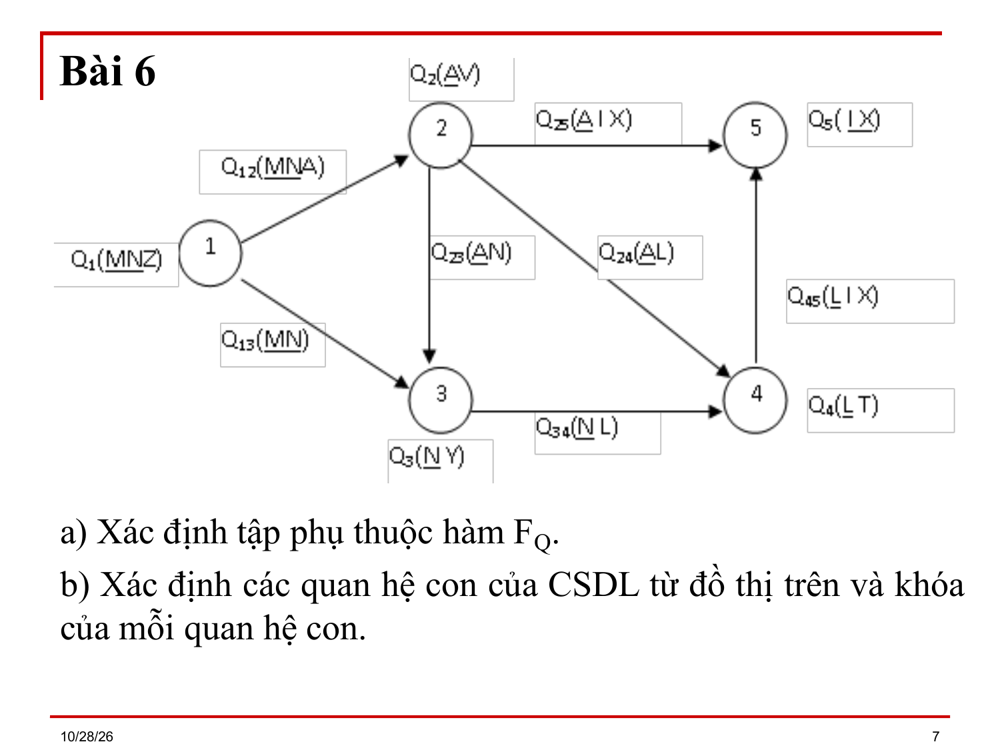
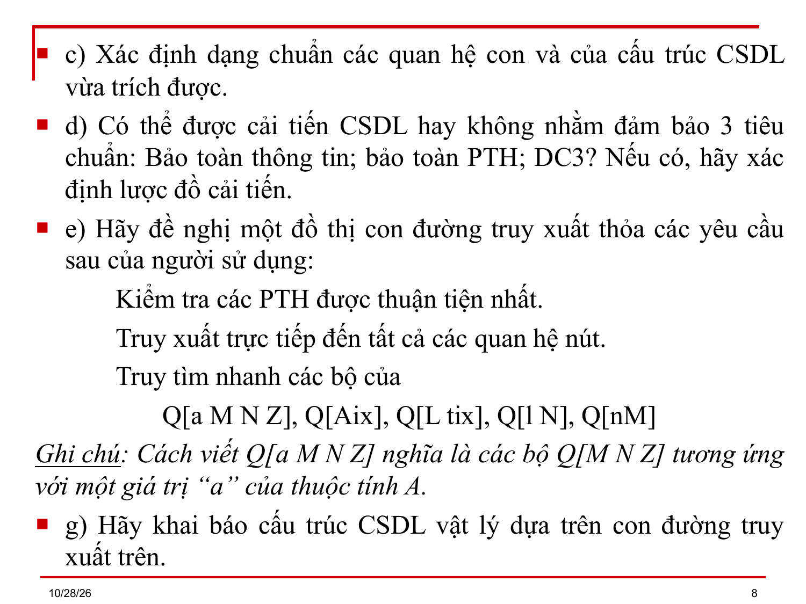

# Bài 11 — Bài tập con đường truy xuất

> Bản chuyển lại từ `Bai 11.ppt` (9 slide) thay cho `Bai 11.md`. Ký hiệu Wingdings/Symbol đã đổi về Unicode; chỉ số dưới/trên suy từ ngữ cảnh. `⟨?XX⟩` = ký hiệu chưa đọc được. `[BẢNG]` = ô bảng chép theo thứ tự trong file, cần xếp lại theo slide gốc.

---

## Slide 1

**Bài 11**

- BÀI TẬP VỀ CON ĐƯỜNG TRUY XUẤT

## Slide 2

**Biến đổi sang đồ thị quan hệ**

- Bài 1:
- Cho phân rã: C₁ = {⟨Q₁(ABCX), FQ₁ = {ABC → X}⟩
      - ⟨Q₂(BCY), FQ₂ = {BC → Y}⟩
      - ⟨Q₃(CZ), FQ₃ = {C → Z}⟩}
- Hãy biến đổi sang đồ thị quan hệ.
- Bài 2: Cho phân rã:
- C = {Q₁(AB X₁); Q₂(A X₂); Q₃(ABC X₃ DEG); Q₄(BDE X₄);
      - Q₅(CEG X₅); Q₆(CE X₆); Q₇(EH X₇); Q₈(H X₈);
      - Q₉(HG); Q₁₀(ABCH) }
- Hãy biến đổi sang đồ thị quan hệ.

## Slide 3

**Bài 3**

- a) Chỉ ra 2 chỗ bị trùng lắp thông tin
- b) Định nghĩa 1 ĐTQH khác không còn sự trùng lắp thông tin trên, nhưng tương đương với ĐTQH ban đầu.

## Slide 4

**Bài 4**

- a) Chỉ ra 2 chỗ bị trùng lắp thông tin
- b) Định nghĩa 1 ĐTQH khác không còn sự trùng lắp thông tin trên, nhưng tương đương với ĐTQH ban đầu.

## Slide 5

**Bài 5**

- a) Cho biết tập phụ thuộc hàm FQ và các quan hệ con từ đồ thị trên. Xác định dạng chuẩn các quan hệ con và của cấu trúc CSDL vừa trích được.
- b) So với quan hệ vừa trích, đồ thị này ưu tiên những phép toán gì trên Q[MNPEABD]. Viết câu lệnh SQL để liệt kê danh sách A[MNP].
- c) Cho một đồ thị con đường truy xuất tương ứng với đồ thị trên như sau:

## Slide 6

- Hãy khai báo theo ngôn ngữ SQL cấu trúc này (ngôn ngữ SQL chuẩn hay SQL Server).
- d) Đồ thị quan hệ đã cho có thể được cải tiến như thế nào để cấu trúc CSDL trích được đạt 3 tiêu chuẩn: Bảo toàn thông tin; bảo toàn PTH; DC3, đồng thời cho phép tạo Q[DP] không cần thông qua Q[DMNPE].

## Slide 7

**Bài 6**

- a) Xác định tập phụ thuộc hàm FQ.
- b) Xác định các quan hệ con của CSDL từ đồ thị trên và khóa của mỗi quan hệ con.

## Slide 8

- c) Xác định dạng chuẩn các quan hệ con và của cấu trúc CSDL vừa trích được.
- d) Có thể được cải tiến CSDL hay không nhằm đảm bảo 3 tiêu chuẩn: Bảo toàn thông tin; bảo toàn PTH; DC3? Nếu có, hãy xác định lược đồ cải tiến.
- e) Hãy đề nghị một đồ thị con đường truy xuất thỏa các yêu cầu sau của người sử dụng:
  - Kiểm tra các PTH được thuận tiện nhất.
  - Truy xuất trực tiếp đến tất cả các quan hệ nút.
  - Truy tìm nhanh các bộ của
      - Q[a M N Z], Q[Aix], Q[L tix], Q[l N], Q[nM]
- Ghi chú: Cách viết Q[a M N Z] nghĩa là các bộ Q[M N Z] tương ứng với một giá trị “a” của thuộc tính A.
- g) Hãy khai báo cấu trúc CSDL vật lý dựa trên con đường truy xuất trên.

> [Ghi chú] Dòng e) ở slide kế tiếp là g) (không có f)): đúng như file gốc. Ký hiệu như Q[a M N Z] giữ nguyên chữ của slide; "a" là giá trị của thuộc tính A theo ghi chú ngay bên dưới.

## Slide 9

(slide trống hoặc chỉ có hình)

