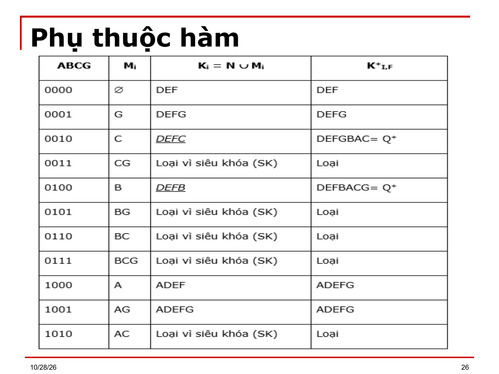

# Bài 3 — Mô hình quan hệ và phụ thuộc hàm

> Bản chuyển lại từ `Bai 3.ppt` (38 slide) thay cho `Bai 3.md`. Ký hiệu Wingdings/Symbol đã đổi về Unicode; chỉ số dưới/trên suy từ ngữ cảnh. `⟨?XX⟩` = ký hiệu chưa đọc được. `[BẢNG]` = ô bảng chép theo thứ tự trong file, cần xếp lại theo slide gốc.

---

## Slide 1

**BÀI 3**

- MÔ HÌNH QUAN HỆ VÀ CÁC PHỤ THUỘC DỮ LIỆU

## Slide 2

**Nội dung chi tiết**

- Mô hình dữ liệu quan hệ: nhắc lại các khái niệm cơ bản
- Phụ thuộc hàm (functional dependency)
- Các Dạng Chuẩn (normal form) trên quan Hệ
- Bài tập áp dụng

## Slide 3

**Mục tiêu**

- Sau khi học xong chương này, học viên có thể nhận biết được:
- Mô hình dữ liệu quan hệ
- Phụ thuộc hàm

## Slide 4

**Mô hình dữ liệu quan hệ**

- Nhắc lại các khái niệm căn bản
- Thuộc tính (Attribute) là thông tin đặc thù (hay tính chất  dùng để mô tả) của mỗi đối tượng được quản lý
- Thuộc tính được xác định bởi:
- Tên gọi: TenSV, TenGV
- Kiểu dữ liệu (Type): Số, Văn bản, Boolean...
- Miền giá trị (Domain): Ký hiệu MGT(A)

## Slide 5

**Mô hình dữ liệu quan hệ**

- Nhắc lại các khái niệm căn bản
- Một lược đồ quan hệ Q được định nghĩa trên một tập thuộc tính {A₁, A₂, .., An} là một sự biểu diễn tập đối tượng có chung các thuộc tính.
- Ký hiệu: Q(A₁, A₂,..,An)
- Ký hiệu: Q⁺ dùng biểu diễn tập thuộc tính {A₁, A₂, .., An}
- Mỗi quan hệ Q đều kèm theo một tân từ ||Q|| dùng để mô tả mối liên hệ ngữ nghĩa của các thuộc tính trong Q.

## Slide 6

**Mô hình dữ liệu quan hệ**

- Nhắc lại các khái niệm căn bản
- Ví dụ:
- KetQuaHT(MSSV, MSMon, HocKy, DiemL1, DiemL2)
- Tân từ: Mỗi môn học (MSMon) trong một học kỳ (HocKy) sinh viên (MSSV) được thi tối đa 2 lần (DiemL1, DiemL2).
- Một bộ q: của lược đồ quan hệ Q(A₁, A₂,..,An) là một tổ hợp giá trị (a1, a2,..,an) thoả 2 điều kiện:
- (1)∀Aᵢ ∈ Q⁺, ai ∈ MGT(Aᵢ)
- (2) Tân từ ||Q(a1, a2,..,an) || được thỏa
- Ví dụ: q=(01TH125, CSDL, 8, NULL)

## Slide 7

**Mô hình dữ liệu quan hệ**

- Nhắc lại các khái niệm căn bản
- Một tập thể hiện của lược đồ quan hệ Q được ký hiệu TQ, là một tập các bộ của Q TQ = { q= (a1,a2,.., an) / ai ∈ MGT(Aᵢ), ||Q(q)|| = TRUE }
- Một Siêu khóa (Super Key) trên lược đồ quan hệ  Q là một tập thuộc tính S ⊆ Q⁺  nếu mỗi giá trị của S có thể xác định duy nhất một bộ của Q ∀q₁, q₂ ∈ TQ, q₁.S = q₂.S thì q₁ = q₂.
- Khóa chỉ định (Candidate Key) hay khóa nội của Q là một siêu khóa ít thuộc tính nhất, không chứa bất kỳ một siêu khóa nào.

## Slide 8

**Mô hình dữ liệu quan hệ**

- Nhắc lại các khái niệm căn bản
- Thuộc tính khóa và thuộc tính không khóa: Các thuộc tính tham gia vào khóa gọi là thuộc tính khóa, các thuộc tính không tham gia vào khóa gọi là các thuộc tính không khóa.
- Một CSDL là 1 tập hợp các quan hệ, ký hiệu: C = { Qᵢ }, i = 1..t

## Slide 9

**Mô hình dữ liệu quan hệ**

- Nhắc lại các khái niệm căn bản
- Phép chiếu của một bộ q lên tập thuộc tính X ⊂ Q⁺ là phép trích ra từ bộ q các giá trị tương ứng với tập thuộc tính X
- Ký hiệu: q.X hay q[X]
- Ví dụ: q=(01TH125, CSDL, 8, NULL) thì q.[MSSV, DiemL1]=(01TH125,  8)
- Chiếu một quan hệ Q lên tập thuộc tính X ⊆ Q⁺ sẽ tạo thành một quan hệ Q' có tập thuộc tính X và TQ'={q' / ∃q∈TQ q.X = q'}
- Ký hiệu: ΠX(Q) hay Q[X].

## Slide 10

**Phụ thuộc hàm**

  - Phụ thuộc hàm là công cụ dùng để biểu diễn một cách hình thức mối quan hệ dữ liệu của các thuộc tính bên trong CSDL.
- Ví dụ: Xét lịch xếp lớp của một trường học trong một ngày, ta thấy có mối quan hệ dữ liệu như sau: "Nếu ta biết được tên giáo viên và giờ dạy, ta sẽ biết được lớp nào đang học."

## Slide 11

**Phụ thuộc hàm**

- Thông qua cách biểu diễn phụ thuộc hàm, ta có thể dễ dàng xác định khóa của quan hệ.
- Phương pháp biểu diễn này có vai trò quan trọng trong các phương pháp thiết kế một lược đồ quan niệm của CSDL, nhằm tạo ra những quan hệ độc lập nhau, giảm thiểu sự trùng lắp, dư thừa dữ liệu lưu trữ. Do đo, giảm bớt các sai sót khi cập nhật dữ liệu của người sử dụng. Ngoài ra, còn dùng để đánh giá chất lượng thiết kế một CSDL.

## Slide 12

**Phụ thuộc hàm**

- Nhắc lại định nghĩa:
- Cho một quan hệ Q(X, Y, Z) với X,Y,Z là các tập thuộc tính con của Q⁺ và với X,Y khác rỗng.
- Mọi thể hiện TQ của Q đều thỏa phụ thuộc hàm X → Y nếu:∀q₁, q₂ ∈ TQ: q₁.X = q₂.X  thì q₁.Y = q₂.Y
- Khi đó ta nói: X xác định hàm Y hay Y phụ thuộc hàm vào X
- Quy ước: Nếu Y không phụ thuộc hàm vào X ta ký hiệu: X ↛ Y
- X → Y là Phụ thuộc hàm hiển nhiên nếu Y ⊆ X

## Slide 13

**Phụ thuộc hàm**

- Tập Phụ thuộc hàm Của một quan hệ:
- Tập hợp các PTH không hiển nhiên của Q được ký hiệu là FQ
  - FQ = {fᵢ: X → Y xác định trên Q}
- Qui ước: Chỉ mô tả các phụ thuộc hàm không hiển nhiên trong tập F.
- Ví dụ: Xét quan hệ Giảng dạy:
- GD(MsGV, Hoten, MsMH, TenMH, Phòng, Giờ)
  - F={f1:MsGV→Hoten; f2: MsMH→TenMH;
  - f3: Phong,Gio→MSMH; f4: MsGV,Giờ→Phòng}

## Slide 14

**Phụ thuộc hàm**

- Hệ Tiên Đề Amstrong Và Một Số Tính Chất Của PTH:
- a) Hệ tiên đề Amstrong:
- Cho lược đồ quan hệ Q và X, Y, W, Z ⊆ Q⁺.
- LD1: Luật phản xạ:	Y ⊆ X ⟹ X → Y
- LD2: Luật thêm vào:	Nếu X → Y và Z ⊆ W thì X,W → Y,Z
- LD3: Luật bắc cầu: 	Nếu X → Y và Y → Z thì X → Z
- b) Một số luật dẫn suy từ hệ tiên đề Amstrong:
- LD4: Luật phân rã:	Nếu X→ Y,Z thì X→Y và X→ Z
- LD5: Luật hội:	Nếu X→ Y và X → Z thì X → Y,Z
- LD6: Luật bắc cầu giả: Nếu X → Y và Y,Z → W thì X,Z → W

## Slide 15

**Phụ thuộc hàm**

- Bao Đóng Của Tập Phụ Thuộc Hàm:
- Định nghĩa: Cho một quan hệ Q có tập phụ thuộc hàm FQ
- Bao đóng của FQ, ký hiệu FQ⁺, là tập hợp tất cả các PTH có thể suy diễn từ FQ dựa vào hệ luật dẫn Amstrong.
- Ký hiệu: FQ⁺ = { X → Y / F ⊨ X → Y}
- Ví dụ: Q(A,B,C) và FQ = {f1: A→B, f2: B→C}
- FQ⁺ = { A→A; A→B; A→C; A→AB, A→AC; A→ABC, B→B, B→C, B→BC, C→C, AB→AB, AB→A, AB→B, AB→C, AB→AC, AB→BC, AC→A, AC→B, AC→C, AC→AC, AC→BC, AC→ABC, BC→B, BC→C, BC→BC, ABC→A, ABC→B, ABC→C, ABC→AB, ABC→AC, ABC→BC, ABC→ABC}

## Slide 16

**Phụ thuộc hàm**

- Bao Đóng Của Tập Thuộc Tính:
- Định nghĩa: Cho 1 LĐQH Q có tập các phụ thuộc hàm FQ={f1, f2,.., fm} và X ⊆ Q⁺.
- Bao đóng của tập thuộc tính X dựa trên FQ, ký hiệu X⁺F, là tập các thuộc tính phụ thuộc hàm vào X dựa trên F.
- X⁺F = {Y ∈ Q⁺: X →Y ∈ F⁺}
- Nhận xét:
- 1.	X ∈ X⁺F
- 2.	Y ∈ X⁺F ⟺ f: X → Y ∈ FQ⁺.
- Dựa vào nhận xét 2 ta có thể giải quyết bài toán thành viên (bài toán kiểm tra sự tồn tại của 1 phụ thuộc hàm) bằng cách xác định bao đóng của tập thuộc tính bên vế trái của phụ thuộc hàm đó.

## Slide 17

**Phụ thuộc hàm**

- Thuật toán xác định X⁺F:
  - begin
    - X⁺F = X;
    - repeat
      - X' = X⁺F
      - For i:=1 to m do  {m = card(F)}
      - if VT(fᵢ) ∈ X⁺F then X⁺F := X⁺F ∪ VP(fᵢ)
    - until (X⁺F = X');
    - end
- Ghi chú: VT(fᵢ): Vế trái của phụ thuộc hàm fᵢ.
      - VP(fᵢ): Vế phải của phụ thuộc hàm fᵢ.

## Slide 18

**Phụ thuộc hàm**

- Ví dụ: cho Q(ABCDEGH) và tập PTH
- F = {f1: B→A; f2: DA→CE; f3: D→H; f4: GH→C; f5: AC→D}
- Tìm bao đóng của tập thuộc tính X₁ = {BD}
- X⁺F = BD
- Do f1: 	X⁺F = BDA
- Do f2: 	X⁺F = BDACE
- Do f3: 	X⁺F = BDACEH
- Do f5: 	X⁺F = BDACEH
- Vậy X⁺F = BDACEH.

## Slide 19

**Phụ thuộc hàm**

- Ví dụ: Cho Q(ABCDEF) và
  - F = {f1: AB→C, f2: AE→D, f3: BC→D,
  - f4: C→E, f5: ED→F}
  - Kiểm tra AB→EF có thuộc F⁺ hay không?
- Cách giải: Kiểm tra EF ⊆ {AB}⁺F.

## Slide 20

**Phụ thuộc hàm**

- Khóa và cách xác định
- a. Định nghĩa: Cho LĐQH Q và tập phụ thuộc hàm
- FQ = {f1, f2,… fn}
- S ⊆ Q⁺, S là siêu khóa của Q nếu S→Q⁺∈ FQ
- K ⊆ Q⁺, K là khóa chỉ định nếu K là siêu khóa
- pth K→Q⁺ là pth nguyên tố.
- (Không tồn tại K’ là con thật sự của K để K’→ Q⁺)
- Nhận xét: Nếu đồ thị biểu diễn của tập pth F không chứa chu trình thì Q chỉ có duy nhất một khóa.

## Slide 21

**Phụ thuộc hàm**

- b. Cách xác định khóa của một quan hệ:
- Ý tưởng:
- Gọi N là tập thuộc tính nguồn, chỉ chứa thuộc tính không có bên vế phải của các phụ thuộc hàm.
- Gọi M là tập thuộc tính trung gian, chứa các thuộc tính vừa xuất hiện bên vế phải vừa xuất hiện bên vế trái.
- Nếu N⁺F = Q⁺ thì N chính là khóa chỉ định của Q và là khóa duy nhất.
- Ngược lại, ta lần lượt hội N với từng tập con của M để kiểm tra có là khóa chỉ định hay không.

## Slide 22

**Phụ thuộc hàm**

- Ví dụ: Cho quan hệ Giảng dạy:
- GD(MsGV, Hoten, MsMH, TenMH, Phòng, Giờ)
- F={f1:MsGV→Hoten; f2: MsMH→TenMH;
  - f3: Phong,Gio→MSMH; f4: MsGV,Giờ→Phòng}
- Tìm khóa của quan hệ GD.
- Giải:
- N = {MsGV, Gio}
- M = {MsMH, Phong}
- ⟹ Khóa là {MsGV, Gio}

## Slide 23

**Phụ thuộc hàm**

- c. Thuật toán: Xác định tất cả các khóa của một quan hệ Q.
- Input: <Q,F>; Output: K {Tập các khóa của quan hệ Q}
- Begin
- b1: Xây dựng tập N và M.
- b2: Xây dựng 2m tập con của tập M với m = Card(M)
- b2: Xây dựng tập K chứa các khóa
- K = ∅;
- For i:=1 to 2ᵐ do

## Slide 24

**Phụ thuộc hàm**

- c. Thuật toán: Xác định tất cả các khóa của một quan hệ Q.
- begin
- Kᵢ := N ∪ Mᵢ
- Nếu Kᵢ không chứa các khóa đã xác định trước đó và Kᵢ⁺F = Q⁺ thì Kᵢ là 1 khóa của Q: K = K ∪ Kᵢ.
- end
- End;

## Slide 25

**Phụ thuộc hàm**

- Ví dụ: Cho quan hệ Q(ABCDEFG) và
- FQ = {f1: EC→B; f2: AB→C; f3: EB→A; f4: BG→A; f5: AE→G}.
- Xác định các khóa của lđ quan hệ Q.
- Giải: N = {D,E,F}, M = {A,B,C,G}

## Slide 26

- Phụ thuộc hàm

## Slide 27

**Phụ thuộc hàm**

- Phủ và Phủ tối thiểu của FQ:
- Trong rất nhiều bài toán liên quan đến CSDL thì độ phức tạp tùy thuộc vào số PTH cũng như các thuộc tính bên vế trái, vế phải của PTH.
- Do đó, để giảm độ phức tạp người ta thường xây dựng các tập PTH tương đương với tập PTH ban đầu nhưng đơn giản hơn.

## Slide 28

**Phụ thuộc hàm**

- Phủ và Phủ tối thiểu của FQ:
- a) Định nghĩa phụ thuộc hàm tương đương:
- Hai tập phụ thuộc hàm F và G được gọi là tương đương với nhau nếu F⁺ = G⁺.
- Nghĩa là: ∀f ∈ F thì f ∈ G⁺ và ∀g∈ G thì g ∈ F⁺
- Ký hiệu: F ≡ G

## Slide 29

**Phụ thuộc hàm**

- Ví dụ: Cho 2 tập PTH định nghĩa trên Q(ABCDE)
- F = {A→BC; A→D; CD→E} và G ={A→BCE; A→BD; CD→E}
- Xét A→E ∈ G chứng minh A→E ∈ F⁺.
- Ta có {A}⁺F = {ABCDE } nên A→E ∈ F⁺
- Ta thấy F ⊆ G⁺ ; G ⊆ F⁺
- Vậy F⁺ = G⁺
- Ví dụ: Cho F={A→BC; A→D; CD→E} và G = {A→BCDE}
- Xét CD→E ∈ F có {CD}⁺G = {CD} nên  CD→E ∉ G⁺

## Slide 30

**Phụ thuộc hàm**

- b) Định nghĩa Phủ của một PTH:
- Tập phụ thuộc hàm G được gọi là phủ của tập pth F nếu F ⊆  G⁺.
- c)  Định nghĩa Phủ tối thiểu của F:
- Cho tập phụ thuộc hàm F. G là Phủ tối thiểu của F nếu G là Phủ của F, đồng thời thỏa 3 điều kiện:
- Vế phải của các pth trên G chỉ chứa một thuộc tính.
- G chỉ gồm những pth đầy đủ.
- Không chứa pth thừa: ¬∃ (X→A) ∈ G sao cho G ≡ (G – {X→A})

## Slide 31

**Phụ thuộc hàm**

- d) Thuật toán tìm Phủ tối thiểu:
- Input: Tập pth FQ
- Output: Phủ tối thiểu của FQ
- Bắt đầu:
- b1. Phân rã các pth để có vế phải chỉ còn 1 thuộc tính.
- b2. Thay thế các pth không đầy đủ bằng các pth đầy đủ.
- b3. Loại bỏ các pth dư thừa.
- Kết thúc

## Slide 32

**Phụ thuộc hàm**

- d) Thuật toán tìm Phủ tối thiểu:
- Ví dụ: Cho F={A→B; B→A; B→C; A→C; C→A}. Tìm phủ tối thiểu của F.
- Giải:
- Các PTH của F có vế phải chỉ chứa một thuộc tính (thỏa (1)).
- Các PTH của F đều thỏa điều kiện (2) vì có vế trái chỉ chứa một thuộc tính.
- Xét điều kiện (3):

## Slide 33

**Phụ thuộc hàm**

- d) Thuật toán tìm Phủ tối thiểu:
- Nếu loại B→A và A→C ta nhận thấy tập kết quả G = {A→B; B→C; C→A} ≡ F. Nếu loại thêm 1 trong 3 PTH còn lại thì tập kết quả không tương đương. Vậy G là 1 phủ tối thiểu của F.
- Nếu loại B→C ta nhận thấy tập kết quả G = {A→B; B→A; A→C; C→A} ≡ F. Nếu loại thêm 1 trong 4 PTH còn lại thì tập kết quả không tương đương. Vậy G là 1 phủ tối thiểu của F.

## Slide 34

**Phụ thuộc hàm**

- Tính Chất Của Phụ Thuộc Hàm:
- a)  Tính chiếu:
- Cho pth f: X→Y định nghĩa trên Q và Q' = Q[W] với W ⊃ X và W ∩ Y ≠ ∅
- thì Q' có phụ thuộc hàm f' : X→(W ∩ Y)
- Ví dụ: Cho Q(ABC) có f:A→BC. Với Q'(AB) thì Q' có f': A→B
- b) Tính phản chiếu:
- Cho Q' = Q[W] và f: X→Y định nghĩa trên Q' thì phụ thuộc hàm f: X→Y cũng định nghĩa trên cả Q.
- Ví dụ: Nếu Q'(AB) thì có f': A→B thì Q(ABC) cũng có f:A→B

## Slide 35

**Phụ thuộc hàm**

- Bài tập: Bao đóng và khóa
  - 1. Cho Q(ABCD) có F = {f1:A→C; f2:D→C; f3:BD→A}.
- Xác định 1 khóa của Q.
  - 2.Q(ABCDEHK) và F= {f1:AB→C; f2:CD→E; f3:AH→K; f4:A→D; f5:B→D}.
- Xác định tất cả các khóa của Q.

## Slide 36

**Phụ thuộc hàm**

- Bài tập: Bao đóng và khóa
- 3.Cho quan hệ Q(ABCDEG) và tập pth: F = {AB →C;  C →A; BC →D; ACD →B; D →EG; BE →C; CG →BD; CE →AG}
- a) Tìm {BD}⁺F
- b) Tìm 1 khóa của Q
- 4. Cho quan hệ Q(ABCEGH) và tập pth F = {AB →E; AC →G; BE→G; E →C;CG →H}
- a) AB → GH?
- b) Tìm tất cả các khóa của Q

## Slide 37

**Phụ thuộc hàm**

- Bài tập: Tìm phủ tối thiểu
- Cho lược đồ quan hệ Q(A,B,C,D) và tập phụ thuộc F như sau:
- F = {AB → CD, B → C,C  → D}
  - Hãy tìm phủ tối thiểu của F?

## Slide 38

(slide trống hoặc chỉ có hình)

