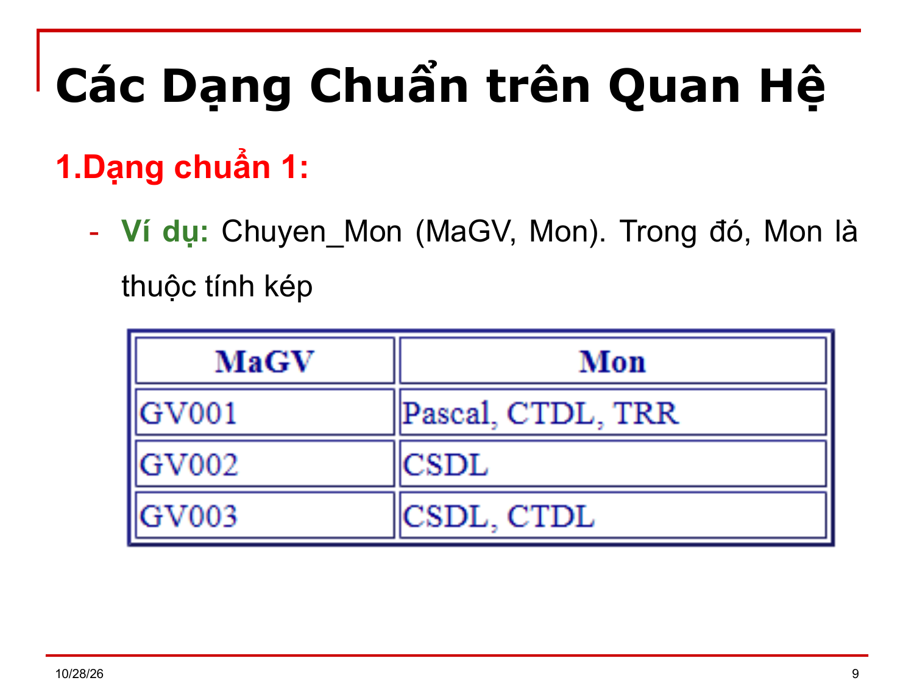
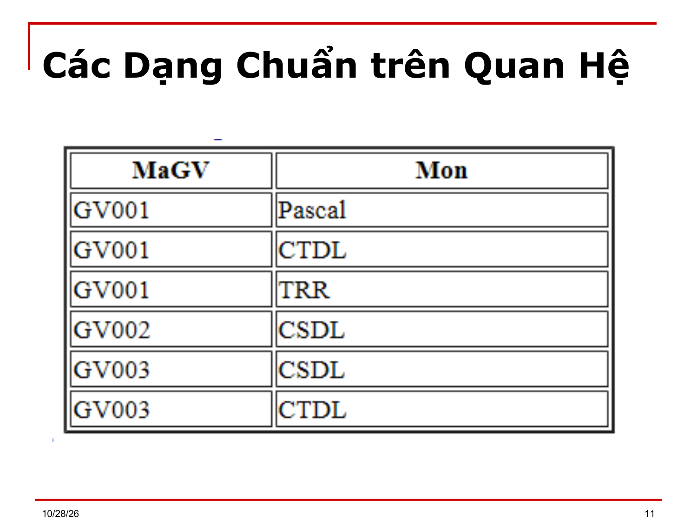

# Bài 4 — Chuẩn hóa dữ liệu

> Bản chuyển lại từ `Bai 4.ppt` (37 slide) thay cho `Bai 4.md`. Ký hiệu Wingdings/Symbol đã đổi về Unicode; chỉ số dưới/trên suy từ ngữ cảnh. `⟨?XX⟩` = ký hiệu chưa đọc được. `[BẢNG]` = ô bảng chép theo thứ tự trong file, cần xếp lại theo slide gốc.

---

## Slide 1

**BÀI 4**

- CHUẨN HÓA DỮ LIỆU

## Slide 2

**Nội dung chi tiết**

- Các Dạng Chuẩn (Normal Form) trên LĐ quan hệ
- Bài tập áp dụng

## Slide 3

**Mục tiêu**

- Sau khi học xong bài này, học viên có thể đánh giá trùng lắp thông tin qua:
- Các dạng chuẩn trên quan hệ
- Dạng chuẩn 1
- Dạng chuẩn 2
- Dạng chuẩn 3
- Dạng chuẩn BCK
- Dạng chuẩn 4
- Dạng chuẩn của một lđ CSDL

## Slide 4

**Các Dạng Chuẩn trên Quan Hệ**

- Mục tiêu:
- Trong thực tế, một ứng dụng có thể được phân tích thành nhiều LĐCSDL khác nhau và dĩ nhiên chất lượng thiết kế của các LĐCSDL này cũng khác nhau.
- Chất lượng thiết kế của một LĐCSDL được đánh giá dựa trên các tiêu chuẩn như:
- Sự trùng lắp thông tin: Vì nó sẽ làm tăng không gian lưu trữ và gây nên tình huống thông tin bị mâu thuẫn sau những lần cập nhật CSDL.
- Chi phí kiểm tra ràng buộc toàn vẹn
- Bảo toàn thông tin
- Bảo toàn qui tắc quản lý tức là bảo toàn các phụ thuộc hàm.

## Slide 5

**Các Dạng Chuẩn trên Quan Hệ**

- Ví dụ: Xét một thể hiện của quan hệ quản lý học tập của sinh viên
- QLHT(MsSV, Ten, NS, Phai, ĐC, MsLop, TenLop, MsMH, TenMH, Diem)
- F = {f1:MsSV → Ten, NS, Phai, ĐC, MsLop;
- f2: MsLop → TenLop;
- f3: MsMH → TenMH;
- f4: TenMH → MsMH;
- f5: MsSV, MsMH → Diem}
- Quan hệ trên có sự trùng lắp thông tin? Sự trùng lắp thông tin này có thể gây nên 1 số vấn đề khi thao tác trên quan hệ:

## Slide 6

**Các Dạng Chuẩn trên Quan Hệ**

- a) Sửa đổi: Giả sử có 1 SV thay đổi địa chỉ, thì hệ thống cần phải duyệt trên toàn bộ quan hệ để tìm và sửa địa chỉ ở các bộ liên quan đến SV này. Nếu để sót thì sẽ dẫn đến tình trạng thông tin không nhất quán
- b) Xóa: Giả sử SV có mã số 1108 hiện nay chỉ đăng ký học môn CSDL. Nếu muốn xóa kết quả điểm môn này thì dẫn đến mất luôn thông tin của SV
- c) Thêm: Vì khóa của quan hệ là {MsSV, MsMH} và {MsSV, TenMH} do đó không thể thêm 1 SV vào quan hệ nếu SV đó chưa đăng ký học môn nào.

## Slide 7

**Các Dạng Chuẩn trên Quan Hệ**

- Qua ví dụ trên chúng ta nhận thấy sự trùng lắp thông tin là nguyên nhân làm cho CSDL có chất lượng kém.
- Để hạn chế tình trạng trùng lắp dữ liệu, người ta đưa ra các yêu cầu thiết kế cần thiết cho một quan hệ dựa trên khái niệm phụ thuộc hàm, được gọi là các dạng chuẩn của một quan hệ.

## Slide 8

**Các Dạng Chuẩn trên Quan Hệ**

- 1.Dạng chuẩn 1 (1st):
- Khái niệm Thuộc tính đơn: Một thuộc tính được gọi là thuộc tính đơn nếu giá trị của nó không phải là sự kết hợp bởi nhiều thông tin có ý nghĩa khác nhau và hệ thống luôn truy xuất trên toàn bộ giá trị của nó ít khi truy xuất đến từng phần dữ liệu của nó. Ngược lại, là thuộc tính kép.

## Slide 9

**Các Dạng Chuẩn trên Quan Hệ**

- 1.Dạng chuẩn 1:
- Ví dụ: Chuyen_Mon (MaGV, Mon). Trong đó, Mon là thuộc tính kép

## Slide 10

**Các Dạng Chuẩn trên Quan Hệ**

- Định nghĩa DC1: Một lược đồ quan hệ Q đạt dạng chuẩn 1 nếu mọi thuộc tính của Q đều là thuộc tính đơn.
- Ví dụ: Chuyen_Mon như hình trên không ở dạng chuẩn 1 vì thuộc tính Mon là thuộc tính kép. Cách khắc phục: tách thuộc tính kép thành các thuộc tính đơn hoặc tách thành các dòng.

## Slide 11

- Các Dạng Chuẩn trên Quan Hệ

## Slide 12

**Các Dạng Chuẩn trên Quan Hệ**

- Dạng chuẩn 2:
- Khái niệm phụ thuộc đầy đủ:
- Thuộc tính A được gọi là phụ thuộc đầy đủ vào tập thuộc tính X nếu:
- A ∈ X⁺F
- X → A là pth nguyên tố.
- Khái niệm thuộc tính khóa, thuộc tính không khóa
- Thuộc tính khóa (thuộc tính nguyên tố): là một thuộc tính của lược đồ quan hệ Q mà là thành phần của ít nhất một khóa dự tuyển trong Q.

## Slide 13

**Các Dạng Chuẩn trên Quan Hệ**

- Dạng chuẩn 2:
- Khái niệm thuộc tính khóa, thuộc tính không khóa
- Thuộc tính khóa (thuộc tính nguyên tố): là một thuộc tính của lược đồ quan hệ Q mà là thành phần của ít nhất một khóa dự tuyển trong Q.
- Thuộc tính không khóa (thuộc tính không nguyên tố): là thuộc tính không phải là thuộc tính nguyên tố (tức không tham gia vào bất kỳ một khóa nào của lược đồ quan hệ)

## Slide 14

**Các Dạng Chuẩn trên Quan Hệ**

- Dạng chuẩn 2:
- Khái niệm thuộc tính khóa, thuộc tính không khóa
- Ví dụ: R(U, F) với U = ABCDE, K₁ = AB, K₂ = CB            Tập thuộc tính khóa là A, B, C            Tập thuộc tính không khóa là DE

## Slide 15

**Các Dạng Chuẩn trên Quan Hệ**

- Định nghĩa Dạng chuẩn 2:
- Một lược đồ quan hệ Q đạt dạng chuẩn 2 nếu
- a. Q ở DC1
- b. Mọi thuộc tính không khóa đều phụ thuộc đầy đủ vào các khóa của Q.
- Ví dụ: MsSV, MsMH → Ten là phụ thuộc hàm không đầy đủ vì chỉ cần MsSV là xác định được Ten:  MsSV →  Ten

## Slide 16

**Các Dạng Chuẩn trên Quan Hệ**

- Thuật toán kiểm tra dạng chuẩn 2
- Vào: lược đồ quan hệ Q, tập phụ thuộc hàm F
- Ra: khẳng định Q đạt chuẩn 2 hay không đạt chuẩn 2.
- Bước 1: Tìm tất cả khóa của Q
- Bước 2: Với mỗi khóa K, tìm bao đóng của tất cả tập con thật sự S của K.
- Bước 3: Nếu có bao đóng S⁺ chứa thuộc tính không khóa thì Q không đạt chuẩn 2 Ngược lại thì Q đạt chuẩn 2

## Slide 17

**Các Dạng Chuẩn trên Quan Hệ**

- Có thể thay quan hệ QLHT bằng 3 quan hệ sau để đạt dạng chuẩn 2:
- KQHT(MsSV, MsMH, Diem)
- FKQHT = {f4: MsSV, MsMH → Diem}
- SV(MsSV, Ten, Ngsinh, Phai, MsLop, TenLop)
- FSV = {f1: MsSV→Ten, NS, Phai, ĐC, MsLop; f2: MsLop → TenLop}
- MH(MsMH, TenMH)
- FMH = { f3: MsMH → TenMH}

> [Ghi chú] Slide ghi "FKQHT = {f4: MsSV, MsMH → Diem}" nhưng ở slide 5 phụ thuộc hàm này là f5 (f4 là TenMH → MsMH): đây là chỗ không nhất quán trong bài giảng.

## Slide 18

**Các Dạng Chuẩn trên Quan Hệ**

- Nhận xét:
- Nếu mỗi khóa của quan hệ Q chỉ có 1 thuộc tính thì Q đạt dạng chuẩn 2.
- Quan hệ SV ở dạng chuẩn 2 nhưng vẫn trùng lắp thông tin.

## Slide 19

**Các Dạng Chuẩn trên Quan Hệ**

- 3. Dạng chuẩn 3:
- Khái niệm Phụ thuộc bắc cầu:
- Thuộc tính A ∈ Q⁺ được gọi là PTBC vào một tập thuộc tính X nếu tồn tại nhóm thuộc tính Y ⊆ Q⁺ thỏa mảng 4 điều kiện sau:
- i.	X → Y ∈ F⁺
- ii.	Y → A ∈ F⁺
- iii.	Y ↛ X
- iv.	A ∉ {X ∪ Y}
- Ví dụ: Xét quan hệ SV(MsSV, Ten, Ngsinh, Phai, MsLop, TenLop)
- TenLop phụ thuộc bắc cầu vào MsSV vì: MsSV→MsLop và MsLop→TenLop

## Slide 20

**Các Dạng Chuẩn trên Quan Hệ**

- Định nghĩa DC3:
- Một lược đồ quan hệ Q đạt dạng chuẩn 3 nếu
- a. Q ở DC2
- b. Mọi thuộc tính không khóa Q đều không phụ thuộc bắc cầu vào một khóa nào của Q.
- Ví dụ: Quan hệ SV không đạt dạng chuẩn 3. Ta có thể tách thành 2 quan hệ:
- SV(MsSV, Ten, Ngsinh, Phai, MsLop)
- Lop(MsLop, TenLop)

## Slide 21

**Các Dạng Chuẩn trên Quan Hệ**

- Thuật toán kiểm tra dạng chuẩn 3
- Vào: lược đồ quan hệ Q, tập phụ thuộc hàm F
- Ra: khẳng định Q đạt chuẩn 3 hay không đạt chuẩn 3.
- Bước 1: Tìm tất cả khóa của Q
- Bước 2: Từ F tạo tập phụ thuộc hàm tương đương F₁ có vế phải một thuộc tính.
- Bước 3: Nếu mọi phụ thuộc hàm X → A ∈ F₁ với A ∉X đều có X là siêu khóa hoặc A là thuộc tính khóa thì Q đạt chuẩn 3 ngược lại Q không đạt chuẩn 3.

## Slide 22

**Các Dạng Chuẩn trên Quan Hệ**

- Ví dụ: Xét quan hệ Tồn kho như sau: TK(MSHH, MSKho, TenKho, SLT)
- F={MSHH, MSKho → SLT; MSKho → TenKho; TenKho → MsKho}
- Quan hệ TK có 2 khóa là {MSHH,MSKho} và {MSHH, TenKho}, đạt dạng chuẩn 3 (?) vì chỉ có 1 thuộc tính không khóa là SLT và thuộc tính này không ptbc vào các khóa. Tuy quan hệ tồn kho đạt dạng chuẩn 3 nhưng vẫn còn sự trùng lắp thông tin trên các cột MsKho và TenKho.

## Slide 23

**Các Dạng Chuẩn trên Quan Hệ**

- 4. Dạng chuẩn BCK (Boyee-Codd-Kent) (còn gọi là BC):
- Định nghĩa: Một lđqh Q ở dạng chuẩn BCK nếu mọi phụ thuộc hàm không hiển nhiên đều có vế trái chứa khóa.
  - X → A ∈ F⁺: A ∉ X và X phải chứa khóa của Q
- Nhận xét: Nếu Q đạt dạng chuẩn BCK thì mọi vế trái  của pth đều là siêu khóa.
  - Ví dụ: Quan hệ TK không đạt dạng chuẩn BCK. Vì: MsKho → TenKho.
  - Ta tách thành 2 quan hệ: TK (MSHH, MSKho, SLT) và Kho(MSKho, TenKho)

## Slide 24

**Các Dạng Chuẩn trên Quan Hệ**

- Thuật toán kiểm tra dạng chuẩn BC
- Vào: lược đồ quan hệ Q, tập phụ thuộc hàm F
- Ra: khẳng định Q đạt chuẩn BC hay không đạt chuẩn BC.
- Bước 1: Tìm tất cả khóa của Q
- Bước 2: Từ F tạo tập phụ thuộc hàm tương đương F₁ có vế phải một thuộc tính
- Bước 3: Nếu mọi phụ thuộc hàm X → A ∈ F₁ với A∉X đều có X là siêu khóa thì Q đạt chuẩn BC ngược lại Q không đạt chuẩn BC

## Slide 25

**Các Dạng Chuẩn trên Quan Hệ**

- 5. Dạng chuẩn 4:
- Phụ thuộc đa trị.
- Ngoài các pth đã trình bày, người ta còn xét đến một loại phụ thuộc hàm khác, đó là pth đa trị.
- Ví dụ: Xét quan hệ nhân viên:
- NhânViên(MãNV, HọTênNV, ConNV, BậcLương)
- Ta có pth đa trị: MãNV ↠ ConNV
- HC03 ↠ {"Nguyễn Văn A", Nguyễn Thị B"}

## Slide 26

**Các Dạng Chuẩn trên Quan Hệ**

- Ví dụ: Xét lđqh LICHTHI(Ngay, Giờ, Phong, Mon)
- F = {Ngay, Gio, Phong → Mon}
- Nếu có qui định: Một môn thi được xếp vào những phòng cố định không phụ thuộc ngày, giờ.
- Khi đó, xuất hiện một loại phụ thuộc đa trị giữa Môn và phòng:
- Mon↠Phong

## Slide 27

**Các Dạng Chuẩn trên Quan Hệ**

- Định nghĩa Phụ thuộc đa trị:
- Cho một LĐQH Q(X,Y,Z) với X ⊂ Q⁺,Y ⊂ Q⁺, X∩Y= ∅ và Z = Q⁺ \ {X,Y}
- Ký hiệu X ↠ Y là một Phụ thuộc hàm đa trị được định nghĩa trên Q nếu mỗi giá trị x của X xác định duy nhất một tập giá trị {y₁, y₂,…} của Y, và tập giá trị này không phụ thuộc vào các giá trị của Z trong các bộ có liên quan đến x, y₁, y₂,…
- Nghĩa là: Với mọi bộ (x, z₁), (x, z₂) ∈ Q[X,Z]
- thì (Q: X=x và Z = z₁)[Y] = (Q:X=x và Z = z₂)[Y]

## Slide 28

**Các Dạng Chuẩn trên Quan Hệ**

- Phụ thuộc hiển nhiên: Phụ thuộc hàm đa trị X ↠ Y là một Phụ thuộc hàm đa trị hiển nhiên trên Q nếu X∪Y = Q⁺ (nghĩa là Z = ∅)
- Ví dụ: Trong quan hệ Phân Công(NV, ĐềÁn)
- Với qui tắc Mỗi nhân viên phụ trách nhiều Đề án.
- Suy ra, ta có phụ thuộc đa trị hiển nhiên:
- NV ↠ ĐềÁn	và 	ĐềÁn ↠ NV

## Slide 29

**Các Dạng Chuẩn trên Quan Hệ**

- Nhận xét: Nếu X ↠ Y là một phụ thuộc đa trị thì Q[X,Y], Q[X,Z] = Q
- Vậy với phụ thuộc đa trị X↠ Y thì kết nối trên không dư thừa thông tin, hay nói cách khác phân rã trên (Q thành Q[X,Y], Q[X, Z]) không mất mát thông tin).
- Cách Kiểm tra phụ thuộc đa tri:
- Biến đổi các pt đa trị không hiển nhiên trong một cấu trúc này thành pt đa trị hiển nhiên trong 1 cấu trúc khác
- Ví dụ: Trên Q(X,Y,Z) có phụ thuộc đa trị không hiển nhiên X ↠ Y ta tạo ra cấu trúc: C = {Q₁(X,Y); Q₂(X,Z)}

## Slide 30

**Các Dạng Chuẩn trên Quan Hệ**

- Hệ Luật dẫn trên PTH đa trị:
  - Một số hệ luật dẫn cơ bản:
- Cho lược đồ quan hệ Q và X, Y, W, Z ⊆ Q⁺.
- LD1: Luật bù:	X ↠ Y thì  X ↠ (Q⁺ - X - Y)
- Ví dụ: Từ M ↠ P suy ra M ↠ N, G
- LD2: Luật thêm vào:	Nếu X↠Y và Z ⊆ W thì X,W ↠ Y,Z
- LD3: Luật bắc cầu: 	Nếu X ↠ Y và Y ↠ Z thì X ↠ (Z-Y)
- LD4: Nếu X → Y thì X ↠ Y
- LD5: Nếu X ↠ Y và W → Z , với Z ⊆ Y; W ∩ Y  = ∅  thì X → Z

> [Ghi chú] Ký hiệu giữa "Z" và "Q⁺" bị mất trong file gốc; đã khôi phục là ⊆ theo Bài 3 slide 14 ("X, Y, W, Z ⊆ Q⁺"). Cần đối chiếu slide.

## Slide 31

**Các Dạng Chuẩn trên Quan Hệ**

- Định nghĩa Dạng chuẩn 4: Q đạt dạng chuẩn 4 nếu:
- (i) Q ở dạng chuẩn BCK và
- (ii) ∀Phụ thuộc đa trị không hiển nhiên X↠Y được định nghĩa trên Q thì vế trái X phải chứa 1 khóa của Q⁺ \ Y, nghĩa là ∀A ∈ Q⁺ \ Y thì X → A ∈ F⁺.

## Slide 32

**Các Dạng Chuẩn trên Quan Hệ**

- Mục đích của dạng chuẩn 4: là không cho phép xuất hiện phụ thuộc đa trị không hiển nhiên trên một quan hệ. Nếu có, cần tách nhỏ các quan hệ nhằm biến các phụ thuộc đa trị không hiển nhiên thành hiển nhiên trong các quan hệ mới để không cần kiểm tra nữa.
- Trong cấu trúc này nếu ta thêm 1 thông tin mới ta không cần kiểm tra.

## Slide 33

**Các Dạng Chuẩn trên Quan Hệ**

- Ví dụ: Xét cấu trúc LICHTHI(Ngay, Giờ, Phong, Mon)
- Có F={Ngay, Giờ, Phòng → Mon; d1: Mon↠Phong}
- => LichThi không đạt dạng chuẩn 4. Nếu ta tách thành 2 quan hệ:
- LT1(Mon, Phong) với FLT1= {d1: Mon↠Phong}
- LT2(Ngay, Gio, Mon) với FLT2 = ∅
- Quan hệ LT1 có khoá là {Mon, Phong} và chỉ có ptđt hiển nhiên là Mon ↠Phong nên đạt dạng chuẩn 4.

## Slide 34

**Các Dạng Chuẩn trên Quan Hệ**

- Nhận xét:
- Trong các DC, DC BCK v DC4 là những dạng chuẩn nhằm giảm thiểu tối đa những thông tin trùng lắp và giải quyết tương đối hiệu quả việc kiểm tra các phụ thuộc hàm (đối với DC BCK) và phụ thuộc đa trị (đối với DC4).
- Tuy nhiên, đôi khi vẫn còn tồn tại một số pth mà việc kiểm tra chúng không được thuận lợi vì phải thực hiện trên nhiều quan hệ. Khi đó, người thiết kế có thể lựa chọn 1 cấu trúc hợp lý, phù hợp với yêu cầu khai thác CSDL: dựa trên khối lượng dữ liệu trong mỗi quan hệ; tần suất thực hiện các thao tác thêm / xóa / sửa trên quan hệ; về yêu cầu thời gian xử lý... và sẽ đặt ra những ưu tiên:

## Slide 35

**Các Dạng Chuẩn trên Quan Hệ**

- Nhận xét:
- Khi chỉ có phụ thuộc hàm: Chọn DC3 và chấp nhận một số bất tiện khi khai thác để đánh đổi việc kiểm tra tất cả các pth đều thuận lợi; hoặc chọn DC BCK và chấp nhận kiểm tra một số pth sẽ phức tạp hơn.
- Khi có thêm pt đa trị: cân nhắc giữa DC4, DC BCK, DC3 cũng dựa theo lý lẽ tương tự như trên.

## Slide 36

**Các Dạng Chuẩn trên Quan Hệ**

- Bài tập
- Cho lược đồ quan hệ Q(A,B,C,D) và tập phụ thuộc hàm F={AB→C; B→D; BC→A}. Hỏi Q có đạt chuẩn 2 không?
- Quan hệ sau đạt chuẩn mấy? Q(G,M,V,N,H,P) F={G→M; G→N; G→H; G→P; M→V; NHP→M}
- Cho lược đồ quan hệ Q(A,B,C,D) F={AB→C; D→B; C→ABD}. Hỏi Q có đạt chuẩn 3 không?
- Q(A,B,C,D,E,I) F={ACD→EBI;CE→AD}. Hỏi Q có đạt chuẩn BC không?

## Slide 37

(slide trống hoặc chỉ có hình)

