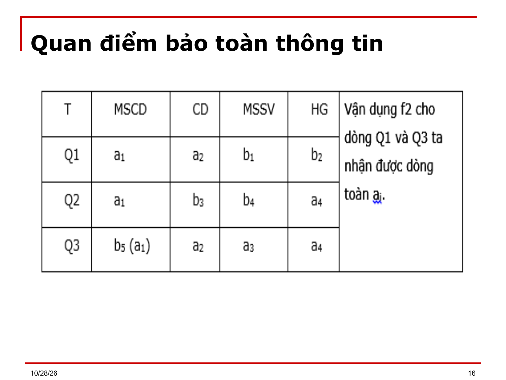

# Bài 6 — Đánh giá lược đồ CSDL

> Bản chuyển lại từ `Bai 6.ppt` (18 slide) thay cho `Bai 6.md`. Ký hiệu Wingdings/Symbol đã đổi về Unicode; chỉ số dưới/trên suy từ ngữ cảnh. `⟨?XX⟩` = ký hiệu chưa đọc được. `[BẢNG]` = ô bảng chép theo thứ tự trong file, cần xếp lại theo slide gốc.

---

## Slide 1

**BÀI 6**

- CÁC PHƯƠNG PHÁP ĐÁNH GIÁ CÁC LƯỢC ĐỒ (LĐ) CSDL

## Slide 2

**Nội dung chi tiết**

- Dẫn nhập
- Các tiêu chuẩn của quá trình chuẩn hóa
- Quan điểm bảo toàn phụ thuộc hàm
- Quan điểm bảo toàn thông tin
- Quan điểm biểu diễn trọn vẹn

## Slide 3

**Mục tiêu**

- Sau khi học xong bài này, học viên có thể nắm được:
- Đánh giá các LĐ CSDL dựa trên các  chuẩn hóa
- Các tiêu chuẩn của quá trình chuẩn hóa
- Quan điểm bảo toàn phụ thuộc hàm (BTPTH)
- Quan điểm bảo toàn thông tin (BTTT)
- Quan điểm biểu diễn trọn vẹn

## Slide 4

**Dẫn nhập**

- Xuất phát từ giai đoạn phân tích nhu cầu, ta có thể có 1 trong 2 kết quả sau:
  - (i) Dựa trên kinh nghiệm, chúng ta có thể đề nghị một cấu trúc CSDL ban đầu gồm các quan hệ con Qᵢ cùng các phụ thuộc dữ liệu FQᵢ định nghĩa trên các quan hệ con.
- C = (⟨Qᵢ, FQᵢ⟩), i = 1..n

## Slide 5

**Dẫn nhập**

  - (ii) Hoặc chỉ có một quan hệ phổ quát duy nhất Q₀ chứa tất cả các thuộc tính cần được lưu trữ và tập các phụ thuộc FQ tìm được.
      - C₀ = <Q₀, FQ>
- Chúng ta cần kiểm tra và chuẩn hóa các kết quả đầu tiên này, dựa trên một số tiêu chuẩn thiết kế, để có được một cấu trúc quan niệm CSDL được đánh giá tốt hơn, phù hợp hơn với các yêu cầu của môi trường ứng dụng.

## Slide 6

**Các Tiêu chuẩn của quá trình chuẩn hóa**

- Hầu hết các công trình nghiên cứu về thiết kế CSDL đều thỏa thuận rằng 2 tiêu chuẩn quan trọng cần đạt được qua quá trình chuẩn hóa một CSDL ở mức quan niệm là:
- (i) CSDL kết quả cần đạt dạng chuẩn cao nhất.
- (ii) CSDL kết quả phải tương đương với CSDL phân tích lúc ban đầu.

## Slide 7

**Các Tiêu chuẩn của quá trình chuẩn hóa**

- Tiêu chuẩn dạng chuẩn được đề ra nhằm đáp ứng 2 yêu cầu cụ thể:
- Cập nhật: Hạn chế tối đa sự trùng lắp thông tin trong CSDL, do đó sẽ giảm bớt tình huống thông tin bị mâu thuẫn sau những lần cập nhật CSDL.
- Kiểm tra RBTV: Tạo điều kiện thuận lợi cho việc kiểm tra RBTV ở dạng phụ thuộc dữ liệu dựa trên cơ chế khoá sẵn có bên trong các phần mềm quản trị CSDL.

## Slide 8

**Các Tiêu chuẩn của quá trình chuẩn hóa**

- Tiêu chuẩn tương đương:
- Nhằm đáp ứng yêu cầu truy xuất dữ liệu. Với tiêu chuẩn này các thông tin lưu trữ trong CSDL ban đầu đều phải được tìm thấy đầy đủ trong CSDL kết quả.
- Có 3 quan niệm khác nhau về tiêu chuẩn tương đương:

## Slide 9

**Quan điểm bảo toàn phụ thuộc hàm**

- Quan điểm này cho rằng các thông tin được lưu trong CSDL là những thông tin được thể hiện thông qua các phụ thuộc dữ liệu. Do đó cần phải bảo toàn phụ thuộc hàm trong khi biến đổi.
- Tiêu chuẩn tương đương theo quan điểm bảo toàn phụ thuộc hàm được đề ra như sau:
- Giả sử, C₁ = ⟨Q, F⟩ và C₂ = {⟨Qᵢ, Fᵢ⟩}, i = 1..n là một biến đổi từ C₁
- C₁ ≡ C₂ nếu hai điều kiện sau được thỏa:
- (i.1) ∪ Qᵢ⁺ = Q⁺ (không được sót thuộc tính)
- (i.2) (∪ Fᵢ)⁺ = F⁺ (bảo toàn PTH)

> [Ghi chú] Ký hiệu ∪ ở (i.1) và (∪ Fᵢ)⁺ ở (i.2) bị mất trong file gốc (ô trống); đã khôi phục theo ngữ cảnh và theo slide 10 ("(∪Fᵢ)⁺ = F⁺"). Cần đối chiếu slide.

## Slide 10

**Quan điểm bảo toàn phụ thuộc hàm**

- Phương pháp Chứng minh phân rã bảo toàn PTH:
- Để Chứng minh (∪Fᵢ)⁺ = F⁺ ta đặt F' = (∪Fᵢ)
- Và chứng minh: ∀f' ∈ (F' \ F) thì f' ∈ F⁺ và ∀f ∈ (F \ F') thì f ∈ F'⁺
- Ví dụ: Cho Q(ABCD) và F = {A → C; C → A; D → C; BD → A}
- Xét phân rã Q₁(AB); Q₂(ACD); Q₃(BCD)
- a) Xác định tập phụ thuộc hàm chiếu trên từng quan hệ
- b) Kiểm tra tính bảo toàn phụ thuộc hàm của phân rã trên

## Slide 11

**Quan điểm bảo toàn thông tin**

- Quan điểm này cho rằng các thông tin lưu trữ trong CSDL ban đầu đều phải được tìm thấy đầy đủ trong CSDL kết quả.
- Tiêu chuẩn tương đương theo quan điểm bảo toàn thông tin được đề ra như sau:
- Giả sử, C₁ = ⟨Q, F⟩ và C₂ = {⟨Qᵢ, Fᵢ⟩}, i = 1..n là một biến đổi từ C₁
- C₁ ≡ C₂       nếu hai điều kiện sau được thỏa:
- (i.1) ∪ Qᵢ⁺ = Q⁺ (không được sót thuộc tính)
- (i.2) (⋈ Q[Qᵢ⁺]) = Q (bảo toàn thông tin lưu trữ)

> [Ghi chú] Ký hiệu ∪ ở (i.1) và ⋈ (phép kết các hình chiếu) ở (i.2) bị mất trong file gốc; đã khôi phục theo ngữ cảnh. Cần đối chiếu slide.

## Slide 12

**Quan điểm bảo toàn thông tin**

- Phương pháp kiểm tra tính chất bảo toàn thông tin của một phân rã:
- Cho C = {Qᵢ} là 1 phân rã của lđqh Q có tập pth FQᵢ.
- b1: Xây dựng 1 bảng 2 chiều mà các cột là các thuộc tính của Q, mỗi dòng là một Qᵢ trong phân rã nhận được.
- Mỗi ô ở dòng i cột j chứa ký hiệu:
- a) aⱼ nếu Qᵢ có chứa thuộc tính thứ j của Q
- b) bₖ nếu ngược lại (trong đó k là số thứ tự xuất hiện b)

## Slide 13

**Quan điểm bảo toàn thông tin**

- b2: Biến đổi bảng dựa trên các pth có trong FQ theo qui tắc sau:
- Xét một pth f: X → Y ∈ FQ.
- Chọn 2 dòng Qᵢ, Qⱼ sao cho: Qᵢ.X = Qⱼ.X
- Nếu Qᵢ.Y ≠ Qⱼ.Y thì thực hiện thay thế trên Qᵢ và Qⱼ ở từng cột Aₖ thuộc Y theo các trường hợp sau:
- Nếu cả 2 ô(i,k) và ô(j,k) đều không chứa aₖ thì ta không thay đổi
- Ngược lại nếu có 1 ô chứa aₖ thì thay ô kia bằng ký hiệu aₖ.

## Slide 14

**Quan điểm bảo toàn thông tin**

- b3: Lặp lại b2 cho đến khi xuất hiện 1 dòng chứa toàn ký hiệu a hoặc không còn thay đổi giá trị aₖ nào trong bảng.
- b4: Nếu xuất hiện 1 dòng chứa toàn ký hiệu a thì phân rã bảo toàn thông tin.
- Ngược lại thì phân rã không bảo toàn thông tin.

## Slide 15

**Quan điểm bảo toàn thông tin**

- Ví dụ: Xét phân rã C = {Q₁(MSCD, CD); Q₂(MSCD, HG); Q₃(CD, HG, MSSV)} của quan hệ Q(MSCĐ, MSSV, CĐ, HG)
- Với FQ = {f1: MSCD → CD; f2: CD → MSCD; f3: CĐ, MSSV → HG; f4: MSCD,HG → MSSV; f5: CĐ,HG → MSSV (2 sv không đồng hạng trong cùng 1 chuyên đề); f6: MSCD,MSSV → HG}
- Tân từ: Mỗi chuyên đề có 1 tên phân biệt và có một mã số phân biệt. Một chuyên đề có thể được thực hiện bởi nhiều sinh viên và hạng của mỗi sinh viên trong cùng một chuyên đề là phân biệt.

## Slide 16

- Quan điểm bảo toàn thông tin

## Slide 17

**Quan điểm biểu diễn trọn vẹn**

- Yêu cầu CSDL kết quả vừa bảo toàn thông tin và vừa bảo toàn PTH.

## Slide 18

(slide trống hoặc chỉ có hình)

