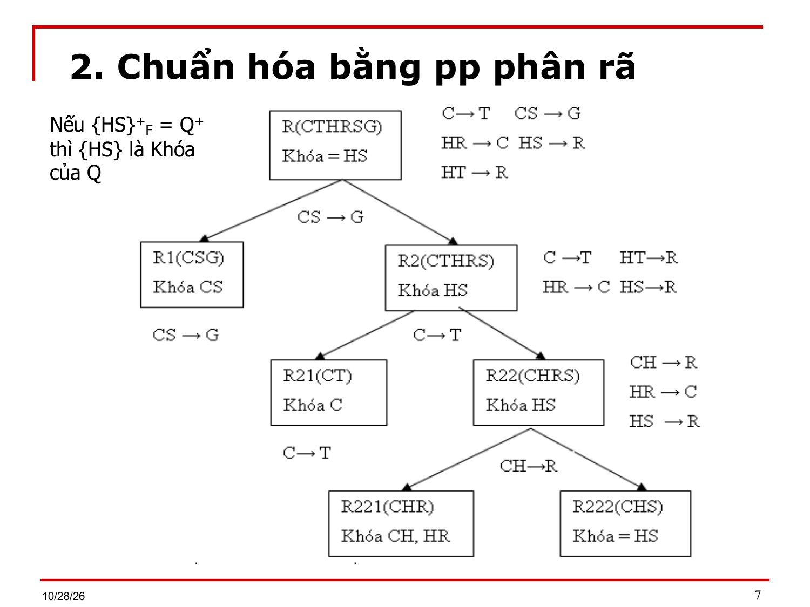

# Bài 7 — Phương pháp chuẩn hóa

> Bản chuyển lại từ `Bai 7.ppt` (20 slide) thay cho `Bai 7.md`. Ký hiệu Wingdings/Symbol đã đổi về Unicode; chỉ số dưới/trên suy từ ngữ cảnh. `⟨?XX⟩` = ký hiệu chưa đọc được. `[BẢNG]` = ô bảng chép theo thứ tự trong file, cần xếp lại theo slide gốc.

---

## Slide 1

**BÀI 7**

- PHƯƠNG PHÁP CHUẨN HÓA MỘT LĐ CSDL

## Slide 2

**Nội dung chi tiết**

- Chuẩn hóa bằng phương pháp phân rã
- Chuẩn hóa bằng phương pháp tổng hợp

## Slide 3

**Mục tiêu**

- Sau khi học xong bài này, học viên có thể chuẩn hóa LĐ CSDL bằng các phương pháp:
- Phương pháp phân rã
- Phương pháp tổng hợp
- Thuật toán tổng hợp cải tiến
- Phân tích hai cách tiếp cận

## Slide 4

**Chuẩn hóa bằng PP phân rã**

- Ý tưởng:
- Lần lượt phân rã các quan hệ con trong CSDL thành những quan hệ con có ít thuộc tính hơn, sao cho cấu trúc kết quả tương đương với cấu trúc ban đầu (bảo toàn thông tin) nhưng đạt dạng chuẩn cao hơn.

## Slide 5

**Chuẩn hóa bằng PP phân rã**

- Cơ sở lý thuyết:
- Định lý Delobel: (1973)
- Cho lược đồ quan hệ Q và tập pth F
- Nếu  f: X→A ∈ F⁺ sao cho X∪A là tập con thật sự của Q⁺
- thì phép phân rã Q thành 2 lđqh con:
- <Q₁(X, A), F₁⁺ = {f ∈ F⁺: VT(f) ∪ VP(f) ⊂ Q₁⁺} >
- <Q₂(Q⁺ \ A), F₂⁺ ={f ∈ F⁺: VT(f) ∪ VP(f) ⊂ Q₂⁺} >
- là bảo toàn thông tin

## Slide 6

**Chuẩn hóa bằng PP phân rã**

- Thuật toán phân rã:
- Ý tưởng: Dựa vào định lý Delobel, ta phân rã quan hệ Q thành 2 quan hệ Q₁ và Q₂ bằng 1 pth f thỏa điều kiện của định lý. Lặp lại phân rã trên Q₁ và Q₂ cho đến khi không còn pth f như vậy nữa.
- Thuật toán:  PhanRa(Q, F);
- Input: <Q, F>
- Output: C = { Qᵢ }, i = 1..n {tập các lđqh được phân rã}

## Slide 7

**Chuẩn hóa bằng PP phân rã**

- Bắt đầu
  - B1. Loại bỏ các pth có VT ∪ VP = Q⁺ khỏi F
- F* = F \ { f ∈ F: VT(f) ∪ VP(f) = Q⁺ }
  - B2. Nếu F* = ∅ thì C = C ∪ { Q } và kết thúc 	{Điểm dừng}
  - ngược lại, thực hiện phân rã:
- b21. Chọn f: X → A ∈ F
- b22. Phân rã thành 2 lđ con:
- <Q₁⁺ = {X, A}, F₁={f∈F⁺: VT(f) ∪ VP(f) ⊆ Q₁⁺} >
- <Q₂⁺ = Q⁺ \ A, F₂={f∈F⁺: VT(f) ∪ VP(f) ⊆ Q₂⁺} >
- b23. Phân rã đệ qui Q₁ và Q₂:
- PhanRa(Q₁, F₁);
- PhanRa(Q₂, F₂);
- Kết thúc

## Slide 8

**Chuẩn hóa bằng PP phân rã**

- Ví dụ: Xét LĐQH  Q(MsKH, TP, CTyVC, MsHH, SL)
- MsKH: Mã số Khách hàng. TP: Thành phố của nhà cung cấp. CtyVC: công ty vận chuyển hàng. MsHH: mã hàng hóa. SL: số lượng.
- F = {f1: MsKH → TP; f2: MsKH → CTyVC;
      - f3: MsKH, MsHH → SL; f4: TP → CtyVC}
- Khóa là: {MsKH, MsHH}
- Đạt dạng chuẩn 1, không đạt dạng chuẩn 2 vì: CtyVC không phụ thuộc đầy đủ vào khóa.

## Slide 9

**Chuẩn hóa bằng PP phân rã**

- Sử dụng PP phân rã để nâng cấp lược đồ quan hệ Q:
- Q(MAKH, TP, CTyVC, MsHH, SL)
- Chọn f4: TP → CTyVC để phân rã => Q₁(TP, CTyVC)
- => Q₂(MSKH, TP, MsHH, SL), F₂={f1,f3}. Chọn f1, ko chọn f3 vì đạt BC).
- => Q₂₁(MsKH, TP), F₂₁={MsKH → TP}
- => Q₂₂(MsKH, MsHH, SL), F₂₂={f3}
- Kết quả: C = {<Q₁(TP, CtyVC), F₁ = {f4}>;
- <Q₂₁(MsKH, TP), F₂₁ = {f1}>;
- <Q₂₂(MsKH, MsHH, SL), F₂₂ = {f3: MsKH, MsHH → SL}>
- Lược đồ CSDL trên dạt dạng chuẩn BCK, bảo toàn thông tin, bảo toàn PTH.

## Slide 10

**Chuẩn hóa bằng PP phân rã**

- Nhận xét:
- a) Thuật toán phân rã như trên là bảo toàn thông tin theo đinh lý delobel
- b) Tất cả các quan hệ kết quả đều đạt dạng chuẩn BCK
- c) Tùy theo thứ tự các pth được xét, trong quá trình phân rã, mà kết quả và số lượng quan hệ con có thể khác nhau.
- Hậu quả:
- d) Thuật toán có thể dẫn đến 1 lược đồ csdl không bảo toàn phụ thuộc hàm.
- e) Có thể chứa một quan hệ con mà ngữ nghĩa của nó không có ích cho ứng dụng.

## Slide 11

**Chuẩn hóa bằng PP tổng hợp**

- Mục tiêu của phương pháp:
- Tìm một cấu trúc CSDL gồm các Qᵢ sao cho:
- Dễ dàng kiểm tra các phụ thuộc hàm
- Tối thiểu đạt DC3
- Đạt điều kiện (ii) trong tiêu chuẩn bảo toàn phụ thuộc hàm.

## Slide 12

**Chuẩn hóa bằng PP tổng hợp**

- Thuật toán Tổng hợp
- Input: <Q, FQ>
- Output: C = {⟨Qᵢ, FQᵢ⟩}
- Bắt đầu:
- B1. Tìm Phủ tối thiểu của FQ.
- B2. Chia PTT thành những nhóm Fᵢ. Mỗi nhóm Fᵢ chứa các pth có cùng vế trái.
- Ghi chú: Vế trái của mỗi Fᵢ, được ký hiệu Kᵢ, là siêu khóa của quan hệ con tương lai.

## Slide 13

**Chuẩn hóa bằng PP tổng hợp**

- Thuật toán Tổng hợp
- B3. Gộp các Fᵢ có vế trái phụ thuộc lẫn nhau lại thành một nhóm.
- Ví dụ: Fᵢ chứa các pth có vế trái là Kᵢ;
- Fⱼ chứa các pth có vế trái là KJ;
- Nếu Kᵢ → Kⱼ và Kⱼ  → Kᵢ thì gộp Fᵢ và Fⱼ thành 1 nhóm.
- B4. Tạo các quan hệ con Qᵢ từ các nhóm pth Fᵢ đã tạo ở B3.
- Kết thúc.

## Slide 14

**Chuẩn hóa bằng PP tổng hợp**

- Ví dụ: Xét quan hệ Q(MSCD, MSSV, CD, HG (Hạng))
- Tân từ: Mỗi chuyên đề có 1 tên phân biệt và có một mã số phân biệt. Một chuyên đề có thể được thực hiện bởi nhiều sinh viên và hạng của mỗi sinh viên trong cùng một chuyên đề là phân biệt.
- Tập phụ thuộc hàm từ tân từ trên như sau:
- FQ = {f1: MSCD → CD; f2: CD → MSCD;
- f3: CD, MSSV → HG; f4: MSCD,HG → MSSV;
- f5: CD,HG → MSSV; (2 sv không đồng hạng trong cùng 1 chuyên đề)
- f6: MSCD,MSSV → HG}
- Xác định 1 phân rã theo thuật toán Tổng hợp như sau:

## Slide 15
**Chuẩn hóa bằng PP tổng hợp**

- B1. Tìm PTT của FQ: PTT = {f1; f2; f3; f4}
- B2. Có 4 nhóm:
  - F₁: f1: MSCD → CD;
  - F₂: f2: CD → MSCD;
  - F₃: f3: CD, MSSV → HG;
  - F₄: f4: MSCD, HG → MSSV
- B3. Gộp các Fᵢ có vế trái phụ thuộc lẫn nhau:
  - F₁₂ = {f1: MSCD → CD; f2: CD → MSCD};
  - F₃₄ = {f3: CD, MSSV → HG; f4: MSCD, HG → MSSV}

> [Ghi chú] Phần F₁…F₄ và F₁₂, F₃₄ không có trong chữ của file `.ppt` (có thể nằm trong ô vẽ/hình nhúng); chép từ `Bai 7.md` cũ (ở đó viết "CÑ" thay cho "CĐ"). Cần đối chiếu slide.

## Slide 16

**Chuẩn hóa bằng PP tổng hợp**

- B4. Tạo các quan hệ con Qᵢ từ các F'ᵢ:
- Q₁₂(MSCD, CD), F₁ = {f1: MSCD → CD;  f2: CD → MSCD}
- Q₃₄(CD, MSSV, MSCD,HG), F₂ = {f3: CD, MSSV → HG; f4: MSCD, HG → MSSV}

## Slide 17

**Chuẩn hóa bằng PP tổng hợp**

- Đánh giá thuật toán:
- Kết quả tìm PTT có thể khác nhau tùy theo thứ tự các pth trong FQ.
- Ví dụ: Nếu ở bước 2, kết quả tìm PTT là: {f1, f2, f4, f6}
- Thì ta có C₂ = {<Q₁₂, F₁₂>; <Q₃₄(MSCD, MSSV, HG), F₃ = {f4, f6}>}
- Theo thuật toán, Fᵢ trong cấu trúc kết quả chỉ chứa các pth dạng: Khóa(Qᵢ) → thuộc tính(Qᵢ)

## Slide 18

**Chuẩn hóa bằng PP tổng hợp**

- Đánh giá thuật toán:
- Còn các pth khác được định nghĩa trên Qᵢ nhưng không ở dạng trên thì không được đưa vào trong tập Fᵢ.
- Ví dụ: Xét Q(ABC), có FQ = {f1: AB→C; f2: C→B}
- Áp dụng thuật toán ta có: C = {<Q₁(A B C), F₁ = {f1}>; <Q₂(CB), F₂ = {f2} >}
- Ngoài ra f1 cũng có f2 được định nghĩa trên Q₁.

## Slide 19

**Chuẩn hóa bằng PP tổng hợp**

- Đánh giá thuật toán:
- Các Qᵢ đạt dạng chuẩn 3. Đây là hệ quả của việc xây dựng quan hệ Qᵢ từ các Fᵢ.
- CSDL kết quả được tạo dựa trên PTT nên bảo đảm điều kiện (ii) trong tiêu chuẩn bảo toàn phụ thuộc hàm, còn điều kiện (i) trong tiêu chuẩn chưa chắc được đảm bảo.
- Ví dụ: Xét Q(ABCD), có FQ = {f1: AB→C; f2: C→B}
- Áp dụng thuật toán ta có:
- C = {<Q₁(A B C), F₁ = {f1}>; <Q₂(CB), F₂ = {f2}>}
- Trong CSDL này không xuất hiện thuộc tính D.
- Kết quả thuật toán không bảo đảm được tính bảo toàn thông tin.

## Slide 20

(slide trống hoặc chỉ có hình)

