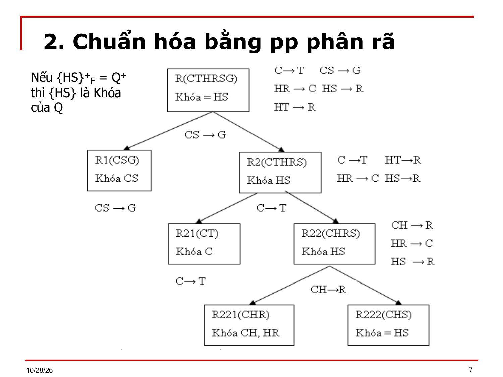

# Bài 7 bổ sung — Chuẩn hóa

> Bản chuyển lại từ `Bai 7_Bo sung.ppt` (19 slide) thay cho `Bai 7_Bo sung.md`. Ký hiệu Wingdings/Symbol đã đổi về Unicode; chỉ số dưới/trên suy từ ngữ cảnh. `⟨?XX⟩` = ký hiệu chưa đọc được. `[BẢNG]` = ô bảng chép theo thứ tự trong file, cần xếp lại theo slide gốc.

---

## Slide 1

**Bài 7: Chuẩn hóa**

- 1.  Đặt vấn đề
- 2.  Chuẩn hóa bằng phương pháp phân rã
- 3.  Chuẩn hóa bằng phương pháp tổng hợp
- 4. Chuẩn hóa bằng phương pháp tổng hợp mở rộng
- 5.  Dạng bài tập

## Slide 2

**Các pp chuẩn hóa**

- Chuẩn hóa
- Bảo toàn thông tin
- Bảo toàn phụ thuộc hàm
- Phương pháp phân rã
- Phương pháp tổng hợp

## Slide 3

**2. Chuẩn hóa bằng tt phân rã**

- Định lý Delobel (1973)
- Cho lược đồ quan hệ R gồm các tập thuộc tính A,B,C khác rỗng và rời nhau, tập pth F.
- Nếu A → B ∈ F⁺ thì tách R={R₁,R₂} sao cho  R₁ = Π_AB(R) và R₂ = Π_AC(R) là một phép tách không mất thông tin.
- Định lý Risanen (1977)
- Cho ρ(R₁,R₂) là một phép tách của ⟨R,F⟩ thành hai lược đồ R₁,R₂. Phép phân rã ρ là phép tách không tổn thất nếu và chỉ nếu có
    - PTH: R₁ ∩ R₂ → R₁ \ R₂   hoặc R₂ ∪ R₁ → R₂ \ R₁

> [Ghi chú] Định lý Rissanen ở slide ghi "R₁ ∩ R₂ → R₁ \ R₂ hoặc R₂ ∪ R₁ → R₂ \ R₁". Vế thứ hai dùng ký hiệu ∪ (có thể thầy gõ nhầm); dạng đúng của định lý là R₁ ∩ R₂ → R₂ \ R₁. Chưa kiểm chứng với slide, nên hỏi lại thầy. (Slide viết "Risanen"; tên đúng là Rissanen.)

## Slide 4

**2. Chuẩn hóa bằng pp phân rã**

- Vào: Lược đồ quan hệ có tập thuộc tính Q và tập pth F.
- Ra: Phép tách Q không mất thông tin sao cho mỗi lược đồ quan hệ trong phép tách đều ở BCNF đối với phép chiếu  của F trên lược đồ đó.
- Các bước của thuật toán:
- B1: Ban đầu phép tách ρ chỉ bao gồm Q.
- B2: Các bước tiếp theo, nếu S là một lược đồ thuộc ρ và S chưa ở BCNF thì chọn PTH X → A trong S, trong đó X không là siêu khóa của S và A ∉ X. (chỉ chọn PTH vi phạm định nghĩa BCNF để phân rã).

## Slide 5

**2. Chuẩn hóa bằng tt phân rã**

- B3: Thay thế S trong ρ bởi S₁ và S₂ với (X → A)
      - S₁ = XA, S₂ = S \ A.
- B4: Theo định lý Risanen, phép tách S thành S₁ và S₂ là phép tách không mất thông tin đối với tập PTH trên S vì
      - S₁ ∩ S₂ = X,  X → S₁ \ S₂ = A (PTH  X→A)
- B5: Quá trình tiếp tục cho đến khi tất cả các lược đồ đều ở BCNF

## Slide 6

**2. Chuẩn hóa bằng pp phân rã**

- Ví dụ: Cho lược đồ quan hệ u=⟨Q,F⟩ với Q=(C,T,H,R,S,G) và tập phụ thuộc hàm  F = {
- C → T: Mỗi Course  có một thầy (Teacher) duy nhất.
- HR →  C: Tại một thời điểm (Hour) ở tại phòng học (Room) chỉ có một Course duy nhất.
- HT → R: Tại một thời điểm (Hour) và một Teacher chỉ ở một Room duy nhất
- CS →  G: Một sinh viên (Student) học một Course thì chỉ ở một nhóm (Group) duy nhất.
- HS →  R: Một sinh viên, ở một thời điểm nhất định chỉ ở trong một phòng duy nhất. }
- a- Lược đồ đã cho ở dạng chuẩn mấy? (tìm khóa, xét tập PTH)
- b- Nếu chưa đạt BCNF thì phân rã lược đồ quan hệ u thành các lược đồ con đạt BCNF.

## Slide 7

**2. Chuẩn hóa bằng pp phân rã**

- Nếu {HS}⁺F = Q⁺ thì {HS} là Khóa của Q

## Slide 8

**2. Chuẩn hóa bằng tt phân rã**

- Ví dụ 1: Cho LĐQH u=⟨Q,F⟩ với
      - Q=(abc), F= {a → b, b → c}
      - u ở dạng chuẩn mấy? Nếu u chưa BCNF hãy phân rã để được các LĐQH ở BCNF?
- Ví dụ 2: Cho LĐQH u=⟨Q,F⟩ với
      - Q=(abcd), F= {a → b, b → c}
      - u ở dạng chuẩn mấy? Nếu u chưa BCNF hãy phân rã để được các LĐQH ở BCNF?

## Slide 9

**2. Chuẩn hóa bằng pp phân rã**

- Ví dụ 3: Cho LĐQH u(Q,F) với Q=(I,J,K,L,M) và tập phụ thuộc hàm
      - F = { f1: I → J; f2: I → K; f3: I,L → M; f4: J → K}
  - a- Xác định dạng chuẩn của u ?
  - b- Nếu u chưa đạt BCNF, hãy phân rã để đạt được các LĐQH đạt BCNF và bảo toàn phụ thuộc hàm.

## Slide 10

**2. Chuẩn hóa bằng pp phân rã**

- Nguyên tắc chọn PTH để phân rã:
- Không chọn PTH có vế trái là siêu khóa. (ví dụ 1)
- Không chọn PTH có vế phải là vế trái của một PTH khác. (ví dụ 2)
- Không chọn PTH khi mất đi vế phải sẽ làm mất PTH và không thể suy lại dựa vào Amstrong. (ví dụ 3)
- Nhận xét: Phương pháp phân rã luôn bảo toàn thông tin nhưng có khả năng cho chúng ta một phân rã không bảo toàn phụ thuộc hàm.

## Slide 11

**3. Chuẩn hóa bằng pp tổng hợp**

- Vào: Q,F
- Ra: ℂ = {⟨Qᵢ, Fᵢ⟩}, i = 1..n
- B1. Tìm Phủ tối thiểu (PTT) của F.
- B2. Chia PTT thành những nhóm Fᵢ. Mỗi nhóm Fᵢ chứa các pth có cùng vế trái.
- Ghi chú: Vế trái của mỗi Fᵢ, được ký hiệu Kᵢ, là siêu khóa của quan
      - hệ con tương lai.
- B3. Gộp các Fᵢ có vế trái phụ thuộc lẫn nhau lại thành một nhóm.
      - Ví dụ: Fᵢ chứa các pth có vế trái là Kᵢ;
      - Fⱼ chứa các pth có vế trái là Kⱼ;
      - Nếu Kᵢ → Kⱼ và Kⱼ → Kᵢ thì gộp Fᵢ và Fⱼ thành 1 nhóm.
- B4. Tạo các quan hệ con Qᵢ từ các nhóm pth Fᵢ đã tạo sau B3

## Slide 12

**3. Chuẩn hóa bằng pp tổng hợp**

- Ví dụ : cho LĐQH u=⟨Q,F⟩
      - Q(ABCD), F= {f1: A → C; f2: C → A;
      - f3: BC → D; f4: AD → B;
      - f5: CD → B; f6: AB → D}
- Hãy chuẩn hóa bằng pp tổng hợp.

## Slide 13

**3. Chuẩn hóa bằng pp tổng hợp**

- B1: tìm PTT => Ftt =  {f1: A → C; f2: C → A;
      - f3: BC → D; f4: AD → B}
      - (bỏ f5: CD → B; f6: AB → D là các PTH thừa) (tự chứng minh)
- B2: không có các PTH có vế trái giống nhau
- B3: F₁={f1: A → C; f2: C → A}
      - F₂={f3: BC → D, f4: AD → B}
      - Do BC → D, C → A => BC → AD
      - Do AD → B, A → C => AD → BC
- B4: Q₁=(AC), F₁={f1: A → C; f2: C → A}, K={AC}
      - Q₂=(ABCD), F₂={f3: BC → D, f4: AD → B}, K={ABC,ADC}

> [Ghi chú] Tính lại (chưa phải lời giải của thầy): với F₁ = {A → C; C → A} thì Q₁(AC) có hai khóa là {A} và {C}, không phải {AC}; với F₂ = {BC → D; AD → B} cùng A ↔ C thì Q₂(ABCD) có các khóa AB, AD, BC, CD (vì BC⁺ = ABCD). Slide ghi K = {AC} và K = {ABC, ADC}, các tập này là siêu khóa chứ không tối thiểu. Đã kiểm bằng script tính bao đóng; nên hỏi lại thầy.

## Slide 14

**3. Chuẩn hóa bằng pp tổng hợp**

- Ví dụ 1: cho LĐQH u=⟨Q,F⟩ với Q=(ABCDEHG)
      - và F = {f1: AB → D; f2: EH → G; f3: G → C; f4: D → C}
      - Hãy chuẩn hóa bằng pp tổng hợp, kiểm tra bảo toàn thông tin và bảo toàn phụ thuộc hàm
- ℂ = {⟨Q₁(ABD); F₁={ f1 }⟩; ⟨Q₂(EHG), F₂={f2}⟩;
      - ⟨Q₃(GC); F₃ = {f3}⟩; ⟨Q₄(DC), F₄={f4}⟩}
- ℂ không bảo toàn thông tin => tự kiểm tra.

## Slide 15

**3.  PP tổng hợp cải tiến**

- Từ phương pháp tổng hợp, ta thêm vào 2 bước nhằm bảo toàn thông tin:
      - B5. Tìm tập khóa (K) của quan hệ Q ban đầu
      - B6. Nếu không tồn tại Qᵢ chứa khóa của Q ban đầu thì thêm vào CSDL C một quan hệ Q’(Kᵢ) chứa một khóa Kᵢ của Q ban đầu.
- Ví dụ:
- Xét Q(ABCD), có F = {f1: AB → C; f2: C → B}

## Slide 16

**4. Bài tập sử dụng pp tổng hợp**

- Ví dụ 4: Cho tập các thuộc tính Q={A,B,C,D,E,G,H,I,J,K,L} và tập phụ thuộc hàm
      - F= {f1: A→B,C,D,E,G,H, I,J,K, L;
      - f2: B,C,D→A,E,G,H,J,K,L;
      - f3: B,C,E→A,D,G, H,I,J,K;
      - f4: H → I,J,K;
      - f5: D, G→L;
      - f6: E ,G → L;
      - f7: I,J → K;
      - f8: J, K → I;
      - f9: I,K →J}

## Slide 17

- Với tập PTH F ở trên ta có:
      - a) PTH: H → K là dư thừa vì ta có H → I,J ( luật phân rã) và I,J → K do vậy H→K (luật bắc cầu).
      - b) PTH: B,C,D→ E,G,H,J,K,L là dư thừa vì ta có B,C,D→A và A→E,G,H,J,K,L  luật bắc cầu).
      - c) Ngoài ra ta có A → I,J,K, L là dư thừa.

## Slide 18

**Tập PTH tối tiểu của F**

- Ftt={A → B,C,D,E,G,H;
      - B,C,D→A;
      - B,C,E→A;
      - H → I,J;
      - D,G→L;
      - E,G → L;
      - I,J → K;
      - J,K → I;
      - I,K →J}

## Slide 19

- Thiết lập các lược đồ với khóa như sau:
- Q₁ = (A,B,C,D,E,G,H) với khóa {A, BCD, BCE}
  - F₁={A → B,C,D,E,G,H; B,C,D→A; B,C,E→A}
- Q₂ = (H, I, J) với khóa (H) , F₂={H → I,J}
- Q₃ = (D,G, L)  với khóa  (DG) , F₃={D,G→L}
- Q₄=  (E,G , L) với khóa  (EG), F₄={E,G → L}
- Q₅ = (I,J,K) với khóa (IJ, JK, KI),
  - F₅={ I,J → K; J,K → I; I,K →J}
- Đây là các lược đồ QH tối thiểu ở 3NF.
- Kiểm tra có bảo toàn thông tin không? nếu không BTTT thì làm thêm B5 và B6.

