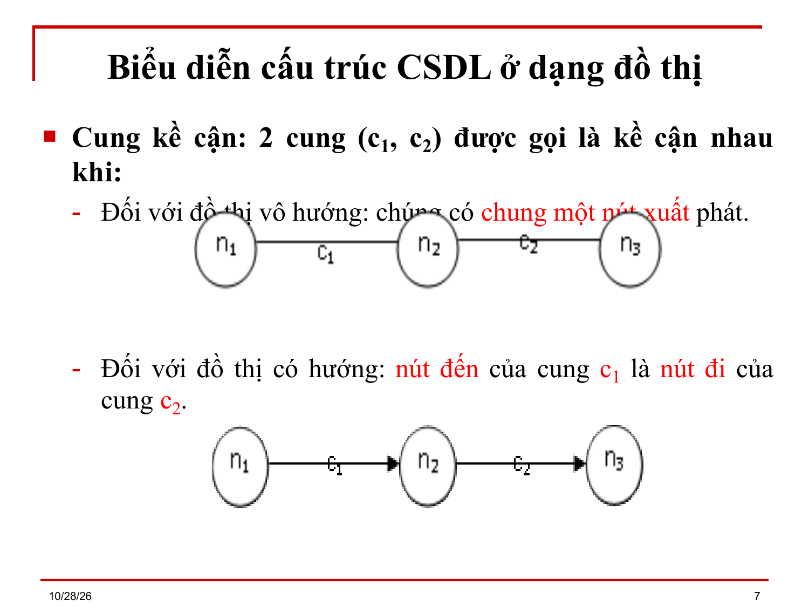
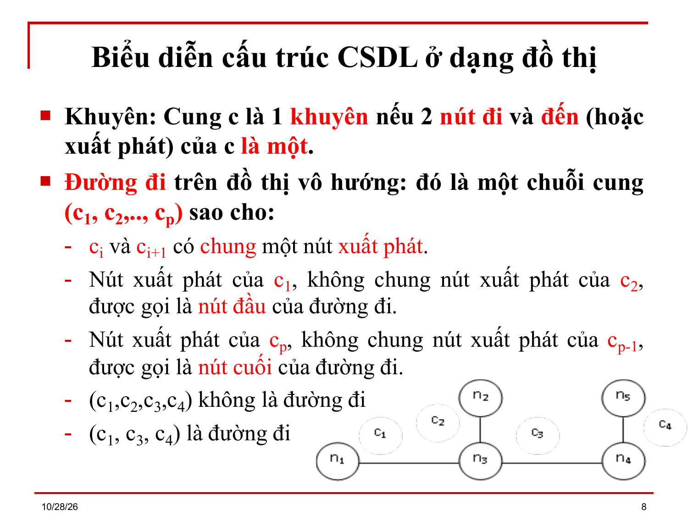
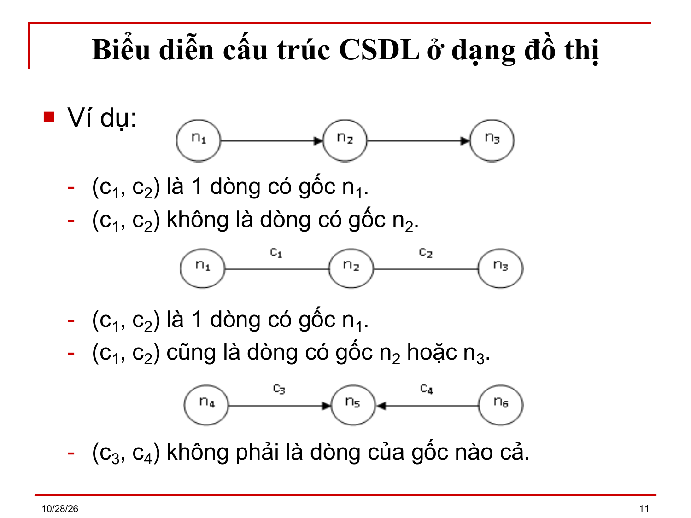
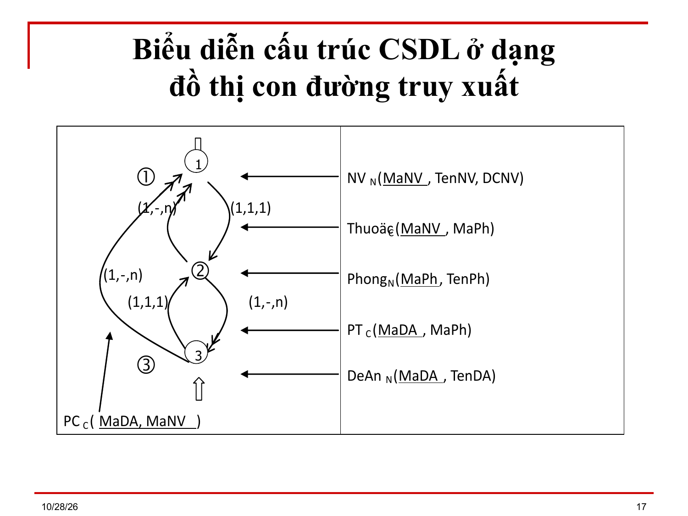
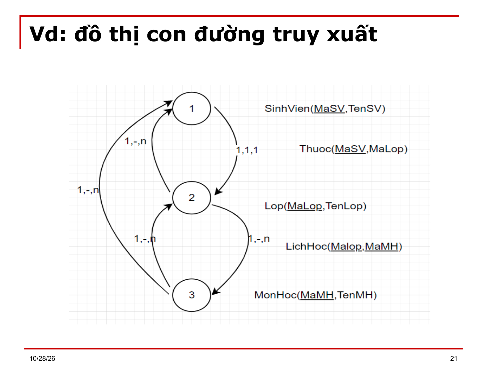

# Bài 8 bổ sung (nội dung Bài 9) — Đồ thị quan hệ

> Bản chuyển lại từ `Bai 8_Bo sung.ppt` (28 slide) thay cho `Bai 8_Bo sung.md`. Ký hiệu Wingdings/Symbol đã đổi về Unicode; chỉ số dưới/trên suy từ ngữ cảnh. `⟨?XX⟩` = ký hiệu chưa đọc được. `[BẢNG]` = ô bảng chép theo thứ tự trong file, cần xếp lại theo slide gốc.

---

## Slide 1

**BÀI 9**

- LÝ THUYẾT ĐỒ THỊ QUAN HỆ

## Slide 2

**Nội dung chi tiết**

- Dẫn nhập
- Biểu diễn Cấu trúc CSDL quan niệm ở dạng đồ thị
- Đồ thị con đường truy xuất thô
- Đồ thị quan hệ
- Biến đổi một đồ thị quan hệ sang một đồ thị con đường truy xuất thô và ngược lại

## Slide 3

**Mục tiêu**

- Sau khi học xong bài này, học viên có thể nắm được lý thuyết đồ thị quan hệ, để biểu diễn LĐQH thành đồ thị quan hệ tiện cho việc biểu diễn và khai thác CSDL quan hệ dựa trên các kiến thức sau:
- Biểu diễn cấu trúc CSDL quan hệ ở dạng đồ thị
- Đồ thị con đường truy xuất thô
- Đồ thị quan hệ
- Biến đổi một đồ thị quan hệ sang một đồ thị con đường truy xuất thô và ngược lại.
- Chuỗi kết được cài đặt trên đồ thị

## Slide 4

**Dẫn nhập**

- Thao tác quan trọng và thường xảy ra nhất trong CSDL quan hệ là phép kết.
- Để thao tác này được thực hiện hiệu quả, hệ QTCSDL thường dựa trên các chỉ mục của các quan hệ liên quan.
- Do đó, vai trò của người thiết kế là làm thế nào xác định được đủ các chỉ mục cần thiết, với số thuộc tính vừa đủ để khai thác.
- Chỉ mục bao gồm nhiều thuộc tính hoặc tạo quá nhiều chỉ mục sẽ gây tốn chỗ và tốn kém trong việc bảo trì hệ thống chỉ mục.

## Slide 5

**Dẫn nhập**

- Để có thể xác định đúng các chỉ mục cần thiết, người ta sử dụng phương pháp biểu diễn quan hệ ở dạng đồ thị.
- Dạng biểu diễn đồ thị này cho phép làm nổi bật các thuộc tính chung giữa 2 hay nhiều quan hệ (vì đây là cơ sở của phép kết) qua đó giúp cho người thiết kế sau này dễ dàng đánh giá và chọn lựa đúng các chỉ mục.

## Slide 6

**Biểu diễn Cấu trúc CSDL quan niệm ở dạng đồ thị**

- Đồ thị: Một đồ thị DT(N, C) được định nghĩa trên 1 tập nút N = {n₁, n₂, .., nₙ} và 1 tập cung C = {c₁, c₂,.., cn}
- Nếu hiện diện cung có hướng, đó là đồ thị có hướng, và 2 nút nối bởi 1 cung có hướng được gọi là nút đi và nút đến.
- Nếu tất cả các cung đều vô hướng, đó là đồ thị vô hướng, và các nút trên đồ thị đều được xem là nút xuất phát.

## Slide 7

**Biểu diễn Cấu trúc CSDL quan niệm ở dạng đồ thị**

- Cung kề cận: 2 cung (c₁, c₂) được gọi là kế cận nhau khi:
- Đối với đồ thị vô hướng: chúng có chung một nút xuất phát.
- Đối với đồ thị có hướng: nút đến của cung c₁ là nút đi của cung c₂.

## Slide 8

**Biểu diễn Cấu trúc CSDL quan niệm ở dạng đồ thị**

- Khuyên: Cung c là 1 khuyên nếu 2 nút đi và đến (hoặc xuất phát) của c là một.
- Đường đi trên đồ thị vô hướng: đó là một chuỗi cung (c₁, c₂,.., cₚ) sao cho:
- cᵢ và cᵢ₊₁ có chung một nút xuất phát.
- Nút xuất phát của c₁, không chung nút xuất phát của c₂, được gọi là nút đầu của đường đi.
- Nút xuất phát của cₚ, không chung nút xuất phát của cₚ₋₁, được gọi là nút cuối của đường đi.
- (c₁,c₂,c₃,c₄) không là đường đi
- (c₁, c₃, c₄) là đường đi

## Slide 9

**Biểu diễn Cấu trúc CSDL quan niệm ở dạng đồ thị**

- Mạch đi trên đồ thị có hướng: đó là một chuỗi cung (c₁, c₂,.., cₚ) sao cho:
- Nút đến của cᵢ là nút đi của cᵢ₊₁.
- Nút đi của c₁ được gọi là nút đầu của mạch đi.
- Nút đến của cₚ được gọi là nút cuối của mạch đi.

## Slide 10

**Biểu diễn Cấu trúc CSDL quan niệm ở dạng đồ thị**

- Chu trình: là đường đi hay mạch đi trong đó
- Nút đầu và nút cuối trùng nhau
- 1 cung không xuất hiện 2 lần trong chuỗi.
- Một dòng có gốc n₁ là một tập cung D = (c₁, c₂, …, cₚ) sao cho:
- 1 cung trong tập đó có nút xuất phát (hoặc nút đí) là n₁.
- ∀cᵢ, ∀nᵢ, nút xuất phát (hoặc nút đi | đến) của cᵢ, ∃ 1 đường đi (hoặc mạch đi) có nút đầu là n₁, nút cuối là nᵢ và gồm các cung của tập D.

## Slide 11

**Biểu diễn Cấu trúc CSDL quan niệm ở dạng đồ thị**

- Ví dụ:
- (c₁, c₂) là 1 dòng có gốc n₁.
- (c₁, c₂) không là dòng có gốc n₂.
- (c₁, c₂) là 1 dòng có gốc n₁.
- (c₁, c₂) cũng là dòng có gốc n₂ hoặc n₃.
- (c₃, c₄) không phải là dòng của gốc nào cả.

## Slide 12

**Biểu diễn Cấu trúc CSDL quan niệm ở dạng đồ thị**

- Ví dụ:
- (c₁, c₂) là 1 dòng có gốc n₁.
- (c₁, c₂) không là dòng có gốc n₂.
- (c₁, c₂) là 1 dòng có gốc n₁.
- (c₁, c₂) cũng là dòng có gốc n₂ hoặc n₃.
- (c₃, c₄) không phải là dòng của gốc nào cả.

## Slide 13

**Biểu diễn Cấu trúc CSDL quan niệm ở dạng đồ thị**

- Đồ thị con đường truy xuất:
- Định nghĩa: Đồ thị con đường truy xuất (N, C, R, Cđ, f, g, h, i, j) là 1 đồ thị có hướng với:
- N: tập nút,  Ký hiệu: Nút: ○ và Nút vào: ○ có mũi tên rỗng chỉ vào (xem hình slide 17)
- C ⊆ (N x N): tập cung có hướng, ký hiệu: → hoặc ->>
- R: tập quan hệ Qᵢ;
- Đơn ánh f: N → R: f(nᵢ) = Q_N, mỗi nút nᵢ ứng với 1 quan hệ Q_N. Gọi là quan hệ nút.

## Slide 14

**Biểu diễn Cấu trúc CSDL quan niệm ở dạng đồ thị**

- Đồ thị con đường truy xuất:
- Định nghĩa: Đồ thị con đường truy xuất (N, C, R, Cđ, f, g, h, i, j) là 1 đồ thị có hướng với:
- Ánh xạ g: C → R: g(cᵢ) = Q_C, mỗi cung ứng với 1 quan hệ Q_C, gọi là quan hệ cung. Ngược lại, Tồn tại tối đa 2 cung thuộc g⁻¹(Q_C), 2 cung này có 2 chiều ngược nhau, nút đi của cung thứ nhất là nút đến của cung thứ hai và ngược lại.
- Điều kiện: f(N) ∪ g(C) = R

## Slide 15

**Biểu diễn Cấu trúc CSDL quan niệm ở dạng đồ thị**

- Cđ: tập con đường truy xuất
- Song ánh h: C → Cđ: Mỗi cung tương ứng với 1 con đường truy xuất.
- nᵢ  ->  nⱼ: từ một quan hệ nút f(nᵢ), có thể truy xuất đến 1 bộ của quan hệ nút f(nⱼ) thông qua con đường truy xuất h(cᵢⱼ).
- nᵢ  ->> nⱼ: từ một quan hệ nút f(nᵢ), có thể truy xuất đến n bộ của quan hệ nút f(nⱼ) thông qua con đường truy xuất h(cᵢⱼ).

## Slide 16

**Biểu diễn Cấu trúc CSDL quan niệm ở dạng đồ thị**

- Ánh xạ i: Cđ → N x N x N: Trên mỗi con đường truy xuất cᵢⱼ có gắn 1 tổ hợp (m,A,M) thể hiện số bộ tối thiểu (m), trung bình (A), tối đa (M) của quan hệ nút f(nⱼ) có thể truy xuất được từ 1 bộ của quan hệ nút f(nᵢ).
- Ánh xạ j: N → { 0, 1 }:  khi j(nᵢ) = 1 thì nᵢ là một nút vào.

## Slide 17

**Biểu diễn Cấu trúc CSDL quan niệm ở dạng đồ thị**

- Ví dụ: Xét CSDL
- NV(MaNV, TenNV, MaPh)
- Phong(MaPh, TenPh)
- DeAn(MaDA, TenDA, Maph)
- Với RBTV là một nhân viên trong một phòng được phân công vào tất cả các đề án do phòng đó phụ trách.

## Slide 18

- Biểu diễn Cấu trúc CSDL quan niệm ở dạng đồ thị

## Slide 19

- Biểu diễn Cấu trúc CSDL quan niệm ở dạng đồ thị

## Slide 20

**Đồ thị con đường truy xuất thô**

- Là đồ thị con đường truy xuất thỏa mãn 2 điều kiện sau:
- Giữa 2 nút của đồ thị nếu có 1 cung thì bao giờ cũng có một cung theo chiều ngược lại
- Các nút trên đồ thị đều là nút vào.
- Ví dụ: Với đồ thị trên, nếu từ nút NV(1) đến DeAn(3) có thêm một con đường truy xuất, và nếu nút Phong(2) cũng là nút vào thì đồ thị trở thành đồ thị con đường truy xuất thô.

## Slide 21

**Đồ thị quan hệ**

- Trong quá trình chuyển sang dạng biểu diễn đồ thị, một cấu trúc CSDL cụ thể được biểu diễn thành nhiều đồ thị khác nhau.
- Tuy nhiên không phải tất cả đều có những hiệu quả khai thác như nhau (điều này sẽ được minh họa trong phần cuối chương).
- Một đồ thị con đường truy xuất được đơn giản hóa sẽ giúp người thiết kế đánh giá dễ dàng chất lượng của dạng biểu diễn đồ thị này: đó là đồ thị quan hệ.

## Slide 22

**Đồ thị quan hệ**

- Định nghĩa:
- Một Đồ thị quan hệ là đồ thị có hướng, được định nghĩa trên tập (N_Q, C_Q, R_Q,  f_Q, g_Q, k_Q)  với:
- N_Q: tập nút,  Ký hiệu: Nút: ○
- C_Q ⊆ (N_Q x N_Q): tập cung có hướng hoặc không
- R_Q: tập quan hệ Qᵢ;
- Đơn ánh f_Q: N_Q → R_Q: f_Q(nᵢ) = Q_N, mỗi nút nᵢ ứng với 1 quan hệ Q_N. Gọi là quan hệ nút

## Slide 23

**Đồ thị quan hệ**

- Định nghĩa:
- Một Đồ thị quan hệ là đồ thị có hướng, được định nghĩa trên tập (N_Q, C_Q, R_Q,  f_Q, g_Q, k_Q)  với:
- Ánh xạ g_Q: C_Q → R_Q: g_Q(cᵢ) = Q_C, mỗi cung ứng với 1 quan hệ Q_C, gọi là quan hệ cung. Ngược lại, Tồn tại tối đa 2 cung thuộc g⁻¹(Q_C), 2 cung này có 2 chiều ngược nhau, nút đi của cung thứ nhất là nút đến của cung thứ hai và ngược lại.
- Điều kiện: f(N) ∪ g(N) = R
- Ánh xạ k_Q: C_Q → {0, 1}:  k_Q(cᵢ) = 1 nếu là cung có hướng, k_Q(cᵢ) = 0 nếu là một cung vô hướng.

## Slide 24

**Biến đổi một đồ thị quan hệ sang một dttx thô và ngược lại**

- Biến đổi đồ thị con đường truy xuất thô thành đồ thị quan hệ:
- ĐTCĐTX thô (N, C, R, Cđ, f, g, h, i, j) → ĐTQH(N_Q, C_Q, R_Q, f_Q, g_Q, k_Q)
- Với: N_Q = N
- R_Q = R
- f_Q = f

## Slide 25

**Biến đổi một đồ thị quan hệ sang một dttx thô và ngược lại**

- ∀(c, c') ∈ C có chiều ngược nhau, và g(c) = g(c'), ∃c_Q ∈ C_Q sao cho:
- g_Q(c_Q) = g(c) = g(c')
- Nếu max( c )>1 và max( c' ) > 1 thì k_Q(c_Q) = 0 (cung c_Q là vô hướng)
- Nếu max( c )<=1 và max( c' ) <= 1 thì k_Q(c_Q) = 1 (cung c_Q là có hướng) khi đó:
- c_Q = c nếu max(c) ≤ 1
- c_Q = c' nếu ngược lại.

## Slide 26

**Biến đổi một đồ thị quan hệ sang một dttx thô và ngược lại**

- Biến đổi đồ thị quan hệ thành đồ thị con đường truy xuất thô:
- ĐTQH(N_Q, C_Q, R_Q,  f_Q, g_Q, k_Q) → ĐTCĐTX thô (N, C, R, Cđ, f, g, h, i, j)
- Với: N = N_Q
- R  = R_Q
- f = f_Q

## Slide 27

**Biến đổi một đồ thị quan hệ sang một dttx thô và ngược lại**

- ∀c_Q ∈ C_Q, c_Q = (n₁, n₂), ∃ (c, c') ∈ C với c = (n₁, n₂) và c' = (n₂, n₁) và  g(c) = g(c') = g_Q(c_Q)
- Nếu k_Q(c_Q) = 1 thì max(c)>1 và max(c') > 1
- Nếu k_Q(c_Q) = 0 thì max(c)<= 1 hoặc max(c') <=1.
- ∀n ∈ N_Q, j(n) = 1 (nút vào).

## Slide 28

(slide trống hoặc chỉ có hình)

