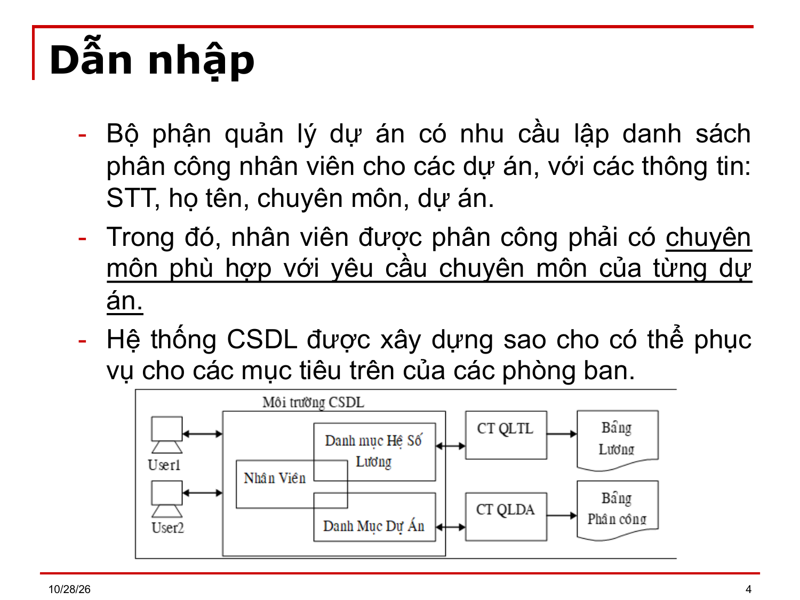
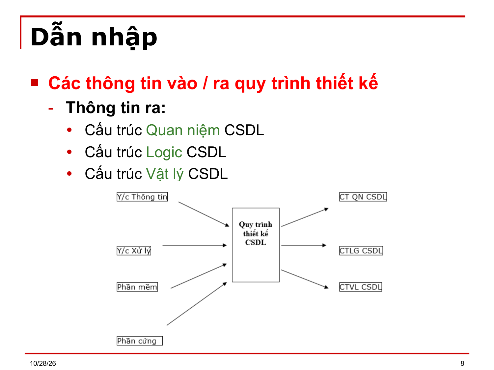
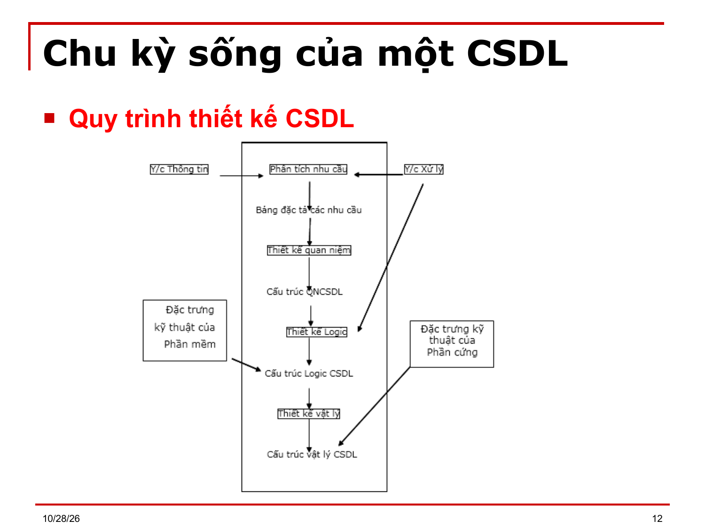

# Bài 1–2 — Các giai đoạn thiết kế CSDL

> Bản chuyển lại từ `Bai1_2.ppt` (25 slide) thay cho `Bai1_2.md`. Ký hiệu Wingdings/Symbol đã đổi về Unicode; chỉ số dưới/trên suy từ ngữ cảnh. `⟨?XX⟩` = ký hiệu chưa đọc được. `[BẢNG]` = ô bảng chép theo thứ tự trong file, cần xếp lại theo slide gốc.

---

## Slide 1

**BÀI 1 - 2**

- CÁC GIAI ĐOẠN TRONG QUÁ TRÌNH THIẾT KẾ MỘT CƠ SỞ DỮ LIỆU
- CƠ SỞ DỮ LIỆU NÂNG CAO

## Slide 2

**Nội dung chi tiết**

- Dẫn nhập
- Chu kỳ sống của một CSDL

## Slide 3

**Dẫn nhập**

- Khái niệm về hệ thống CSDL:
- Hệ thống CSDL của một ứng dụng tin học là 1 tập hợp dữ liệu được tổ chức 1 cách chọn lọc, ghi trên các thiết bị trữ tin, nhằm phục vụ đồng thời cho nhiều người, với nhiều mục đích xử lý và khai thác khác nhau.
- Ví dụ: Trong một công ty phần mềm:
- Bộ phận quản lý tiền lương có nhu cầu lập bảng lương cho đơn vị với các thông tin ghi trên bảng lương như sau: STT, họ tên, hệ số lương, tiền lương, Chữ ký.
- Trong đó, Tiền lương = hệ số lương x 500000; hệ số lương được phân chia dựa trên học vị.

## Slide 4

**Dẫn nhập**

- Bộ phận quản lý dự án có nhu cầu lập danh sách phân công nhân viên cho các dự án, với các thông tin: STT, họ tên, chuyên môn, dự án.
- Trong đó, nhân viên được phân công phải có chuyên môn phù hợp với yêu cầu chuyên môn của từng dự án.
- Hệ thống CSDL được xây dựng sao cho có thể phục vụ cho các mục tiêu trên của các phòng ban.

## Slide 5

**Dẫn nhập**

- Mục tiêu chính công việc thiết kế CSDL
- Làm thế nào chuyển đổi các nhu cầu lưu trữ và khai thác dữ liệu của người sử dụng thành một hệ thống CSDL hiệu quả.
- Tính hiệu quả được thể hiện cụ thể bởi các tính chất:
- Tính không trùng lắp
- Tính nhất quán dữ liệu
- Tính dễ khai thác
- Dễ kiểm tra các qui tắc quản lý bởi các ràng buộc toàn vẹn
- Dễ cập nhật và nâng cấp hệ thống

## Slide 6

**Dẫn nhập**

- Với cùng các nhu cầu lưu trữ và khai thác dữ liệu, có thể có nhiều cấu trúc CSDL khác nhau.
- Tiêu chuẩn để lựa chọn một cấu trúc CSDL hiệu quả liên quan đến vấn đề khai thác trong tương lai, bao gồm:
- Thời quan truy xuất dữ liệu đáp ứng cho một yêu cầu khai thác?
- Thời gian phục hồi CSDL khi có sự cố?
- Chi phí tổ chức và cài đặt CSDL?
- Dễ bảo trì, nâng cấp, sửa đổi khi phát sinh những nhu cầu mới hay không?

## Slide 7

**Dẫn nhập**

- Các thông tin vào / ra quy trình thiết kế
- Thông tin vào:
- (1) Yêu cầu về thông tin: Dùng CSDL cho vấn đề gì? Xuất phát từ người sử dụng có nhu cầu và quan điểm như thế nào. Ta cần phải ghi nhận lại hết.
- (2) Ở đây chỉ giới hạn ở mức dữ liệu.
- (3) Yêu cầu về xử lý: Mỗi nhóm người sử dụng sẽ nêu ra các yêu cầu xử lý của riêng mình; Tần suất xử lý và khối lượng dữ liệu.
- Đặc trưng kỹ thuật của hệ quản trị CSDL cần sử dụng để cài đặt CSDL
- Cấu hình thiết bị tin học gì để đáp ứng với (1), (2) và (3)

## Slide 8

**Dẫn nhập**

- Các thông tin vào / ra quy trình thiết kế
- Thông tin ra:
- Cấu trúc Quan niệm CSDL
- Cấu trúc Logic CSDL
- Cấu trúc Vật lý CSDL

## Slide 9

**Chu kỳ sống của một CSDL**

- Giai đoạn xây dựng CSDL
- (a) Phân tích các nhu cầu của người sử dụng
- (b) Thiết kế CSDL ở mức quan niệm: nghĩa là xác định nội dung CSDL (chứa những thông tin gì?). Chỉ quan tâm ở mức dữ liệu
- (c) Thiết kế CSDL ở mức Logic: Chia vấn đề cần xử lý ra thành nhiều bước. Ở đây chỉ chú ý đến các xử lý đặt ra, nhưng chưa chú ý đến phần mềm và phần cứng.
- (d) Thiết kế CSDL ở mức vật lý: Cài đặt CSDL như thế nào? Giải quyết những vấn đề mang tính kỹ thuật.
- Ví dụ: Sử dụng phần mềm nào? Với cấu hình máy ra sao?

> [Ghi chú] Các nhãn (a)–(d) do người chuyển thêm: file gốc không có nhãn ở slide này, nhưng slide 10 tiếp tục bằng (e), (f), (g).

## Slide 10

**Chu kỳ sống của một CSDL**

- Giai đoạn thử nghiệm và khai thác:
- (e) Cài đặt và chạy thử nghiệm: Nếu có sai sót thì phải hiệu chỉnh lại cấu trúc CSDL ở các mức quan niệm; logic; vật lý.
- (f) Đưa cho người sử dụng khai thác.
- (g) Thích ứng CSDL theo những nhu cầu mới.
- Quá trình thiết kế  là giai đoạn xây dựng CSDL của  chu trình sống, nếu nhu cầu mới quá nhiều thì cần phải chuẩn bị CSDL mới để thay thế CSDL cũ.

## Slide 11

**Chu kỳ sống của một CSDL**

- Giai đoạn thử nghiệm và khai thác:
- (e) Cài đặt và chạy thử nghiệm: Nếu có sai sót thì phải hiệu chỉnh lại cấu trúc CSDL ở các mức quan niệm; logic; vật lý.
- (f) Đưa cho người sử dụng khai thác.
- (g) Thích ứng CSDL theo những nhu cầu mới.
- Quá trình thiết kế  là giai đoạn xây dựng CSDL của  chu trình sống, nếu nhu cầu mới quá nhiều thì cần phải chuẩn bị CSDL mới để thay thế CSDL cũ

> [Ghi chú] Nội dung slide 11 trùng hoàn toàn slide 10 trong file gốc.

## Slide 12

**Chu kỳ sống của một CSDL**

- Quy trình thiết kế CSDL

## Slide 13

**Chu kỳ sống của một CSDL**

- Quy trình thiết kế CSDL
- Giai đoạn phân tích nhu cầu
- Đây là bước khó nhất trong quá trình thiết kế vì nó được thực hiện thông qua sự tiếp xúc giữa người thiết kế và người sử dụng.
- Nội dung của giai đoạn này là:
- Thu thập thông tin về dữ liệu và xử lý từ người sử dụng, từ các tài liệu, chứng từ, biểu mẫu thống kê liên quan đến CSDL và cả những tài liệu của CSDL cũ (nếu có).
- Sau khi thu thập phải tổng hợp và phân tích những nhu cầu đó. Kiểm tra xem có những mâu thuẩn giữa các nhu cầu không?

## Slide 14

**Chu kỳ sống của một CSDL**

- Quy trình thiết kế CSDL
- Giai đoạn phân tích nhu cầu
- Kết quả là phải xác định cho được:
- Mục tiêu sử dụng, khai thác
- Nội dung, yêu cầu chi tiết cần thực hiện
- Thời gian đáp ứng và hình thức xử lý
  - Ví dụ:
- Tình trạng bán vé trong các chuyến bay, chuyến tàu đòi hỏi phải xử lý tức thời, riêng rẽ từng trường hợp.
- Tình trạng mượn, trả sách của độc giả thư viện đòi hỏi phải xử lý riêng rẽ nhưng thời gian xử lý có thể trễ.

## Slide 15

**Chu kỳ sống của một CSDL**

- Quy trình thiết kế CSDL
- Giai đoạn phân tích nhu cầu
- Cách thực hiện:
- Dùng kỹ thuật phỏng vấn: Trực tiếp
- Gián tiếp: tự lập ra các câu hỏi trên giấy để User trả lời.
- Đối tượng phỏng vấn: có liên quan
- Ban giám đốc
- Các phòng ban có liên quan

## Slide 16

**Chu kỳ sống của một CSDL**

- Quy trình thiết kế CSDL
- Giai đoạn thiết kế quan niệm
- Mục đích:
- Xác định nội dung dữ liệu, mối quan hệ giữa các dữ liệu bên trong CSDL.
- Chưa cần quan tâm cách cài đặt. Phải xác định đúng và đầy đủ dữ liệu, loại bỏ các dữ liệu thừa.
- Công cụ: Dùng một mô hình dữ liệu nào đó để biểu diễn tùy người thiết kế.

## Slide 17

**Chu kỳ sống của một CSDL**

- Quy trình thiết kế CSDL
- Giai đoạn thiết kế quan niệm
- Cách thực hiện:
- Do nhu cầu khai thác, mỗi nhóm người sẽ có những yêu cầu khác nhau về CSDL.
- Ví dụ: Đối với người quản trị kinh doanh chỉ quan tâm đến các thành phẩm: Mã thành phẩm, tên, số lượng tồn, đơn giá bán.
- Đối vời người quản lý kho: ngoài thông tin của các thành phẩm, người quản lý kho còn quan tâm đến các chứng từ liên quan đến các thành phẩm: Số đợt, giá thành, số lượng.

## Slide 18

**Chu kỳ sống của một CSDL**

- Quy trình thiết kế CSDL
- Giai đoạn thiết kế quan niệm
- Người thiết kế cần chuyển đầy đủ các yêu cầu vào CSDL bằng cách:
- Phân chia các nhu cầu ra thành từng mảng. Điều đó dẫn đến sẽ có nhiều mô hình quan niệm dữ liệu,  mỗi mô hình liên quan đến 1 mảng.
- Cuối cùng cần tích hợp các mô hình đó lại. Khi tổng hợp, cần phải xác định tất cả các ràng buộc toàn vẹn và tạo ra từ điển dữ liệu.

## Slide 19

**Chu kỳ sống của một CSDL**

- Quy trình thiết kế CSDL
- Giai đoạn thiết kế logic
- Mục đích:
- Đây là bước chuyển tiếp. Đặc biệt cân nhắc dựa trên nhu cầu xử lý, nghiên cứu cách sử dụng dữ liệu thông qua xử lý
- Các thông tin cần: Tần suất, khối lượng ...
- Trong giao đoạn thiết kế quan niệm, dữ liệu cần loại bỏ những thông tin trùng lắp. Nhưng ở giai đọan thiết kế logic, cần phải cân nhắc, dựa trên hiệu quả xử lý, để quyết định có hay không có cài đặt thông tin trùng lắp.

## Slide 20

**Chu kỳ sống của một CSDL**

- Quy trình thiết kế CSDL
- Giai đoạn thiết kế logic
- Cách thực hiện:
- Chọn cấu trúc logic gần với phần mềm sẽ sử dụng cài đặt CSDL.
- Ở giai đoạn này, người ta thường thể hiện thông tin theo mô hình Quan hệ.

## Slide 21

**Chu kỳ sống của một CSDL**

- Quy trình thiết kế CSDL
- Giai đoạn thiết kế vật lý
- Mục đích:
- Xây dựng một cấu trúc vật lý phụ thuộc vào phần mềm và cấu hình phần cứng mà ta đã lựa chọn để cài đặt CSDL.
- Giai đoạn này, đơn giản hay phức tạp tùy thuộc vào đặc trưng kỹ thuật của phần mềm và phần cứng.

## Slide 22

**Chu kỳ sống của một CSDL**

- Quy trình thiết kế CSDL
- Giai đoạn thiết kế vật lý
- Cách thực hiện:
- Chọn lựa phần mềm phù hợp với độ phức tạp của dự án
- Chọn lựa cấu hình phần cứng
- Quyết định những vấn đề liên quan đến An toàn dữ liệu và phục hồi dữ liệu.

## Slide 23

**Chu kỳ sống của một CSDL**

- Quy trình thiết kế CSDL
- Giai đoạn thiết kế vật lý
- An toàn dữ liệu:
- Ai được quyền truy xuất dữ liệu này?
- Ai được quyền cập nhật dữ liệu này?
- Phục hồi dữ liệu: Trong mọi sự cố làm hư hỏng dữ liệu, cần phân định rõ các khối xử lý và lưu trữ tình trạng dữ liệu trước khi thực hiện 1 khối xử lý, để phục hồi nếu có sự cố.

## Slide 24

**Chu kỳ sống của một CSDL**

- Quy trình thiết kế CSDL
- Giai đoạn thiết kế vật lý
- Cài đặt vật lý: Xác định
- Danh mục quan hệ: Có thể gộp hay không gộp các quan hệ tùy thuộc vào mục đích.
- Danh mục chỉ mục quan hệ chính, phụ
- Vị trí chứa đựng CSDL
- Trong 1 trang vật lý chứa đựng được bao nhiêu Record
- Xác định kích thước bộ nhớ để chứa dựng dữ liệu trong khi làm việc

## Slide 25

(slide trống hoặc chỉ có hình)

