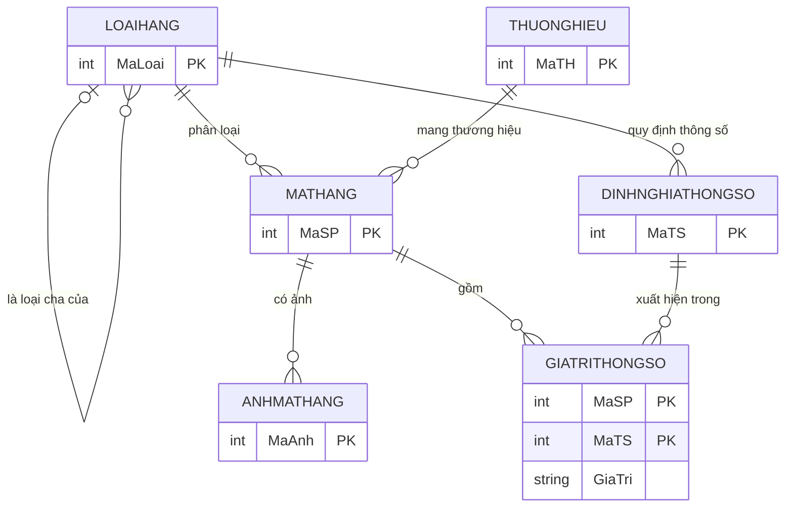
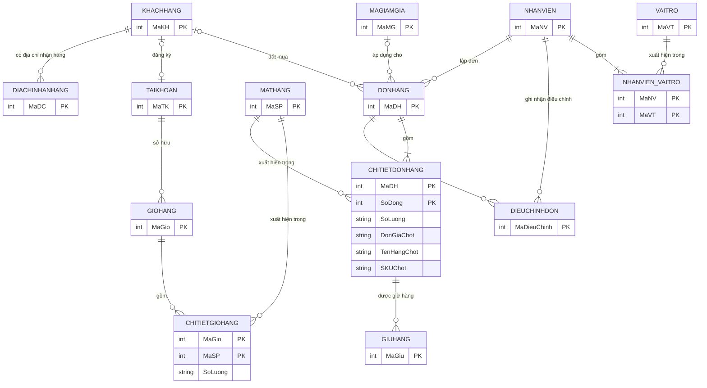
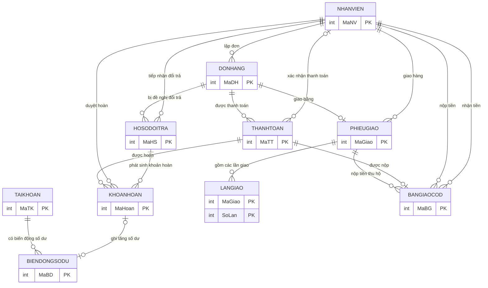
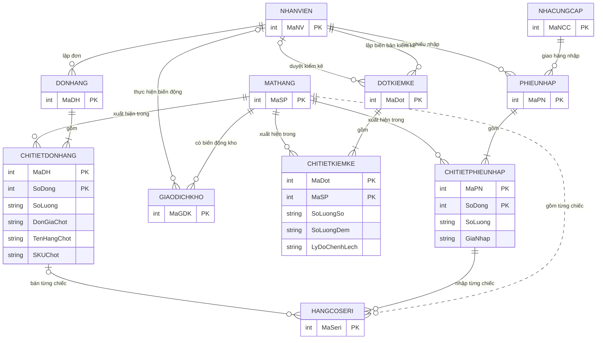
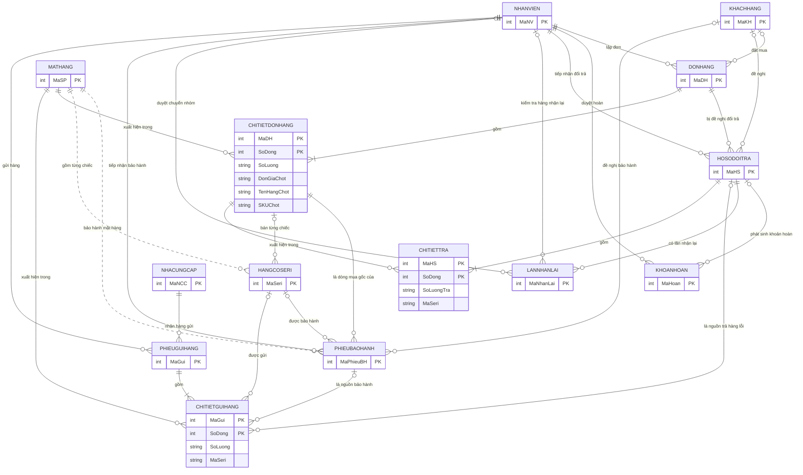

# MỤC 6. VẼ ERD (MÔ HÌNH THỰC THỂ – KẾT HỢP) VỚI BẢN SỐ (MIN, MAX)

Căn cứ: ba loại thực thể và thuộc tính ở [02_Xac_dinh_thuc_the.md](02_Xac_dinh_thuc_the.md), khóa ở [05_Tim_khoa.md](05_Tim_khoa.md), quy tắc nghiệp vụ ở [01_Mo_ta_de_tai_v3.md](01_Mo_ta_de_tai_v3.md). Mô hình gồm **30 thực thể**, **53 mối kết hợp thường** và **8 mối kết hợp có thuộc tính** (MKH).

## 6.1. Quy ước

**Bản số (min, max) theo giáo trình `TH_PTTKHT_2022`.** Bản số đặt cạnh một thực thể cho biết **một thể hiện của thực thể đó tham gia mối kết hợp ít nhất min và nhiều nhất max lần**. Ví dụ KHÁCH HÀNG (0,n) – Mua – HÓA ĐƠN (1,1): một khách mua từ 0 đến nhiều hóa đơn; một hóa đơn thuộc đúng một khách.

| Bản số | Nghĩa |
|---|---|
| (0,1) | Không hoặc một |
| (1,1) | Đúng một |
| (0,n) | Không hoặc nhiều |
| (1,n) | Ít nhất một |

**Ba loại thực thể** trong hình: cơ bản, đối tượng ngoài, nghiệp vụ (xem 02). **Thực thể yếu** (ANHMATHANG, DIACHINHANHANG, LANGIAO...) có bản số (1,1) về phía thực thể chủ.

**Mối kết hợp có thuộc tính (MKH).** Dòng chi tiết là MKH, không phải thực thể (nhận xét của giảng viên). Trong hình vẽ bằng Case Studio hoặc draw.io, MKH là hình thoi nối hai thực thể, thuộc tính ghi cạnh hình thoi. Mermaid không có hình thoi nên vẽ MKH bằng **thực thể kết hợp** (hình chữ nhật có hai đường nối); đây chỉ khác về cách vẽ, không đổi ý nghĩa.

**Đổi bản số sang Mermaid.** Mermaid dùng ký hiệu "chân quạ" đọc **chéo**: ký hiệu cạnh thực thể A cho biết mỗi thể hiện của B ứng với bao nhiêu A. Vì vậy với `A ⟨trái⟩--⟨phải⟩ B`:

- ký hiệu **trái** (cạnh A) lấy theo bản số của **B**;
- ký hiệu **phải** (cạnh B) lấy theo bản số của **A**.

| Bản số | Ký hiệu cạnh trái | Ký hiệu cạnh phải |
|---|---|---|
| (1,1) | `||` | `||` |
| (0,1) | `|o` | `o|` |
| (0,n) | `}o` | `o{` |
| (1,n) | `}|` | `|{` |

Ví dụ KHACHHANG (0,n), DONHANG (0,1) được viết `KHACHHANG |o--o{ DONHANG`. Nét liền `--` là liên kết xác định; nét đứt `..` dùng cho mối kết hợp **dư thừa** (mục 6.4). Mermaid **không biểu diễn được cận trên khác 1 hoặc n** (ví dụ tối đa 3 lần giao): ở đó vẽ (0,n) và ghi cận trong bảng 6.2.

**Công cụ.** Mermaid hiển thị được ký hiệu min và max dạng chân quạ (xem trên GitHub, VS Code, mermaid.live) nhưng không in số "(0,n)". Để có số (min,max) như giáo trình, dựng lại bằng Case Studio hoặc draw.io theo bảng 6.2 và 6.3.

## 6.2. Mối kết hợp thường và bản số

Cột "Đọc" mô tả theo hai chiều. Chữ [GT] là giả thiết chưa được xác nhận.

| STT | Thực thể A | Mối kết hợp | Thực thể B | A (min,max) | B (min,max) | Đọc | Căn cứ |
|---|---|---|---|---|---|---|---|
| 1 | LOAIHANG | là loại cha của | LOAIHANG | (0,n) | (0,1) | Một LOAIHANG có 0 đến nhiều LOAIHANG; một LOAIHANG có 0 đến 1 LOAIHANG | v3 1.2.1: mỗi loại tối đa một loại cha, không vòng |
| 2 | LOAIHANG | phân loại | MATHANG | (0,n) | (1,1) | Một LOAIHANG có 0 đến nhiều MATHANG; một MATHANG có đúng 1 LOAIHANG | v3 1.2.1: mỗi mặt hàng đúng một loại |
| 3 | THUONGHIEU | mang thương hiệu | MATHANG | (0,n) | (1,1) | Một THUONGHIEU có 0 đến nhiều MATHANG; một MATHANG có đúng 1 THUONGHIEU | v3 1.2.1: mỗi mặt hàng đúng một thương hiệu |
| 4 | MATHANG | có ảnh | ANHMATHANG | (0,n) | (1,1) | Một MATHANG có 0 đến nhiều ANHMATHANG; một ANHMATHANG có đúng 1 MATHANG | v3 1.2.1; mặt hàng đang bán phải có một ảnh chính (ràng buộc) |
| 5 | LOAIHANG | quy định thông số | DINHNGHIATHONGSO | (0,n) | (1,1) | Một LOAIHANG có 0 đến nhiều DINHNGHIATHONGSO; một DINHNGHIATHONGSO có đúng 1 LOAIHANG | v3 1.2.1: thông số định nghĩa theo loại hàng |
| 6 | KHACHHANG | có địa chỉ nhận hàng | DIACHINHANHANG | (0,n) | (1,1) | Một KHACHHANG có 0 đến nhiều DIACHINHANHANG; một DIACHINHANHANG có đúng 1 KHACHHANG | v3 1.2.2: nhiều địa chỉ, tối đa một mặc định |
| 7 | KHACHHANG | đăng ký | TAIKHOAN | (0,1) | (0,1) | Một KHACHHANG có 0 đến 1 TAIKHOAN; một TAIKHOAN có 0 đến 1 KHACHHANG | v3 1.2.2: tài khoản gắn tối đa một khách; khách tối đa một tài khoản là [GT] |
| 8 | TAIKHOAN | sở hữu | GIOHANG | (0,n) | (1,1) | Một TAIKHOAN có 0 đến nhiều GIOHANG; một GIOHANG có đúng 1 TAIKHOAN | v3 1.2.4: mỗi tài khoản tối đa một giỏ đang dùng (ràng buộc) |
| 9 | KHACHHANG | đặt mua | DONHANG | (0,n) | (0,1) | Một KHACHHANG có 0 đến nhiều DONHANG; một DONHANG có 0 đến 1 KHACHHANG | v3 1.2.2: khách quầy không để lại thông tin thì đơn không có khách |
| 10 | NHANVIEN | lập đơn | DONHANG | (0,n) | (1,1) | Một NHANVIEN có 0 đến nhiều DONHANG; một DONHANG có đúng 1 NHANVIEN | v3 1.2.3, 1.2.4: nhân viên bán hoặc lập đơn |
| 11 | MAGIAMGIA | áp dụng cho | DONHANG | (0,n) | (0,1) | Một MAGIAMGIA có 0 đến nhiều DONHANG; một DONHANG có 0 đến 1 MAGIAMGIA | v3 1.2.4 mục 6: mỗi đơn tối đa một mã |
| 12 | DONHANG | được điều chỉnh | DIEUCHINHDON | (0,n) | (1,1) | Một DONHANG có 0 đến nhiều DIEUCHINHDON; một DIEUCHINHDON có đúng 1 DONHANG | v3 1.2.4 mục 4: sửa đơn phải ghi trước và sau |
| 13 | NHANVIEN | ghi nhận điều chỉnh | DIEUCHINHDON | (0,n) | (1,1) | Một NHANVIEN có 0 đến nhiều DIEUCHINHDON; một DIEUCHINHDON có đúng 1 NHANVIEN | v3 1.2.4 mục 4 |
| 14 | CHITIETDONHANG | được giữ hàng | GIUHANG | (0,n) | (1,1) | Một CHITIETDONHANG có 0 đến nhiều GIUHANG; một GIUHANG có đúng 1 CHITIETDONHANG | v3 1.2.4 mục 3: giữ hàng theo dòng đơn |
| 15 | DONHANG | được thanh toán | THANHTOAN | (0,n) | (1,1) | Một DONHANG có 0 đến nhiều THANHTOAN; một THANHTOAN có đúng 1 DONHANG | v3 1.2.5: một đơn nhiều lần thanh toán, kể cả cọc |
| 16 | NHANVIEN | xác nhận thanh toán | THANHTOAN | (0,n) | (0,1) | Một NHANVIEN có 0 đến nhiều THANHTOAN; một THANHTOAN có 0 đến 1 NHANVIEN | v3 1.2.5: người xác nhận có thể chưa có |
| 17 | THANHTOAN | được hoàn | KHOANHOAN | (0,n) | (1,1) | Một THANHTOAN có 0 đến nhiều KHOANHOAN; một KHOANHOAN có đúng 1 THANHTOAN | v3 1.2.8 bước 5: mỗi khoản hoàn gắn khoản thu gốc |
| 18 | NHANVIEN | duyệt hoàn | KHOANHOAN | (0,n) | (1,1) | Một NHANVIEN có 0 đến nhiều KHOANHOAN; một KHOANHOAN có đúng 1 NHANVIEN | v3 1.2.2, 1.2.8: người quản lý duyệt hoàn tiền |
| 19 | HOSODOITRA | phát sinh khoản hoàn | KHOANHOAN | (0,n) | (0,1) | Một HOSODOITRA có 0 đến nhiều KHOANHOAN; một KHOANHOAN có 0 đến 1 HOSODOITRA | v3 1.2.8: hoàn tiền từ hồ sơ đổi trả (hoặc hủy đơn) |
| 20 | TAIKHOAN | có biến động số dư | BIENDONGSODU | (0,n) | (1,1) | Một TAIKHOAN có 0 đến nhiều BIENDONGSODU; một BIENDONGSODU có đúng 1 TAIKHOAN | v3 1.2.8: hoàn vào số dư tài khoản (tùy chọn) |
| 21 | KHOANHOAN | ghi tăng số dư | BIENDONGSODU | (0,1) | (0,1) | Một KHOANHOAN có 0 đến 1 BIENDONGSODU; một BIENDONGSODU có 0 đến 1 KHOANHOAN | Một nguồn không tạo biến động hai lần |
| 22 | DONHANG | giao bằng | PHIEUGIAO | (0,1) | (1,1) | Một DONHANG có 0 đến 1 PHIEUGIAO; một PHIEUGIAO có đúng 1 DONHANG | v3 1.2.6: giao trọn trong một đợt [GT]; đơn quầy không có phiếu giao |
| 23 | NHANVIEN | giao hàng | PHIEUGIAO | (0,n) | (1,1) | Một NHANVIEN có 0 đến nhiều PHIEUGIAO; một PHIEUGIAO có đúng 1 NHANVIEN | v3 1.2.6 |
| 24 | PHIEUGIAO | gồm các lần giao | LANGIAO | (0,3) | (1,1) | Một PHIEUGIAO có 0 đến 3 LANGIAO; một LANGIAO có đúng 1 PHIEUGIAO | v3 1.2.6 mục 5: tối đa 3 lần giao |
| 25 | PHIEUGIAO | nộp tiền thu hộ | BANGIAOCOD | (0,n) | (1,1) | Một PHIEUGIAO có 0 đến nhiều BANGIAOCOD; một BANGIAOCOD có đúng 1 PHIEUGIAO | v3 1.2.6 mục 4: nộp về thủ quỹ |
| 26 | THANHTOAN | được nộp | BANGIAOCOD | (0,1) | (1,1) | Một THANHTOAN có 0 đến 1 BANGIAOCOD; một BANGIAOCOD có đúng 1 THANHTOAN | Mỗi khoản thu khi giao được nộp một lần |
| 27 | NHANVIEN | nộp tiền | BANGIAOCOD | (0,n) | (1,1) | Một NHANVIEN có 0 đến nhiều BANGIAOCOD; một BANGIAOCOD có đúng 1 NHANVIEN | Người giao nộp |
| 28 | NHANVIEN | nhận tiền | BANGIAOCOD | (0,n) | (1,1) | Một NHANVIEN có 0 đến nhiều BANGIAOCOD; một BANGIAOCOD có đúng 1 NHANVIEN | Thủ quỹ nhận |
| 29 | DONHANG | bị đề nghị đổi trả | HOSODOITRA | (0,n) | (1,1) | Một DONHANG có 0 đến nhiều HOSODOITRA; một HOSODOITRA có đúng 1 DONHANG | v3 1.2.8: một đơn có thể được trả nhiều lần |
| 30 | KHACHHANG | đề nghị | HOSODOITRA | (0,n) | (0,1) | Một KHACHHANG có 0 đến nhiều HOSODOITRA; một HOSODOITRA có 0 đến 1 KHACHHANG | v3 1.2.8: khách quầy không hồ sơ thì xử lý bằng chứng từ mua |
| 31 | NHANVIEN | tiếp nhận đổi trả | HOSODOITRA | (0,n) | (1,1) | Một NHANVIEN có 0 đến nhiều HOSODOITRA; một HOSODOITRA có đúng 1 NHANVIEN | v3 1.2.8 bước 1 |
| 32 | HOSODOITRA | có lần nhận lại | LANNHANLAI | (0,n) | (1,1) | Một HOSODOITRA có 0 đến nhiều LANNHANLAI; một LANNHANLAI có đúng 1 HOSODOITRA | v3 1.2.8 bước 3 |
| 33 | NHANVIEN | kiểm tra hàng nhận lại | LANNHANLAI | (0,n) | (0,1) | Một NHANVIEN có 0 đến nhiều LANNHANLAI; một LANNHANLAI có 0 đến 1 NHANVIEN | v3 1.2.8 bước 4 |
| 34 | NHANVIEN | duyệt chuyển nhóm | LANNHANLAI | (0,n) | (0,1) | Một NHANVIEN có 0 đến nhiều LANNHANLAI; một LANNHANLAI có 0 đến 1 NHANVIEN | v3 1.2.8 bước 4: người quản lý duyệt |
| 35 | KHACHHANG | đề nghị bảo hành | PHIEUBAOHANH | (0,n) | (0,1) | Một KHACHHANG có 0 đến nhiều PHIEUBAOHANH; một PHIEUBAOHANH có 0 đến 1 KHACHHANG | v3 1.2.7; khách quầy có thể không có hồ sơ |
| 36 | CHITIETDONHANG | là dòng mua gốc của | PHIEUBAOHANH | (0,n) | (1,1) | Một CHITIETDONHANG có 0 đến nhiều PHIEUBAOHANH; một PHIEUBAOHANH có đúng 1 CHITIETDONHANG | v3 1.2.7 bước 4: ghi chứng từ mua gốc |
| 37 | HANGCOSERI | được bảo hành | PHIEUBAOHANH | (0,n) | (0,1) | Một HANGCOSERI có 0 đến nhiều PHIEUBAOHANH; một PHIEUBAOHANH có 0 đến 1 HANGCOSERI | v3 1.2.7: ghi số seri với hàng có seri |
| 38 | MATHANG | bảo hành mặt hàng (nét đứt) | PHIEUBAOHANH | (0,n) | (1,1) | Một MATHANG có 0 đến nhiều PHIEUBAOHANH; một PHIEUBAOHANH có đúng 1 MATHANG | Dư thừa: mặt hàng suy ra từ dòng mua gốc (mục 4, 4.3.2); vẽ nét đứt |
| 39 | NHANVIEN | tiếp nhận bảo hành | PHIEUBAOHANH | (0,n) | (1,1) | Một NHANVIEN có 0 đến nhiều PHIEUBAOHANH; một PHIEUBAOHANH có đúng 1 NHANVIEN | v3 1.2.7 bước 4 |
| 40 | NHACUNGCAP | giao hàng nhập | PHIEUNHAP | (0,n) | (1,1) | Một NHACUNGCAP có 0 đến nhiều PHIEUNHAP; một PHIEUNHAP có đúng 1 NHACUNGCAP | v3 1.2.9 |
| 41 | NHANVIEN | lập phiếu nhập | PHIEUNHAP | (0,n) | (1,1) | Một NHANVIEN có 0 đến nhiều PHIEUNHAP; một PHIEUNHAP có đúng 1 NHANVIEN | v3 1.2.9 bước 3 |
| 42 | MATHANG | gồm từng chiếc (nét đứt) | HANGCOSERI | (0,n) | (1,1) | Một MATHANG có 0 đến nhiều HANGCOSERI; một HANGCOSERI có đúng 1 MATHANG | Dư thừa: mặt hàng suy ra từ dòng nhập (mục 4, 4.3.1); vẽ nét đứt |
| 43 | CHITIETPHIEUNHAP | nhập từng chiếc | HANGCOSERI | (0,n) | (1,1) | Một CHITIETPHIEUNHAP có 0 đến nhiều HANGCOSERI; một HANGCOSERI có đúng 1 CHITIETPHIEUNHAP | v3 1.2.9 bước 2: ghi seri khi nhập |
| 44 | CHITIETDONHANG | bán từng chiếc | HANGCOSERI | (0,n) | (0,1) | Một CHITIETDONHANG có 0 đến nhiều HANGCOSERI; một HANGCOSERI có 0 đến 1 CHITIETDONHANG | v3 1.2.3 bước 1: ghi seri khi bán; chưa bán thì rỗng |
| 45 | MATHANG | có biến động kho | GIAODICHKHO | (0,n) | (1,1) | Một MATHANG có 0 đến nhiều GIAODICHKHO; một GIAODICHKHO có đúng 1 MATHANG | v3 1.2.9 mục 7 |
| 46 | NHANVIEN | thực hiện biến động | GIAODICHKHO | (0,n) | (0,1) | Một NHANVIEN có 0 đến nhiều GIAODICHKHO; một GIAODICHKHO có 0 đến 1 NHANVIEN | DDL cho phép trống người thực hiện |
| 47 | NHANVIEN | lập biên bản kiểm kê | DOTKIEMKE | (0,n) | (1,1) | Một NHANVIEN có 0 đến nhiều DOTKIEMKE; một DOTKIEMKE có đúng 1 NHANVIEN | v3 1.2.9 mục 6 |
| 48 | NHANVIEN | duyệt kiểm kê | DOTKIEMKE | (0,n) | (0,1) | Một NHANVIEN có 0 đến nhiều DOTKIEMKE; một DOTKIEMKE có 0 đến 1 NHANVIEN | v3 1.2.9 mục 6: chỉ điều chỉnh sau khi duyệt |
| 49 | NHACUNGCAP | nhận hàng gửi | PHIEUGUIHANG | (0,n) | (1,1) | Một NHACUNGCAP có 0 đến nhiều PHIEUGUIHANG; một PHIEUGUIHANG có đúng 1 NHACUNGCAP | v3 1.2.9 mục 5 |
| 50 | NHANVIEN | gửi hàng | PHIEUGUIHANG | (0,n) | (1,1) | Một NHANVIEN có 0 đến nhiều PHIEUGUIHANG; một PHIEUGUIHANG có đúng 1 NHANVIEN | v3 1.2.9 mục 5 |
| 51 | PHIEUBAOHANH | là nguồn bảo hành | CHITIETGUIHANG | (0,n) | (0,1) | Một PHIEUBAOHANH có 0 đến nhiều CHITIETGUIHANG; một CHITIETGUIHANG có 0 đến 1 PHIEUBAOHANH | Nguồn đúng một trong hai: phiếu bảo hành hoặc hồ sơ đổi trả (ràng buộc) |
| 52 | HOSODOITRA | là nguồn trả hàng lỗi | CHITIETGUIHANG | (0,n) | (0,1) | Một HOSODOITRA có 0 đến nhiều CHITIETGUIHANG; một CHITIETGUIHANG có 0 đến 1 HOSODOITRA | Như trên |
| 53 | HANGCOSERI | được gửi | CHITIETGUIHANG | (0,n) | (0,1) | Một HANGCOSERI có 0 đến nhiều CHITIETGUIHANG; một CHITIETGUIHANG có 0 đến 1 HANGCOSERI | Ghi seri của chiếc gửi đi |

## 6.3. Mối kết hợp có thuộc tính (MKH)

| MKH | Giữa | Bản số hai đầu | Thuộc tính của MKH | Khóa của MKH (mục 5) | Căn cứ |
|---|---|---|---|---|---|
| CHITIETDONHANG | DONHANG – MATHANG | DONHANG (1,n); MATHANG (0,n) | SoDong, SoLuong, DonGiaChot, TenHangChot, SKUChot | MaDH, SoDong | v3 1.2.3, 1.2.4: đơn ít nhất một dòng; cùng mặt hàng có thể nhiều dòng |
| CHITIETPHIEUNHAP | PHIEUNHAP – MATHANG | PHIEUNHAP (1,n); MATHANG (0,n) | SoDong, SoLuong, GiaNhap | MaPN, SoDong | v3 1.2.9 bước 3: phiếu ít nhất một dòng |
| CHITIETGIOHANG | GIOHANG – MATHANG | GIOHANG (0,n); MATHANG (0,n) | SoLuong | MaGio, MaSP | v3 1.2.4: mỗi mặt hàng một dòng trong giỏ |
| GIATRITHONGSO | MATHANG – DINHNGHIATHONGSO | MATHANG (0,n); DINHNGHIATHONGSO (0,n) | GiaTri | MaSP, MaTS | v3 1.2.1: mỗi cặp tối đa một giá trị |
| NHANVIEN_VAITRO | NHANVIEN – VAITRO | NHANVIEN (1,n); VAITRO (0,n) | (không có) | MaNV, MaVT | v3 1.2.2: nhân viên kiêm nhiều việc |
| CHITIETKIEMKE | DOTKIEMKE – MATHANG | DOTKIEMKE (1,n); MATHANG (0,n) | SoLuongSo, SoLuongDem, LyDoChenhLech | MaDot, MaSP | v3 1.2.9 mục 6 |
| CHITIETTRA | HOSODOITRA – CHITIETDONHANG | HOSODOITRA (1,n); CHITIETDONHANG (0,n) | SoLuongTra, MaSeri | MaHS, SoDong | v3 1.2.8 bước 2: hồ sơ có các dòng trả |
| CHITIETGUIHANG | PHIEUGUIHANG – MATHANG | PHIEUGUIHANG (1,n); MATHANG (0,n) | SoDong, SoLuong, MaSeri | MaGui, SoDong | v3 1.2.9 mục 5 |

Hai điều cần nhớ khi vẽ MKH:

- **CHITIETDONHANG** và **CHITIETPHIEUNHAP**: khóa là (mã đơn, số dòng), không phải (mã đơn, mã mặt hàng), vì một mặt hàng có thể ở nhiều dòng. Khi vẽ bằng hình thoi cần ghi `SoDong` là thuộc tính của hình thoi và đánh dấu nó thuộc khóa.
- **CHITIETTRA** nối HOSODOITRA với một *dòng đơn* (CHITIETDONHANG), tức là MKH trên một MKH; trong hình thoi dùng, ghi cạnh hình thoi dòng đơn gốc.

## 6.4. Sơ đồ ERD (Mermaid)

Hình toàn cảnh ở 6.4.1 chỉ có tên thực thể để thấy các liên kết; năm hình nhóm ở 6.4.2 có thêm thuộc tính khóa. Một số thực thể xuất hiện ở nhiều hình (NHANVIEN, MATHANG, DONHANG...) làm điểm nối giữa các nhóm. Đường **nét đứt** là mối kết hợp dư thừa (R38 MATHANG–PHIEUBAOHANH và R42 MATHANG–HANGCOSERI): mặt hàng đã suy ra được từ dòng mua gốc hoặc dòng nhập (xem mục 4, 4.3.1 và 4.3.2), sẽ xử lý ở mục 8, 9.

### 6.4.1. Toàn cảnh (không có thuộc tính)

```mermaid
erDiagram
    LOAIHANG |o--o{ LOAIHANG : "là loại cha của"
    LOAIHANG ||--o{ MATHANG : "phân loại"
    THUONGHIEU ||--o{ MATHANG : "mang thương hiệu"
    MATHANG ||--o{ ANHMATHANG : "có ảnh"
    LOAIHANG ||--o{ DINHNGHIATHONGSO : "quy định thông số"
    KHACHHANG ||--o{ DIACHINHANHANG : "có địa chỉ nhận hàng"
    KHACHHANG |o--o| TAIKHOAN : "đăng ký"
    TAIKHOAN ||--o{ GIOHANG : "sở hữu"
    KHACHHANG |o--o{ DONHANG : "đặt mua"
    NHANVIEN ||--o{ DONHANG : "lập đơn"
    MAGIAMGIA |o--o{ DONHANG : "áp dụng cho"
    DONHANG ||--o{ DIEUCHINHDON : "được điều chỉnh"
    NHANVIEN ||--o{ DIEUCHINHDON : "ghi nhận điều chỉnh"
    CHITIETDONHANG ||--o{ GIUHANG : "được giữ hàng"
    DONHANG ||--o{ THANHTOAN : "được thanh toán"
    NHANVIEN |o--o{ THANHTOAN : "xác nhận thanh toán"
    THANHTOAN ||--o{ KHOANHOAN : "được hoàn"
    NHANVIEN ||--o{ KHOANHOAN : "duyệt hoàn"
    HOSODOITRA |o--o{ KHOANHOAN : "phát sinh khoản hoàn"
    TAIKHOAN ||--o{ BIENDONGSODU : "có biến động số dư"
    KHOANHOAN |o--o| BIENDONGSODU : "ghi tăng số dư"
    DONHANG ||--o| PHIEUGIAO : "giao bằng"
    NHANVIEN ||--o{ PHIEUGIAO : "giao hàng"
    PHIEUGIAO ||--o{ LANGIAO : "gồm các lần giao"
    PHIEUGIAO ||--o{ BANGIAOCOD : "nộp tiền thu hộ"
    THANHTOAN ||--o| BANGIAOCOD : "được nộp"
    NHANVIEN ||--o{ BANGIAOCOD : "nộp tiền"
    NHANVIEN ||--o{ BANGIAOCOD : "nhận tiền"
    DONHANG ||--o{ HOSODOITRA : "bị đề nghị đổi trả"
    KHACHHANG |o--o{ HOSODOITRA : "đề nghị"
    NHANVIEN ||--o{ HOSODOITRA : "tiếp nhận đổi trả"
    HOSODOITRA ||--o{ LANNHANLAI : "có lần nhận lại"
    NHANVIEN |o--o{ LANNHANLAI : "kiểm tra hàng nhận lại"
    NHANVIEN |o--o{ LANNHANLAI : "duyệt chuyển nhóm"
    KHACHHANG |o--o{ PHIEUBAOHANH : "đề nghị bảo hành"
    CHITIETDONHANG ||--o{ PHIEUBAOHANH : "là dòng mua gốc của"
    HANGCOSERI |o--o{ PHIEUBAOHANH : "được bảo hành"
    MATHANG ||..o{ PHIEUBAOHANH : "bảo hành mặt hàng"
    NHANVIEN ||--o{ PHIEUBAOHANH : "tiếp nhận bảo hành"
    NHACUNGCAP ||--o{ PHIEUNHAP : "giao hàng nhập"
    NHANVIEN ||--o{ PHIEUNHAP : "lập phiếu nhập"
    MATHANG ||..o{ HANGCOSERI : "gồm từng chiếc"
    CHITIETPHIEUNHAP ||--o{ HANGCOSERI : "nhập từng chiếc"
    CHITIETDONHANG |o--o{ HANGCOSERI : "bán từng chiếc"
    MATHANG ||--o{ GIAODICHKHO : "có biến động kho"
    NHANVIEN |o--o{ GIAODICHKHO : "thực hiện biến động"
    NHANVIEN ||--o{ DOTKIEMKE : "lập biên bản kiểm kê"
    NHANVIEN |o--o{ DOTKIEMKE : "duyệt kiểm kê"
    NHACUNGCAP ||--o{ PHIEUGUIHANG : "nhận hàng gửi"
    NHANVIEN ||--o{ PHIEUGUIHANG : "gửi hàng"
    PHIEUBAOHANH |o--o{ CHITIETGUIHANG : "là nguồn bảo hành"
    HOSODOITRA |o--o{ CHITIETGUIHANG : "là nguồn trả hàng lỗi"
    HANGCOSERI |o--o{ CHITIETGUIHANG : "được gửi"
    DONHANG ||--|{ CHITIETDONHANG : "gồm"
    MATHANG ||--o{ CHITIETDONHANG : "xuất hiện trong"
    PHIEUNHAP ||--|{ CHITIETPHIEUNHAP : "gồm"
    MATHANG ||--o{ CHITIETPHIEUNHAP : "xuất hiện trong"
    GIOHANG ||--o{ CHITIETGIOHANG : "gồm"
    MATHANG ||--o{ CHITIETGIOHANG : "xuất hiện trong"
    MATHANG ||--o{ GIATRITHONGSO : "gồm"
    DINHNGHIATHONGSO ||--o{ GIATRITHONGSO : "xuất hiện trong"
    NHANVIEN ||--|{ NHANVIEN_VAITRO : "gồm"
    VAITRO ||--o{ NHANVIEN_VAITRO : "xuất hiện trong"
    DOTKIEMKE ||--|{ CHITIETKIEMKE : "gồm"
    MATHANG ||--o{ CHITIETKIEMKE : "xuất hiện trong"
    HOSODOITRA ||--|{ CHITIETTRA : "gồm"
    CHITIETDONHANG ||--o{ CHITIETTRA : "xuất hiện trong"
    PHIEUGUIHANG ||--|{ CHITIETGUIHANG : "gồm"
    MATHANG ||--o{ CHITIETGUIHANG : "xuất hiện trong"
```

### 6.4.2. Các sơ đồ theo nhóm (có thuộc tính khóa)

**Sơ đồ 1. Hàng hóa, ảnh và thông số**

**Sơ đồ 2. Khách hàng và đặt hàng**

**Sơ đồ 3. Thanh toán, hoàn tiền và giao hàng**

**Sơ đồ 4. Nhập hàng, kho và kiểm kê**

**Sơ đồ 5. Đổi trả, bảo hành và gửi nhà cung cấp**

## 6.5. Ràng buộc mà bản số không biểu diễn được

| Quy tắc | Mối kết hợp liên quan | Ghi chú |
|---|---|---|
| Tối đa 3 lần giao | R24 PHIEUGIAO – LANGIAO | Bản số đúng là PHIEUGIAO (0,3); Mermaid chỉ vẽ (0,n) |
| Mỗi tài khoản tối đa một giỏ đang dùng | R8 | Ràng buộc có điều kiện (theo tình trạng giỏ) |
| Mặt hàng đang bán có đúng một ảnh chính | R4 | Mức (0,n) cho mọi mặt hàng, (1,..) chỉ khi đang bán |
| Mỗi khách tối đa một địa chỉ mặc định | R6 | Có điều kiện |
| Nguồn của dòng gửi đúng một trong hai: phiếu bảo hành hoặc hồ sơ đổi trả | R51, R52 | Ràng buộc loại trừ (cả hai đều (0,1)) |
| Thông số của mặt hàng phải thuộc đúng loại hàng của mặt hàng | GIATRITHONGSO, R2, R5 | Ràng buộc giữa các quan hệ |
| Một mặt hàng không dùng cùng một vị trí ảnh hai lần | R4 | Khóa (MaSP, ViTri) |
| Tổng khoản hoàn không vượt tiền đã thu; tổng số lượng trả không vượt số đã giao | R17, CHITIETTRA | Ràng buộc tổng hợp |
| Bán chiếc hàng có seri thì chiếc đó thuộc đúng mặt hàng của dòng đơn | R44, CHITIETDONHANG | Ràng buộc nhất quán |
| Tham chiếu chứng từ đa hình của giao dịch kho (`LoaiChungTu`, `MaChungTu`) | GIAODICHKHO | Không vẽ thành mối kết hợp vì trỏ tới nhiều thực thể; ghi chú ở thuộc tính |
| Khách tối đa một tài khoản **[GT]**; mỗi đơn giao trọn một đợt **[GT]** | R7, R22 | Giả thiết cần xác nhận |

## 6.6. Đối chiếu với `database/data.sql`

- DDL có **44 khóa ngoại**. Trong đó **25 khóa ngoại thuộc bảng nằm trong mô hình**, và **24** có mối kết hợp tương ứng ở trên; khóa ngoại còn lại (`AspNetUsers.CreatedByUserId`, người tạo tài khoản) không có trong v3. **19 khóa ngoại** thuộc bảng ngoài phạm vi (đánh giá, hỗ trợ, thu cũ, thông báo, bảng định danh phụ).
- Mối kết hợp có đối ứng trong DDL: R1, R2, R3, R4, R5, R6, R8, R9, R11, R15, R40, R41, R45, R46 và năm MKH (CHITIETDONHANG, CHITIETPHIEUNHAP, CHITIETGIOHANG, GIATRITHONGSO, NHANVIEN_VAITRO). **39 trong 53 mối kết hợp thường chưa có khóa ngoại trong DDL**, phần lớn vì thực thể mới (seri, giữ hàng, giao hàng, đổi trả, bảo hành...).
- Điểm khác đáng chú ý: DDL gộp khách, nhân viên và tài khoản vào một bảng `AspNetUsers`, nên R7 (khách đăng ký tài khoản) và R10 (nhân viên lập đơn) không có khóa ngoại riêng; `Orders.UserId` trong DDL chỉ ghi người mua.

## 6.7. Câu hỏi giảng viên có thể hỏi

- *Vì sao DONHANG có (0,1) về phía KHACHHANG?* Vì khách mua tại quầy có thể không để lại thông tin (v3 1.2.2), nên đơn không nhất thiết có khách.
- *Vì sao CHITIETDONHANG vẽ là MKH, không phải thực thể?* Nó chỉ tồn tại khi có một đơn và một mặt hàng, mang thuộc tính (số dòng, số lượng, giá chốt) của mối liên hệ đó. Giảng viên đã nhắc: `ChiTiet...` là MKH.
- *Bản số (1,n) của DONHANG trong CHITIETDONHANG nghĩa là gì?* Mỗi đơn có ít nhất một dòng.
- *Vì sao PHIEUGIAO – LANGIAO có (0,3)?* Mỗi đơn thử giao tối đa 3 lần (v3 1.2.6); phiếu vừa lập chưa có lần giao nào nên min = 0.
- *Vì sao có hai đường nét đứt?* Mặt hàng suy ra được từ dòng nhập hoặc dòng đơn; giữ thêm liên kết trực tiếp là dư thừa, ứng viên để cải tiến.
- *ERD này có khớp với CSDL hiện tại không?* Không hoàn toàn: đây là thiết kế đề xuất theo v3; 39 mối kết hợp thường chưa có khóa ngoại trong DDL (mục 6.6).
