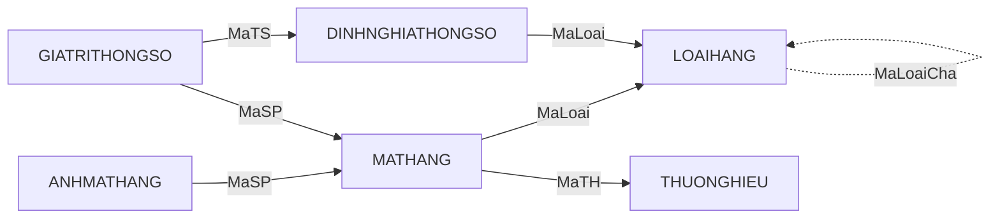
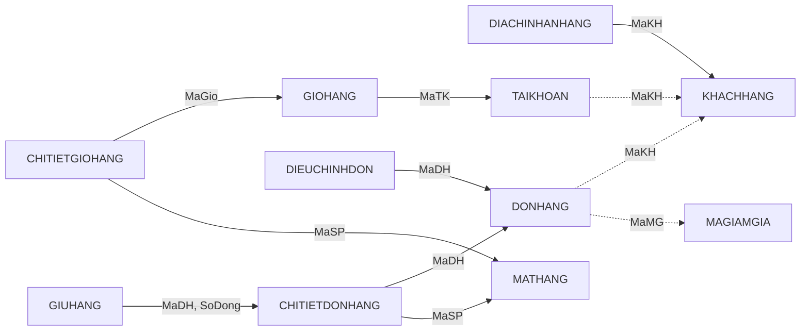
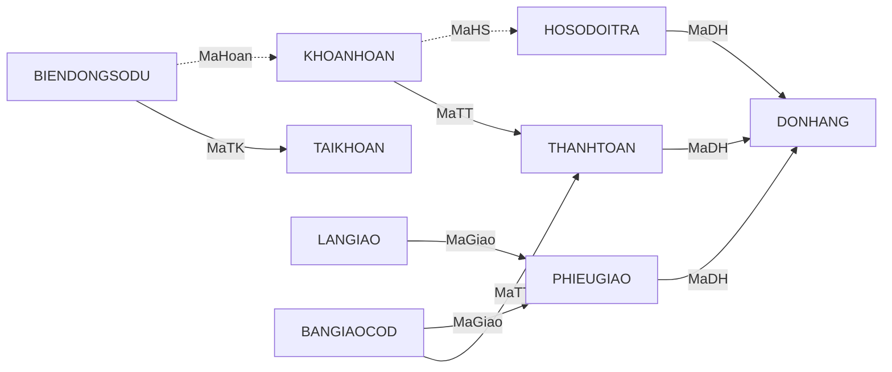
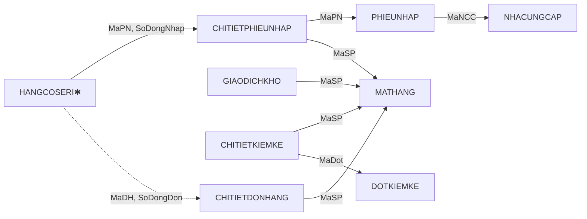
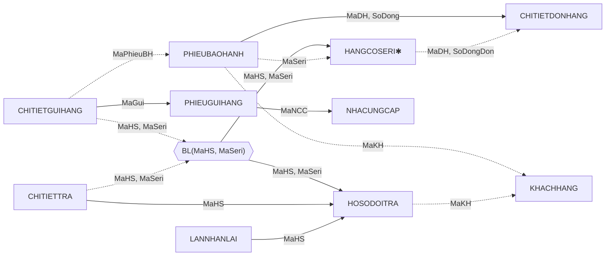
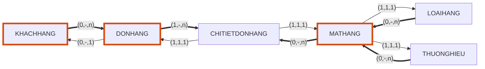
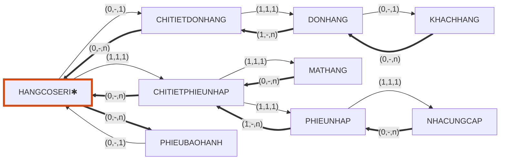

# MỤC 10. ĐỒ THỊ QUAN HỆ VÀ CON ĐƯỜNG TRUY XUẤT

Căn cứ: lược đồ 39 quan hệ sau cải tiến ở [09_Cai_tien.md](09_Cai_tien.md), khóa ở [05_Tim_khoa.md](05_Tim_khoa.md), khóa ngoại và bản số ở [07_Mo_hinh_quan_he.md](07_Mo_hinh_quan_he.md) và [06_ERD.md](06_ERD.md); lý thuyết ở Bài 9, 10, 11 của giáo trình CSDL-NC 2015. Mục này biểu diễn lược đồ thành **đồ thị quan hệ**, chuyển sang **đồ thị con đường truy xuất**, chọn các yêu cầu khai thác thực tế của cửa hàng và chỉ ra chuỗi kết, truy vấn SQL, chỉ mục tương ứng. Kết quả thuật toán do [tools/dothi.py](tools/dothi.py) tính; SQL được kiểm tra tên bảng, tên cột trên một CSDL SQLite rỗng dựng từ lược đồ 39 quan hệ.

**Kết quả chính.**

- Thuật toán B1–B7 trên 39 quan hệ cho đồ thị quan hệ gồm **38 nút** (37 quan hệ nút và 1 nút bản lề), **65 cung có hướng**, **1 cung vô hướng** (NHANVIEN – VAITRO) và **1 khuyên** (LOAIHANG).
- Hai quan hệ HANGCOSERI và SERIMATHANG có chung khóa MaSeri nên **gộp thành một nút** (ký hiệu HANGCOSERI✱); đồ thị phát hiện **một nút bản lề** BL(MaHS, MaSeri) nối CHITIETTRA với CHITIETGUIHANG mà ERD ở mục 6 chưa cho thấy.
- 8 cung bị loại vì thừa; từ các **mạch đi kép** (23 cặp nút có từ hai mạch đi, mục 10.7) rút ra **tám ràng buộc nhất quán** giữa các quan hệ, trong đó **bốn ràng buộc mới** so với các mục trước (khoản hoàn và đơn của hồ sơ; khoản thu COD và đơn của phiếu giao; cặp hồ sơ – chiếc hàng ở dòng gửi nhà cung cấp; chiếc hàng nhận lại và đơn của hồ sơ).
- 7 yêu cầu khai thác (K1–K7) đều có chuỗi kết cài đặt được trên đồ thị; K2 và K5 đi theo dòng toàn cung truy xuất một ("→"), không làm nhân bản dòng.

## 10.1. Cơ sở lý thuyết

Phần này tóm tắt định nghĩa của giáo trình (Bài 9, 10) để các mục sau dùng đúng thuật ngữ.

**Nút, cung, quan hệ nút, quan hệ cung.** Mỗi quan hệ của lược đồ là một **nút** (quan hệ nút). Mỗi **cung** (quan hệ cung Qᵢⱼ) cho biết từ một bộ của quan hệ nút i truy xuất được các bộ của quan hệ nút j. Quan hệ cung hình thành bằng phép chiếu của quan hệ nút trên các thuộc tính khóa của hai nút.

**Đồ thị con đường truy xuất (ĐTCĐTX).** Đồ thị có hướng (N, C, R, Cđ, f, g, h, i, j), trên mỗi cung gắn bộ ba **(m, A, M)** là số bộ **tối thiểu, trung bình, tối đa** của nút đến truy xuất được từ một bộ của nút đi (A viết "-" khi chưa biết). Cung có M = 1 viết "→"; cung có M = n viết "→→". Nút có j(n) = 1 là **nút vào**: cung cấp giá trị khóa là truy xuất trực tiếp được một bộ. **ĐTCĐTX thô** là ĐTCĐTX thỏa hai điều kiện: giữa hai nút nếu có một cung thì có cung theo chiều ngược lại; mọi nút đều là nút vào.

**Đồ thị quan hệ (ĐTQH).** Dạng đơn giản hóa: giữa hai nút chỉ có một cung. Cung **có hướng** i → j khi có phụ thuộc hàm từ khóa của i sang khóa của j (từ một bộ i truy xuất một bộ j); cung **vô hướng** khi hai nút liên hệ nhiều–nhiều. ĐTQH và ĐTCĐTX thô chuyển qua lại được: cung có hướng i → j của ĐTQH ứng với cặp cung i → j có M = 1 và j → i có M = n; cung vô hướng ứng với cặp cung cùng có M = n.

**Chuỗi kết được cài đặt trên đồ thị.** Chuỗi kết α = Q₁ ⋈ Q₂ ⋈ … ⋈ Qₘ **được cài đặt** khi tồn tại một **dòng** (tập cung) có gốc là một nút nào đó sao cho mọi Qᵢ đều là quan hệ cung hoặc quan hệ nút trên dòng. Khi đó từ quan hệ của nút gốc, theo các mạch đi trên dòng tới các quan hệ còn lại là thực hiện được phép kết mà không phải duyệt cả quan hệ. Vì thế đồ thị giúp **chọn đủ các chỉ mục cần thiết**: mỗi cung là một đường truy xuất cần chỉ mục ở đầu đến.

**Thuật toán biểu diễn lược đồ thành ĐTQH (Bài 10).**

| Bước | Nội dung |
|---|---|
| B1 | Biến phân rã thành **phân rã đồng nhất**: gộp hai quan hệ có khóa tương đương (Kᵢ ↔ Kⱼ); nếu Qᵢ chứa một khóa của Qⱼ thì phải chứa mọi khóa của Qⱼ |
| B2 | Mỗi quan hệ là một **nút** |
| B3 | Tạo **nút bản lề**: với mọi cặp nút, giao Qᵢⱼ = Qᵢ ∩ Qⱼ; chừng nào Qᵢⱼ còn khác rỗng, tìm các khóa của Qᵢⱼ; **nếu không quan hệ nào có khóa trùng với khóa của Qᵢⱼ** thì tạo nút bản lề; rồi bớt thuộc tính khóa khỏi Qᵢⱼ và lặp |
| B4 | Tạo **cung**: PTH(Nᵢ) = các nút j mà Qᵢ chứa khóa của Qⱼ; PTH_Thừa(Nᵢ) = nút j ∈ PTH(Nᵢ) đạt được qua nút h ∈ PTH(Nᵢ) khác (Qₕ chứa khóa của Qⱼ); LỒNG_KHÓA(Nᵢ) = các nút j có khóa nằm trong khóa của Qᵢ; Cung(Nᵢ) = (PTH − PTH_Thừa) ∪ (LỒNG_KHÓA − LỒNG_KHÓA_THỪA) |
| B5 | Hủy nút bản lề thừa (chỉ có một cung vào, không có thuộc tính ngoài khóa) |
| B6 | **Mịn hóa** quan hệ nút: bỏ khỏi Qᵢ các thuộc tính khóa của nút đến mà không là khóa của Qᵢ (chúng đã nằm ở quan hệ cung) |
| B7 | Tạo **cung vô hướng**: nút chỉ có thuộc tính khóa, có đúng hai cung ra tới hai nút i, j với khóa bằng Kᵢ ∪ Kⱼ và không có cung vào thì thay bằng một cung vô hướng i — j |

## 10.2. Đầu vào và các quy ước áp dụng

**Đầu vào** là 39 quan hệ của lược đồ cải tiến ở mục 9, mỗi quan hệ có khóa chính (mục 5, mục 7) và các khóa ngoại. Bảng 10.2 ở mục sau liệt kê từng quan hệ cùng khóa.

Thuật toán của giáo trình giả sử lược đồ tổng quát có **mỗi tên thuộc tính là một ý nghĩa duy nhất**. Lược đồ PowerTech có nhiều cột trùng tên mà khác ý nghĩa (SoLuong, TinhTrang, SoDong...) và nhiều khóa ngoại đóng vai trò khác nhau (nhân viên bán, nhân viên giao, nhân viên duyệt...). Vì vậy cần các **quy ước áp dụng**; đây là lựa chọn của báo cáo, không phải nội dung giáo trình:

| Mã | Quy ước | Lý do |
|---|---|---|
| Q1 | Mỗi quan hệ dùng **khóa chính** làm khóa ưu tiên; khóa thay thế (SKU, SoDH, SoPhieu...) thuộc phần cài đặt | Giáo trình 10.1 và 10.4.2: các khóa ngang quyền ở thuật toán, khi cài đặt phải chọn một khóa ưu tiên |
| Q2 | Hai cột là **cùng một thuộc tính** khi nối với nhau bằng khóa ngoại (kể cả khóa ngoại ghép). Cột trùng tên mà không nối nhau là hai thuộc tính khác | Các mục 3, 4 đã coi MaSP, MaDH, SoDong... ở các quan hệ tham chiếu là cùng một thuộc tính (ví dụ MaDH, SoDong → MaSP ở PHIEUBAOHANH) |
| Q3 | **Vai trò riêng**, không dùng chung thuộc tính: mọi khóa ngoại tới NHANVIEN không nằm trong khóa chính; MaKH của HOSODOITRA và PHIEUBAOHANH (người đến đề nghị, có thể không phải người đặt đơn) | Một nhân viên đóng nhiều vai (bán, giao, duyệt) và hai cột cùng chỉ NHANVIEN không bắt buộc cùng giá trị |
| Q4 | B1 chỉ gộp hai quan hệ khi **khóa chính tương đương**. Mối quan hệ một–một tùy chọn qua UNIQUE (TAIKHOAN.MaKH, PHIEUGIAO.MaDH, BANGIAOCOD.MaTT, BIENDONGSODU.MaHoan) **không gộp** | Gộp sẽ sinh giá trị rỗng ở phía tùy chọn |
| Q5 | Ở B4, cung i → j chỉ bị coi là thừa qua nút h khi **đường i → h bắt buộc** (không có cột khóa ngoại cho phép rỗng) hoặc khóa của j nằm trong khóa của h | Giáo trình không xét giá trị rỗng; không có quy ước này, một cung bắt buộc có thể bị loại chỉ vì còn một đường tùy chọn khác dẫn đến cùng nút |
| Q6 | **Khuyên** LOAIHANG → LOAIHANG (loại cha) đặt ngoài thuật toán | Giáo trình có khái niệm khuyên nhưng B1–B7 không xử lý |

## 10.3. Chạy thuật toán B1–B7

### 10.3.1. B1 và B2: phân rã đồng nhất, tạo nút

- Khóa chính của HANGCOSERI là MaSeri; khóa chính của SERIMATHANG cũng là MaSeri. Hai khóa **tương đương** (KHANGCOSERI ↔ KSERIMATHANG), nên theo B1.1 **gộp** thành một nút, ký hiệu **HANGCOSERI✱** với thuộc tính (MaSeri, SoSeri, MaSP, MaPN, SoDongNhap, MaDH, SoDongDon, TinhTrang, ThoiDiemNhap). Điều này là đúng về mặt truy xuất: hai quan hệ liên hệ một–một, cùng khóa; việc tách ở mục 9 để lược đồ đạt BCNF nhưng không làm đổi con đường truy xuất. Khi cài đặt vẫn là hai bảng nối nhau bằng khóa ngoại MaSeri.
- Các quan hệ khác không có hai khóa chính tương đương. Quy ước Q4 giữ riêng TAIKHOAN với KHACHHANG, PHIEUGIAO với DONHANG...
- B1.2 không thêm thuộc tính vì mỗi quan hệ chỉ có một khóa ưu tiên (Q1).
- B2: 39 quan hệ gộp thành **38 nút**.

### 10.3.2. B3: nút bản lề

Có **125 cặp nút** với giao khác rỗng. Vòng lặp "chừng nào giao còn khác rỗng" chạy **130 lượt** (một số cặp có giao gồm nhiều nhóm thuộc tính, cần nhiều lượt). Trong 129 lượt, khóa của giao **trùng với khóa của một nút đã có** nên không tạo nút mới. Ví dụ:

| Cặp nút | Giao Qᵢⱼ | Khóa của Qᵢⱼ | Nút có khóa trùng |
|---|---|---|---|
| ANHMATHANG – CHITIETDONHANG | {MaSP} | (MaSP) | MATHANG |
| CHITIETDONHANG – PHIEUBAOHANH | {MaDH, SoDongDon} | (MaDH, SoDongDon) | CHITIETDONHANG |
| DONHANG – HOSODOITRA | {MaDH} | (MaDH) | DONHANG |
| HANGCOSERI✱ – PHIEUBAOHANH | {MaDH, MaSeri, SoDongDon} | (MaSeri) | HANGCOSERI✱ |

Trong ví dụ cuối, MaDH và SoDongDon đã được xác định bởi MaSeri (chiếc hàng bán ở dòng đơn nào), nên khóa của giao là MaSeri, trùng khóa HANGCOSERI✱.

**Chỉ một lượt không trùng khóa với nút nào: cặp CHITIETGUIHANG – CHITIETTRA.** Giao là {MaHS, MaSeri}; hai thuộc tính này độc lập nhau (không PTH nào giữa MaHS và MaSeri) nên khóa của giao là cả cặp (MaHS, MaSeri), và không quan hệ nào có khóa đúng như vậy. Theo B3 tạo **nút bản lề BL(MaHS, MaSeri)**. Ý nghĩa nghiệp vụ: một chiếc hàng có seri **được nhận lại theo một hồ sơ đổi trả** (dòng của CHITIETTRA) và **được gửi nhà cung cấp theo hồ sơ đó** (dòng của CHITIETGUIHANG): cặp (hồ sơ, chiếc hàng) là điểm gặp của hai quan hệ. ERD ở mục 6 chỉ vẽ hai mối kết hợp riêng R52, R53 và R37; đồ thị cho thấy cần một **ràng buộc nhất quán** giữa chúng (xem 10.7, ràng buộc C6).

### 10.3.3. B4: cung

Với từng nút, B4 tính bốn tập PTH, PTH_Thừa, LỒNG_KHÓA và Cung. Bảng 10.2 liệt kê kết quả cho **cả 38 nút** (cùng nút bản lề và NHANVIEN_VAITRO trước khi thay bằng cung vô hướng). Ký hiệu "–" là tập rỗng.

**Bảng 10.2. Kết quả B4 cho từng nút**

| Nút | Khóa | PTH(N) | PTH_Thừa(N) | LỒNG_KHÓA(N) | Cung(N) |
|---|---|---|---|---|---|
| LOAIHANG | MaLoai | – | – | – | – |
| THUONGHIEU | MaTH | – | – | – | – |
| MATHANG | MaSP | LOAIHANG, THUONGHIEU | – | – | LOAIHANG, THUONGHIEU |
| ANHMATHANG | MaAnh | MATHANG | – | – | MATHANG |
| DINHNGHIATHONGSO | MaTS | LOAIHANG | – | – | LOAIHANG |
| VAITRO | MaVT | – | – | – | – |
| KHACHHANG | MaKH | – | – | – | – |
| DIACHINHANHANG | MaDC | KHACHHANG | – | – | KHACHHANG |
| NHANVIEN | MaNV | – | – | – | – |
| NHACUNGCAP | MaNCC | – | – | – | – |
| TAIKHOAN | MaTK | KHACHHANG | – | – | KHACHHANG |
| PHIEUNHAP | MaPN | NHACUNGCAP, NHANVIEN | – | – | NHACUNGCAP, NHANVIEN |
| HANGCOSERI✱ | MaSeri | CHITIETDONHANG, CHITIETPHIEUNHAP, DONHANG, MATHANG, PHIEUNHAP | DONHANG, MATHANG, PHIEUNHAP | – | CHITIETDONHANG, CHITIETPHIEUNHAP |
| GIAODICHKHO | MaGDK | MATHANG, NHANVIEN | – | – | MATHANG, NHANVIEN |
| DOTKIEMKE | MaDot | NHANVIEN | – | – | NHANVIEN |
| GIOHANG | MaGio | TAIKHOAN | – | – | TAIKHOAN |
| DONHANG | MaDH | KHACHHANG, MAGIAMGIA, NHANVIEN | – | – | KHACHHANG, MAGIAMGIA, NHANVIEN |
| DIEUCHINHDON | MaDieuChinh | DONHANG, NHANVIEN | – | – | DONHANG, NHANVIEN |
| MAGIAMGIA | MaMG | – | – | – | – |
| GIUHANG | MaGiu | CHITIETDONHANG, DONHANG | DONHANG | – | CHITIETDONHANG |
| THANHTOAN | MaTT | DONHANG, NHANVIEN | – | – | DONHANG, NHANVIEN |
| KHOANHOAN | MaHoan | HOSODOITRA, NHANVIEN, THANHTOAN | – | – | HOSODOITRA, NHANVIEN, THANHTOAN |
| PHIEUGIAO | MaGiao | DONHANG, NHANVIEN | – | – | DONHANG, NHANVIEN |
| LANGIAO | MaGiao, SoLan | PHIEUGIAO | – | PHIEUGIAO | PHIEUGIAO |
| BANGIAOCOD | MaBG | NHANVIEN, PHIEUGIAO, THANHTOAN | – | – | NHANVIEN, PHIEUGIAO, THANHTOAN |
| HOSODOITRA | MaHS | DONHANG, KHACHHANG, NHANVIEN | – | – | DONHANG, KHACHHANG, NHANVIEN |
| LANNHANLAI | MaNhanLai | HOSODOITRA, NHANVIEN | – | – | HOSODOITRA, NHANVIEN |
| PHIEUBAOHANH | MaPhieuBH | CHITIETDONHANG, DONHANG, HANGCOSERI✱, KHACHHANG, NHANVIEN | DONHANG | – | CHITIETDONHANG, HANGCOSERI✱, KHACHHANG, NHANVIEN |
| PHIEUGUIHANG | MaGui | NHACUNGCAP, NHANVIEN | – | – | NHACUNGCAP, NHANVIEN |
| BIENDONGSODU | MaBD | KHOANHOAN, TAIKHOAN | – | – | KHOANHOAN, TAIKHOAN |
| CHITIETDONHANG | MaDH, SoDong | DONHANG, MATHANG | – | DONHANG | DONHANG, MATHANG |
| CHITIETPHIEUNHAP | MaPN, SoDong | MATHANG, PHIEUNHAP | – | PHIEUNHAP | MATHANG, PHIEUNHAP |
| CHITIETGIOHANG | MaGio, MaSP | GIOHANG, MATHANG | – | GIOHANG, MATHANG | GIOHANG, MATHANG |
| GIATRITHONGSO | MaSP, MaTS | DINHNGHIATHONGSO, MATHANG | – | DINHNGHIATHONGSO, MATHANG | DINHNGHIATHONGSO, MATHANG |
| NHANVIEN_VAITRO | MaNV, MaVT | NHANVIEN, VAITRO | – | NHANVIEN, VAITRO | NHANVIEN, VAITRO |
| CHITIETKIEMKE | MaDot, MaSP | DOTKIEMKE, MATHANG | – | DOTKIEMKE, MATHANG | DOTKIEMKE, MATHANG |
| CHITIETTRA | MaHS, SoDong | BL(MaHS, MaSeri), HANGCOSERI✱, HOSODOITRA | HANGCOSERI✱, HOSODOITRA | HOSODOITRA | BL(MaHS, MaSeri), HOSODOITRA |
| CHITIETGUIHANG | MaGui, SoDong | BL(MaHS, MaSeri), HANGCOSERI✱, HOSODOITRA, MATHANG, PHIEUBAOHANH, PHIEUGUIHANG | HANGCOSERI✱, HOSODOITRA | PHIEUGUIHANG | BL(MaHS, MaSeri), MATHANG, PHIEUBAOHANH, PHIEUGUIHANG |
| BL(MaHS, MaSeri) | MaHS, MaSeri | HANGCOSERI✱, HOSODOITRA | – | HANGCOSERI✱, HOSODOITRA | HANGCOSERI✱, HOSODOITRA |

**Các cung thuộc PTH_Thừa** (9 cung; 8 cung bị loại, 1 cung được giữ lại nhờ lồng khóa) và lý do:

| Cung bị loại | Đạt được qua | Ý nghĩa |
|---|---|---|
| HANGCOSERI✱ → DONHANG | CHITIETDONHANG | Đơn bán chiếc hàng suy ra từ dòng đơn |
| HANGCOSERI✱ → MATHANG | CHITIETPHIEUNHAP (bắt buộc); cũng qua CHITIETDONHANG khi đã bán | Mặt hàng của chiếc hàng suy ra từ dòng nhập; đây chính là cột MaSP còn lại ở SERIMATHANG |
| HANGCOSERI✱ → PHIEUNHAP | CHITIETPHIEUNHAP | Phiếu nhập suy ra từ dòng nhập |
| GIUHANG → DONHANG | CHITIETDONHANG | Đơn của lượt giữ hàng suy ra từ dòng đơn |
| PHIEUBAOHANH → DONHANG | CHITIETDONHANG | Đơn mua gốc suy ra từ dòng mua gốc |
| CHITIETTRA → HANGCOSERI✱ | BL(MaHS, MaSeri) | Chiếc hàng được trả đi qua nút bản lề (cặp hồ sơ, chiếc hàng) |
| CHITIETTRA → HOSODOITRA | BL(MaHS, MaSeri) | **Được giữ lại** nhờ lồng khóa: khóa của CHITIETTRA chứa MaHS |
| CHITIETGUIHANG → HANGCOSERI✱ | BL(MaHS, MaSeri) | Chiếc hàng gửi (nguồn hồ sơ) đi qua nút bản lề |
| CHITIETGUIHANG → HOSODOITRA | BL(MaHS, MaSeri) | Hồ sơ nguồn của dòng gửi đi qua nút bản lề |

Ở ví dụ DDH – MatHang – CTDH – GiaoHang – CTGH, giáo trình chỉ ra hai mạch đi cùng đến DDH (CTGH → CTDH → DDH và CTGH → GiaoHang → DDH) và dùng chúng để kiểm tra ràng buộc: một chi tiết giao hàng liên quan đến một chi tiết đơn đặt hàng thì đợt giao hàng cũng phải thuộc cùng đơn đó. Phần 10.7 làm điều tương tự cho lược đồ PowerTech.

### 10.3.4. B5, B6, B7

- **B5:** nút bản lề BL(MaHS, MaSeri) có **hai cung vào** (từ CHITIETTRA và CHITIETGUIHANG) nên **không bị hủy**.
- **B7:** NHANVIEN_VAITRO chỉ có hai thuộc tính khóa (MaNV, MaVT), có hai cung ra tới NHANVIEN và VAITRO, không có cung vào, khóa bằng KNHANVIEN ∪ KVAITRO. Thay bằng **cung vô hướng NHANVIEN — VAITRO**, quan hệ cung là NHANVIEN_VAITRO(MaNV, MaVT) (quan hệ nhiều–nhiều: một nhân viên kiêm nhiều việc, một vai trò có nhiều nhân viên). Các MKH khác (CHITIETGIOHANG, GIATRITHONGSO, CHITIETDONHANG...) có thuộc tính ngoài khóa nên **giữ làm nút**.
- **B6 (mịn hóa):** mỗi quan hệ nút chỉ giữ thuộc tính của riêng nó; các cột khóa ngoại chuyển sang quan hệ cung. Bảng 10.A ở Phụ lục liệt kê. Điểm đáng chú ý: sau mịn hóa HANGCOSERI✱ còn giữ (SoSeri, MaSP) vì cung tới MATHANG bị loại (thừa); PHIEUBAOHANH, CHITIETTRA, CHITIETGUIHANG không còn cột MaDH, MaSeri... vì đã có trong quan hệ cung.

### 10.3.5. Kết quả

Đồ thị quan hệ có **38 nút**, **65 cung có hướng** (52 cung PTH, 12 cung vừa PTH vừa lồng khóa, 1 cung chỉ nhờ lồng khóa), **1 cung vô hướng**, **1 khuyên**. Trong 65 cung có hướng, 17 cung là tùy chọn (khóa ngoại cho phép rỗng; nét đứt trong hình), 16 cung đi tới NHANVIEN theo các vai trò khác nhau, 4 cung liên quan nút bản lề.

## 10.4. Đồ thị quan hệ

Quy ước hình: mũi tên từ nút giữ khóa ngoại tới nút được tham chiếu (hướng của phụ thuộc hàm); nhãn là cột khóa ngoại; **nét liền** là cung bắt buộc, **nét đứt** là cung tùy chọn (khóa ngoại cho phép rỗng); hình lục giác là nút bản lề; HANGCOSERI✱ là nút gộp. Để hình đọc được, các cung tới NHANVIEN (16 cung theo vai trò) không vẽ mà liệt kê ở Bảng 10.3.

### 10.4.1. Hàng hóa, ảnh và thông số

**Hình 10.1.** Đồ thị quan hệ: hàng hóa, ảnh và thông số (7 cung).



### 10.4.2. Khách hàng, giỏ hàng và đơn hàng

**Hình 10.2.** Đồ thị quan hệ: khách hàng, giỏ hàng và đơn hàng (11 cung).



### 10.4.3. Thanh toán, hoàn tiền và giao hàng

**Hình 10.3.** Đồ thị quan hệ: thanh toán, hoàn tiền và giao hàng (10 cung).



### 10.4.4. Nhập hàng, kho và kiểm kê

**Hình 10.4.** Đồ thị quan hệ: nhập hàng, kho và kiểm kê (9 cung).



### 10.4.5. Đổi trả, bảo hành và gửi nhà cung cấp

**Hình 10.5.** Đồ thị quan hệ: đổi trả, bảo hành và gửi nhà cung cấp (14 cung).



**Đọc đồ thị.** Hướng mũi tên cho biết từ một bộ của nút đầu truy xuất được **đúng một** bộ của nút cuối (M = 1). Muốn đi ngược (từ cha tới các con) phải dùng cung "→→" của ĐTCĐTX ở 10.5. Nút không có mũi tên đi ra (LOAIHANG ngoài khuyên, THUONGHIEU, KHACHHANG, NHACUNGCAP, MAGIAMGIA, NHANVIEN, VAITRO) là các **đầu nguồn** của đồ thị: dữ liệu nền, được các chứng từ tham chiếu tới.

### 10.4.6. Bảng quan hệ cung

**Bảng 10.3. Các cung của đồ thị quan hệ và bản số truy xuất (m, A, M)**

"Xuôi" là bộ ba theo hướng mũi tên; "ngược" là bộ ba theo chiều ngược lại. m lấy từ bản số tối thiểu ở ERD (mục 6) hoặc từ việc khóa ngoại có cho phép rỗng; M lấy từ bản số tối đa; A là "-" vì chưa có số liệu (mục 10.5 đo trên dữ liệu mẫu cho một số cung).

| STT | Cung | Quan hệ cung Qᵢⱼ | Loại | Xuôi | Ngược |
|---|---|---|---|---|---|
| 1 | MATHANG → LOAIHANG | MATHANG[MaSP, MaLoai] | PTH | (1,1,1) | (0,-,n) |
| 2 | MATHANG → THUONGHIEU | MATHANG[MaSP, MaTH] | PTH | (1,1,1) | (0,-,n) |
| 3 | ANHMATHANG → MATHANG | ANHMATHANG[MaAnh, MaSP] | PTH | (1,1,1) | (0,-,n) |
| 4 | DINHNGHIATHONGSO → LOAIHANG | DINHNGHIATHONGSO[MaTS, MaLoai] | PTH | (1,1,1) | (0,-,n) |
| 5 | DIACHINHANHANG → KHACHHANG | DIACHINHANHANG[MaDC, MaKH] | PTH | (1,1,1) | (0,-,n) |
| 6 | TAIKHOAN → KHACHHANG | TAIKHOAN[MaTK, MaKH] | PTH, tùy chọn | (0,-,1) | (0,-,1) |
| 7 | PHIEUNHAP → NHACUNGCAP | PHIEUNHAP[MaPN, MaNCC] | PTH | (1,1,1) | (0,-,n) |
| 8 | PHIEUNHAP → NHANVIEN (MaNV) | PHIEUNHAP[MaPN, MaNV] | PTH | (1,1,1) | (0,-,n) |
| 9 | HANGCOSERI✱ → CHITIETDONHANG | HANGCOSERI[MaSeri, MaDH, SoDongDon] | PTH, tùy chọn | (0,-,1) | (0,-,n) |
| 10 | HANGCOSERI✱ → CHITIETPHIEUNHAP | HANGCOSERI[MaSeri, MaPN, SoDongNhap] | PTH | (1,1,1) | (0,-,n) |
| 11 | GIAODICHKHO → MATHANG | GIAODICHKHO[MaGDK, MaSP] | PTH | (1,1,1) | (0,-,n) |
| 12 | GIAODICHKHO → NHANVIEN (MaNV) | GIAODICHKHO[MaGDK, MaNV] | PTH, tùy chọn | (0,-,1) | (0,-,n) |
| 13 | DOTKIEMKE → NHANVIEN (MaNVLap) | DOTKIEMKE[MaDot, MaNVLap] | PTH | (1,1,1) | (0,-,n) |
| 14 | DOTKIEMKE → NHANVIEN (MaNVDuyet) | DOTKIEMKE[MaDot, MaNVDuyet] | PTH, tùy chọn | (0,-,1) | (0,-,n) |
| 15 | GIOHANG → TAIKHOAN | GIOHANG[MaGio, MaTK] | PTH | (1,1,1) | (0,-,n) |
| 16 | DONHANG → KHACHHANG | DONHANG[MaDH, MaKH] | PTH, tùy chọn | (0,-,1) | (0,-,n) |
| 17 | DONHANG → MAGIAMGIA | DONHANG[MaDH, MaMG] | PTH, tùy chọn | (0,-,1) | (0,-,n) |
| 18 | DONHANG → NHANVIEN (MaNVBan) | DONHANG[MaDH, MaNVBan] | PTH | (1,1,1) | (0,-,n) |
| 19 | DIEUCHINHDON → DONHANG | DIEUCHINHDON[MaDieuChinh, MaDH] | PTH | (1,1,1) | (0,-,n) |
| 20 | DIEUCHINHDON → NHANVIEN (MaNV) | DIEUCHINHDON[MaDieuChinh, MaNV] | PTH | (1,1,1) | (0,-,n) |
| 21 | GIUHANG → CHITIETDONHANG | GIUHANG[MaGiu, MaDH, SoDong] | PTH | (1,1,1) | (0,-,n) |
| 22 | THANHTOAN → DONHANG | THANHTOAN[MaTT, MaDH] | PTH | (1,1,1) | (0,-,n) |
| 23 | THANHTOAN → NHANVIEN (MaNVXacNhan) | THANHTOAN[MaTT, MaNVXacNhan] | PTH, tùy chọn | (0,-,1) | (0,-,n) |
| 24 | KHOANHOAN → HOSODOITRA | KHOANHOAN[MaHoan, MaHS] | PTH, tùy chọn | (0,-,1) | (0,-,n) |
| 25 | KHOANHOAN → NHANVIEN (MaNVDuyet) | KHOANHOAN[MaHoan, MaNVDuyet] | PTH | (1,1,1) | (0,-,n) |
| 26 | KHOANHOAN → THANHTOAN | KHOANHOAN[MaHoan, MaTT] | PTH | (1,1,1) | (0,-,n) |
| 27 | PHIEUGIAO → DONHANG | PHIEUGIAO[MaGiao, MaDH] | PTH | (1,1,1) | (0,-,1) |
| 28 | PHIEUGIAO → NHANVIEN (MaNVGiao) | PHIEUGIAO[MaGiao, MaNVGiao] | PTH | (1,1,1) | (0,-,n) |
| 29 | LANGIAO → PHIEUGIAO | LANGIAO[MaGiao, SoLan] | PTH, lồng khóa | (1,1,1) | (0,-,3) |
| 30 | BANGIAOCOD → NHANVIEN (MaNVGiao) | BANGIAOCOD[MaBG, MaNVGiao] | PTH | (1,1,1) | (0,-,n) |
| 31 | BANGIAOCOD → NHANVIEN (MaNVNhan) | BANGIAOCOD[MaBG, MaNVNhan] | PTH | (1,1,1) | (0,-,n) |
| 32 | BANGIAOCOD → PHIEUGIAO | BANGIAOCOD[MaBG, MaGiao] | PTH | (1,1,1) | (0,-,n) |
| 33 | BANGIAOCOD → THANHTOAN | BANGIAOCOD[MaBG, MaTT] | PTH | (1,1,1) | (0,-,1) |
| 34 | HOSODOITRA → DONHANG | HOSODOITRA[MaHS, MaDH] | PTH | (1,1,1) | (0,-,n) |
| 35 | HOSODOITRA → KHACHHANG (MaKH) | HOSODOITRA[MaHS, MaKH] | PTH, tùy chọn | (0,-,1) | (0,-,n) |
| 36 | HOSODOITRA → NHANVIEN (MaNVTiepNhan) | HOSODOITRA[MaHS, MaNVTiepNhan] | PTH | (1,1,1) | (0,-,n) |
| 37 | LANNHANLAI → HOSODOITRA | LANNHANLAI[MaNhanLai, MaHS] | PTH | (1,1,1) | (0,-,n) |
| 38 | LANNHANLAI → NHANVIEN (MaNVKiemTra) | LANNHANLAI[MaNhanLai, MaNVKiemTra] | PTH, tùy chọn | (0,-,1) | (0,-,n) |
| 39 | LANNHANLAI → NHANVIEN (MaNVDuyet) | LANNHANLAI[MaNhanLai, MaNVDuyet] | PTH, tùy chọn | (0,-,1) | (0,-,n) |
| 40 | PHIEUBAOHANH → CHITIETDONHANG | PHIEUBAOHANH[MaPhieuBH, MaDH, SoDong] | PTH | (1,1,1) | (0,-,n) |
| 41 | PHIEUBAOHANH → HANGCOSERI✱ | PHIEUBAOHANH[MaPhieuBH, MaSeri] | PTH, tùy chọn | (0,-,1) | (0,-,n) |
| 42 | PHIEUBAOHANH → KHACHHANG (MaKH) | PHIEUBAOHANH[MaPhieuBH, MaKH] | PTH, tùy chọn | (0,-,1) | (0,-,n) |
| 43 | PHIEUBAOHANH → NHANVIEN (MaNVTiepNhan) | PHIEUBAOHANH[MaPhieuBH, MaNVTiepNhan] | PTH | (1,1,1) | (0,-,n) |
| 44 | PHIEUGUIHANG → NHACUNGCAP | PHIEUGUIHANG[MaGui, MaNCC] | PTH | (1,1,1) | (0,-,n) |
| 45 | PHIEUGUIHANG → NHANVIEN (MaNVGui) | PHIEUGUIHANG[MaGui, MaNVGui] | PTH | (1,1,1) | (0,-,n) |
| 46 | BIENDONGSODU → KHOANHOAN | BIENDONGSODU[MaBD, MaHoan] | PTH, tùy chọn | (0,-,1) | (0,-,1) |
| 47 | BIENDONGSODU → TAIKHOAN | BIENDONGSODU[MaBD, MaTK] | PTH | (1,1,1) | (0,-,n) |
| 48 | CHITIETDONHANG → DONHANG | CHITIETDONHANG[MaDH, SoDong] | PTH, lồng khóa | (1,1,1) | (1,-,n) |
| 49 | CHITIETDONHANG → MATHANG | CHITIETDONHANG[MaDH, SoDong, MaSP] | PTH | (1,1,1) | (0,-,n) |
| 50 | CHITIETPHIEUNHAP → MATHANG | CHITIETPHIEUNHAP[MaPN, SoDong, MaSP] | PTH | (1,1,1) | (0,-,n) |
| 51 | CHITIETPHIEUNHAP → PHIEUNHAP | CHITIETPHIEUNHAP[MaPN, SoDong] | PTH, lồng khóa | (1,1,1) | (1,-,n) |
| 52 | CHITIETGIOHANG → GIOHANG | CHITIETGIOHANG[MaGio, MaSP] | PTH, lồng khóa | (1,1,1) | (0,-,n) |
| 53 | CHITIETGIOHANG → MATHANG | CHITIETGIOHANG[MaGio, MaSP] | PTH, lồng khóa | (1,1,1) | (0,-,n) |
| 54 | GIATRITHONGSO → DINHNGHIATHONGSO | GIATRITHONGSO[MaSP, MaTS] | PTH, lồng khóa | (1,1,1) | (0,-,n) |
| 55 | GIATRITHONGSO → MATHANG | GIATRITHONGSO[MaSP, MaTS] | PTH, lồng khóa | (1,1,1) | (0,-,n) |
| 56 | CHITIETKIEMKE → DOTKIEMKE | CHITIETKIEMKE[MaDot, MaSP] | PTH, lồng khóa | (1,1,1) | (1,-,n) |
| 57 | CHITIETKIEMKE → MATHANG | CHITIETKIEMKE[MaDot, MaSP] | PTH, lồng khóa | (1,1,1) | (0,-,n) |
| 58 | CHITIETTRA → BL(MaHS, MaSeri) | CHITIETTRA[MaHS, SoDong, MaSeri] | PTH, tùy chọn | (0,-,1) | (0,-,1) |
| 59 | CHITIETTRA → HOSODOITRA | CHITIETTRA[MaHS, SoDong] | lồng khóa | (1,1,1) | (1,-,n) |
| 60 | CHITIETGUIHANG → BL(MaHS, MaSeri) | CHITIETGUIHANG[MaGui, SoDong, MaHS, MaSeri] | PTH, tùy chọn | (0,-,1) | (0,-,n) |
| 61 | CHITIETGUIHANG → MATHANG | CHITIETGUIHANG[MaGui, SoDong, MaSP] | PTH | (1,1,1) | (0,-,n) |
| 62 | CHITIETGUIHANG → PHIEUBAOHANH | CHITIETGUIHANG[MaGui, SoDong, MaPhieuBH] | PTH, tùy chọn | (0,-,1) | (0,-,n) |
| 63 | CHITIETGUIHANG → PHIEUGUIHANG | CHITIETGUIHANG[MaGui, SoDong] | PTH, lồng khóa | (1,1,1) | (1,-,n) |
| 64 | BL(MaHS, MaSeri) → HANGCOSERI✱ | BL(MaHS, MaSeri) | PTH, lồng khóa | (1,1,1) | (0,-,n) |
| 65 | BL(MaHS, MaSeri) → HOSODOITRA | BL(MaHS, MaSeri) | PTH, lồng khóa | (1,1,1) | (0,-,n) |
| 66 | NHANVIEN — VAITRO (vô hướng) | NHANVIEN_VAITRO[MaNV, MaVT] | B7 | (1,-,n) | (0,-,n) |
| 67 | LOAIHANG → LOAIHANG (khuyên, MaLoaiCha) | LOAIHANG[MaLoai, MaLoaiCha] | khuyên, tùy chọn | (0,-,1) | (0,-,n) |

## 10.5. Đồ thị con đường truy xuất

### 10.5.1. Chuyển ĐTQH sang ĐTCĐTX thô

Theo giáo trình (9.5.2), mỗi cung của ĐTQH thành **hai cung ngược chiều** và mọi nút là nút vào:

- Cung có hướng i → j (khóa ngoại): cung xuôi i → j có **M = 1** (hiển thị "→", bộ ba "xuôi" ở Bảng 10.3), cung ngược j → i có **M = n** ("→→", bộ ba "ngược").
- Cung vô hướng NHANVIEN — VAITRO: hai cung đều "→→" (nhiều–nhiều).
- Mọi nút có j(n) = 1.

Kết quả là ĐTCĐTX thô có **134 cung**: 65 cung có hướng thành 130 cung, khuyên LOAIHANG thành 2 cung, cung vô hướng NHANVIEN — VAITRO thành 2 cung. Bảng 10.3 chính là danh sách đó: mỗi dòng cho cả hai chiều.

*Lưu ý về giáo trình.* Điều kiện hình thức ở mục 9.5 của bản giáo trình dùng (so sánh max(c), max(c') với 1) bị lỗi định dạng, đọc không chắc chắn; báo cáo dựa vào ví dụ Hình 9.7 và 9.8 và phần tóm tắt Bài 9 (cung truy xuất một là có hướng, nhiều–nhiều là vô hướng). Nếu giảng viên dùng cách viết khác, chỉ cần đổi cách ghi nhãn, không đổi kết quả.

### 10.5.2. Ý nghĩa của các con đường truy xuất

Hai hình dưới đây vẽ **đủ hai chiều** (xuôi "→" nét mảnh, ngược "→→" nét đậm) cho hai nhóm quan hệ dùng nhiều nhất; viền đậm là **nút vào** của nhóm.

**Hình 10.6.** ĐTCĐTX cho bán hàng và phân loại (phục vụ K1, K2).



**Diễn giải theo kiểu giáo trình (ví dụ Hình 9.7):**

- KHACHHANG có ngõ vào: cung cấp số điện thoại truy xuất được khách. Từ một khách, con đường KHACHHANG →→ DONHANG cho **danh sách đơn của khách** (0 đến n đơn).
- Từ một đơn, DONHANG →→ CHITIETDONHANG cho **các dòng hàng** của đơn (1 đến n dòng: đơn phải có ít nhất một dòng). Ngược lại CHITIETDONHANG → DONHANG cho đúng một đơn.
- Từ một dòng đơn, CHITIETDONHANG → MATHANG → LOAIHANG và → THUONGHIEU là một dòng toàn cung "→": từ dòng đơn lấy được **đúng một** mặt hàng, loại hàng, thương hiệu. Đây là con đường của câu hỏi "doanh thu theo loại hàng" (K2).
- Ngược chiều, MATHANG →→ CHITIETDONHANG cho **mọi dòng đơn đã bán một mặt hàng** (0 đến n); LOAIHANG →→ MATHANG cho các mặt hàng của một loại.
- Không có con đường trực tiếp từ KHACHHANG tới MATHANG; muốn biết "khách này đã mua mặt hàng nào" phải đi KHACHHANG →→ DONHANG →→ CHITIETDONHANG → MATHANG, tức giống tình huống NV – DeAn ở giáo trình: truy xuất gián tiếp qua các nút trung gian.

**Hình 10.7.** ĐTCĐTX cho truy vết chiếc hàng có seri (phục vụ K5).



- Từ **một chiếc hàng** (nút vào HANGCOSERI✱, tra bằng số seri) mọi cung đều "→": về **dòng nhập** (1,1,1) rồi **phiếu nhập** và **nhà cung cấp**; về **dòng đơn đã bán** (0,-,1) rồi **đơn** và **khách**. Cả ba câu hỏi "nhập từ đâu", "bán cho ai", "thuộc mặt hàng nào" đều nằm trên một dòng toàn cung truy xuất một.
- Ngược lại HANGCOSERI✱ →→ PHIEUBAOHANH cho **mọi lần bảo hành của chiếc hàng**.

### 10.5.3. Chọn nút vào cho cài đặt

ĐTCĐTX thô cho mọi nút là nút vào, nhưng đó là mức tối đa, tốn chỉ mục. Giáo trình nhắc người thiết kế chỉ giữ ngõ vào thật sự cần (ví dụ Phong không có ngõ vào). Căn cứ cách người dùng tra cứu ở mô tả đề tài, **đề xuất** (giả thiết, chờ xác nhận):

| Nút vào | Giá trị người dùng cung cấp | Dùng cho |
|---|---|---|
| KHACHHANG | Số điện thoại (không duy nhất), thư điện tử, mã số thuế | K1, tra khách tại quầy |
| MATHANG | SKU (duy nhất), tên | K3, tra mặt hàng |
| DONHANG | Số đơn SoDH (duy nhất) | K6, tra đơn |
| HANGCOSERI✱ | Số seri | K5, bảo hành |
| PHIEUNHAP | Số phiếu SoPhieu (duy nhất) | Đối chiếu nhập hàng |
| MAGIAMGIA | Mã giảm giá Code | Áp mã khi đặt |
| TAIKHOAN | Định danh đăng nhập | Đăng nhập |
| NHANVIEN | Mã nhân viên | K4, báo cáo theo nhân viên |
| LOAIHANG | Tên loại | K7, duyệt danh mục |

Các nút còn lại (CHITIETDONHANG, ANHMATHANG, GIATRITHONGSO, LANGIAO...) **không là nút vào**: chỉ đến được từ nút cha, như các dòng chi tiết trong chứng từ.

### 10.5.4. Số bộ thực tế trên dữ liệu mẫu

Cột A của bộ ba (m, A, M) trong giáo trình là số bộ trung bình. Với các cung "→→" có bảng tương ứng trong `database/data.seed.sql`, số bộ đo được như sau (đếm trực tiếp, trên mọi bộ cha kể cả bộ chưa có con).

**Bảng 10.4. Số bộ truy xuất đo trên dữ liệu mẫu**

| Con đường (mô hình đề xuất) | Bảng trong CSDL mẫu | Số bộ cha | Cha không có con | (m, A, M) đo được |
|---|---|---|---|---|
| LOAIHANG ->> MATHANG | Categories → Products | 17 | 0 | (5, 7,88, 10) |
| THUONGHIEU ->> MATHANG | Brands → Products | 44 | 1 | (0, 3,05, 25) |
| MATHANG ->> ANHMATHANG | Products → ProductImages | 134 | 14 | (0, 2,31, 3) |
| MATHANG ->> GIATRITHONGSO | Products → ProductSpecifications | 134 | 0 | (3, 9,83, 25) |
| DONHANG ->> CHITIETDONHANG | Orders → OrderItems | 36 | 0 | (1, 1,42, 6) |
| MATHANG ->> CHITIETDONHANG | Products → OrderItems | 134 | 94 | (0, 0,38, 5) |
| MATHANG ->> GIAODICHKHO | Products → StockTransactions | 134 | 0 | (2, 2,04, 4) |
| PHIEUNHAP ->> CHITIETPHIEUNHAP | PurchaseReceipts → PurchaseReceiptItems | 7 | 0 | (4, 19,14, 37) |
| NHACUNGCAP ->> PHIEUNHAP | Suppliers → PurchaseReceipts | 8 | 1 | (0, 0,88, 1) |

Nhận xét (số liệu là bản chụp; seed giữ nguyên các sai lệch nghiệp vụ, xem README):

- Các cung nhiều–nhiều hiếm khi lớn: **ảnh** của một mặt hàng tối đa 3 và **dòng của một đơn** tối đa 6; truy xuất ngược trên các cung này rẻ.
- **THUONGHIEU →→ MATHANG** lệch nhiều (từ 0 đến 25 mặt hàng), và **MATHANG →→ CHITIETDONHANG** có trung bình 0,38 vì 94 trong 134 mặt hàng chưa được bán lần nào. Vì vậy cung ngược này nên có chỉ mục để chỉ đọc đúng các dòng cần.
- **PHIEUNHAP →→ CHITIETPHIEUNHAP** trung bình 19,14 dòng: một phiếu nhập mang nhiều dòng, thích hợp đọc theo khóa chính ghép (MaPN, SoDong).

## 10.6. Các yêu cầu khai thác, chuỗi kết và SQL

Với mỗi yêu cầu, mục này nêu: nút vào, **con đường truy xuất** (các cung đi qua, kèm bộ ba (m, A, M)), **ý nghĩa dữ liệu** của con đường, **chuỗi kết α** và việc α có được cài đặt trên đồ thị không, rồi truy vấn T-SQL. Việc kiểm tra "cài đặt" làm bằng chương trình: mọi phép kết của α phải đi theo một cung của Bảng 10.3 (theo chiều từ nút gốc).

### K1. Lịch sử mua hàng của một khách (theo số điện thoại)

- **Nút vào / gốc của dòng:** KHACHHANG.
- **Con đường truy xuất:** KHACHHANG →→ DONHANG →→ CHITIETDONHANG.
- **Các bước (xuôi theo dòng):** KHACHHANG →→ DONHANG (0,-,n); DONHANG →→ CHITIETDONHANG (1,-,n).
- **Chuỗi kết α:** KHACHHANG ⋈ DONHANG ⋈ CHITIETDONHANG.
- **Cài đặt trên đồ thị:** có; trên dòng có **2 cung "→→"** (số dòng kết quả có thể lớn dần theo mỗi cung "→→").
- **Ý nghĩa:** Cho toàn bộ lịch sử mua của một khách, mỗi dòng hàng một dòng kết quả. Tên hàng lấy từ dòng đơn (**tên đã chốt khi bán**), không phải tên hiện tại trong danh mục, nên lịch sử không đổi khi cửa hàng đổi tên mặt hàng. Số điện thoại không đủ để phân biệt khách (mục 2), nên một số điện thoại có thể trả về nhiều khách.

```sql
-- K1. Lịch sử mua hàng của một khách (theo số điện thoại)
SELECT dh.SoDH, dh.ThoiDiemLap, dh.TinhTrang,
       d.SoDong, d.TenHangChot, d.SoLuong, d.DonGiaChot
FROM KHACHHANG kh
JOIN DONHANG dh        ON dh.MaKH = kh.MaKH
JOIN CHITIETDONHANG d  ON d.MaDH  = dh.MaDH
WHERE kh.SDT = @SDT
ORDER BY dh.ThoiDiemLap DESC, d.SoDong;
```


### K2. Doanh thu hàng theo loại hàng trong một kỳ

- **Nút vào / gốc của dòng:** CHITIETDONHANG.
- **Con đường truy xuất:** CHITIETDONHANG → DONHANG; CHITIETDONHANG → MATHANG → LOAIHANG, cả ba cung truy xuất một.
- **Các bước (xuôi theo dòng):** CHITIETDONHANG → DONHANG (1,1,1); CHITIETDONHANG → MATHANG (1,1,1); MATHANG → LOAIHANG (1,1,1).
- **Chuỗi kết α:** CHITIETDONHANG ⋈ DONHANG ⋈ MATHANG ⋈ LOAIHANG.
- **Cài đặt trên đồ thị:** có; trên dòng có **0 cung "→→"** (không có bước nhân bản dòng).
- **Ý nghĩa:** Doanh thu **hàng** theo loại, tính từ đơn giá đã chốt của từng dòng nên không đổi khi giá niêm yết thay đổi. Ngược lại, **loại hàng lấy theo mặt hàng hiện tại** (không có bản chụp loại ở dòng đơn): nếu sau này mặt hàng chuyển sang loại khác thì doanh thu quá khứ chuyển theo. Kết quả chưa trừ giảm giá cấp đơn (DONHANG.GiamGia) và chưa gồm phí giao.

```sql
-- K2. Doanh thu hàng theo loại hàng trong một kỳ
SELECT l.TenLoai,
       SUM(d.SoLuong * d.DonGiaChot) AS DoanhThuHang,
       COUNT(DISTINCT dh.MaDH)       AS SoDon
FROM CHITIETDONHANG d
JOIN DONHANG dh ON dh.MaDH  = d.MaDH
JOIN MATHANG m  ON m.MaSP   = d.MaSP
JOIN LOAIHANG l ON l.MaLoai = m.MaLoai
WHERE dh.TinhTrang = N'hoàn tất'
  AND dh.ThoiDiemLap >= @TuNgay AND dh.ThoiDiemLap < @DenNgay
GROUP BY l.TenLoai
ORDER BY DoanhThuHang DESC;
```

*Chạy thử trên dữ liệu mẫu* (bảng tương đương Orders, OrderItems, Products, Categories, đơn đã hoàn tất; giá trị là tổng số lượng × đơn giá đã chốt, đồng): có **34 đơn**, **16 loại**, tổng **2.106.779.000**; năm loại cao nhất:

| Loại hàng | Doanh thu hàng | Số đơn |
|---|---|---|
| PC bộ | 692.790.000 | 3 |
| CPU | 342.370.000 | 8 |
| Card đồ họa | 206.970.000 | 3 |
| Phụ kiện | 193.800.000 | 2 |
| Laptop | 183.930.000 | 2 |

### K3. Sổ kho của một mặt hàng, gộp theo nhóm kho và loại biến động

- **Nút vào / gốc của dòng:** MATHANG.
- **Con đường truy xuất:** MATHANG →→ GIAODICHKHO.
- **Các bước (xuôi theo dòng):** MATHANG →→ GIAODICHKHO (0,-,n).
- **Chuỗi kết α:** MATHANG ⋈ GIAODICHKHO.
- **Cài đặt trên đồ thị:** có; trên dòng có **1 cung "→→"** (số dòng kết quả có thể lớn dần theo mỗi cung "→→").
- **Ý nghĩa:** Sổ kho của một mặt hàng gom theo nhóm kho và loại biến động. Cột SoLuong của GIAODICHKHO luôn dương (mục 2); chiều tăng hay giảm do **loại biến động** quyết định, nên muốn ra tồn kho phải có thêm bảng quy ước dấu cho từng loại. Quy ước này chưa được chốt, vì vậy truy vấn chỉ gom theo loại chứ chưa cộng trừ. Đây là điểm cần hỏi giảng viên hoặc chốt với nghiệp vụ trước khi viết truy vấn tồn kho.

```sql
-- K3. Sổ kho của một mặt hàng, gộp theo nhóm kho và loại biến động
SELECT g.NhomKho, g.LoaiBienDong,
       COUNT(*)        AS SoGiaoDich,
       SUM(g.SoLuong)  AS TongSoLuong
FROM MATHANG m
JOIN GIAODICHKHO g ON g.MaSP = m.MaSP
WHERE m.SKU = @SKU
GROUP BY g.NhomKho, g.LoaiBienDong
ORDER BY g.NhomKho, g.LoaiBienDong;
```

*Chạy thử trên dữ liệu mẫu* (bảng StockTransactions): mặt hàng có nhiều giao dịch nhất là `ACC-APPLE-SMARTKEYBOARD-IPAD129-4GEN`; gom theo loại cho kết quả:

| Loại giao dịch | Số giao dịch | Tổng số lượng |
|---|---|---|
| EXPORT | 1 | 1 |
| IMPORT | 3 | 30 |

### K4. Công việc của từng người giao hàng

- **Nút vào / gốc của dòng:** NHANVIEN.
- **Con đường truy xuất:** NHANVIEN →→ PHIEUGIAO →→ LANGIAO (cung vai trò MaNVGiao; mỗi phiếu tối đa 3 lần giao).
- **Các bước (xuôi theo dòng):** NHANVIEN →→ PHIEUGIAO (0,-,n); PHIEUGIAO →→ LANGIAO (0,-,3).
- **Chuỗi kết α:** NHANVIEN ⋈ PHIEUGIAO ⋈ LANGIAO.
- **Cài đặt trên đồ thị:** có; trên dòng có **2 cung "→→"** (số dòng kết quả có thể lớn dần theo mỗi cung "→→").
- **Ý nghĩa:** Khối lượng và chất lượng giao hàng của từng người giao: số phiếu và số lần giao thất bại. Cung PHIEUGIAO →→ LANGIAO có M = 3 (quy tắc tối đa ba lần giao), nên dòng kết quả không phình ra.

```sql
-- K4. Công việc của từng người giao hàng
SELECT nv.MaNV, nv.HoTen,
       COUNT(DISTINCT pg.MaGiao) AS SoPhieuGiao,
       SUM(CASE WHEN l.KetQua = N'thất bại' THEN 1 ELSE 0 END) AS SoLanGiaoThatBai
FROM NHANVIEN nv
JOIN PHIEUGIAO pg ON pg.MaNVGiao = nv.MaNV
LEFT JOIN LANGIAO l ON l.MaGiao = pg.MaGiao
WHERE pg.ThoiDiemXuat >= @TuNgay AND pg.ThoiDiemXuat < @DenNgay
GROUP BY nv.MaNV, nv.HoTen
ORDER BY SoPhieuGiao DESC;
```


### K5. Truy vết một chiếc hàng theo số seri: nhập từ đâu, bán cho ai

- **Nút vào / gốc của dòng:** HANGCOSERI✱.
- **Con đường truy xuất:** HANGCOSERI → CHITIETPHIEUNHAP → PHIEUNHAP → NHACUNGCAP; CHITIETPHIEUNHAP → MATHANG; HANGCOSERI → CHITIETDONHANG → DONHANG → KHACHHANG.
- **Các bước (xuôi theo dòng):** HANGCOSERI✱ → CHITIETPHIEUNHAP (1,1,1); CHITIETPHIEUNHAP → PHIEUNHAP (1,1,1); PHIEUNHAP → NHACUNGCAP (1,1,1); CHITIETPHIEUNHAP → MATHANG (1,1,1); HANGCOSERI✱ → CHITIETDONHANG (0,-,1); CHITIETDONHANG → DONHANG (1,1,1); DONHANG → KHACHHANG (0,-,1).
- **Chuỗi kết α:** HANGCOSERI✱ ⋈ CHITIETPHIEUNHAP ⋈ PHIEUNHAP ⋈ NHACUNGCAP ⋈ MATHANG ⋈ CHITIETDONHANG ⋈ DONHANG ⋈ KHACHHANG.
- **Cài đặt trên đồ thị:** có; trên dòng có **0 cung "→→"** (không có bước nhân bản dòng).
- **Ý nghĩa:** Truy vết một chiếc hàng từ số seri: lấy từ nhà cung cấp nào, theo phiếu nhập nào, nay đã bán cho đơn và khách nào (rỗng nếu còn trong kho). **Mặt hàng lấy qua dòng nhập** (cung HANGCOSERI✱ → MATHANG đã bị loại ở B4 vì thừa), đúng với ràng buộc C1 ở 10.7. Số seri chỉ duy nhất trong cùng mặt hàng nên truy vấn có thể trả về nhiều mặt hàng; điều đó phản ánh đúng quy tắc [GT] đã chốt ở mục 9.

```sql
-- K5. Truy vết một chiếc hàng theo số seri: nhập từ đâu, bán cho ai
SELECT s.SoSeri, m.SKU, m.TenSP, h.TinhTrang,
       pn.SoPhieu, pn.ThoiDiemNhan, ncc.TenNCC,
       dh.SoDH, dh.ThoiDiemLap, kh.MaKH
FROM SERIMATHANG s
JOIN HANGCOSERI h        ON h.MaSeri  = s.MaSeri
JOIN CHITIETPHIEUNHAP cn ON cn.MaPN   = h.MaPN AND cn.SoDong = h.SoDongNhap
JOIN PHIEUNHAP pn        ON pn.MaPN   = cn.MaPN
JOIN NHACUNGCAP ncc      ON ncc.MaNCC = pn.MaNCC
JOIN MATHANG m           ON m.MaSP    = cn.MaSP
LEFT JOIN CHITIETDONHANG cd ON cd.MaDH = h.MaDH AND cd.SoDong = h.SoDongDon
LEFT JOIN DONHANG dh        ON dh.MaDH = cd.MaDH
LEFT JOIN KHACHHANG kh      ON kh.MaKH = dh.MaKH
WHERE s.SoSeri = @SoSeri;
```

*Câu hỏi bảo hành kèm theo* (các lần bảo hành của chiếc hàng) đi thêm cung ngược HANGCOSERI✱ →→ PHIEUBAOHANH:

```sql
SELECT b.MaPhieuBH, b.NgayNhan, b.TinhTrang, b.KetQua
FROM SERIMATHANG s
JOIN PHIEUBAOHANH b ON b.MaSeri = s.MaSeri
WHERE s.SoSeri = @SoSeri
ORDER BY b.NgayNhan;
```


### K6. Dòng hàng trả và tiền hoàn của các hồ sơ đổi trả thuộc một đơn

- **Nút vào / gốc của dòng:** DONHANG.
- **Con đường truy xuất:** DONHANG →→ HOSODOITRA →→ CHITIETTRA; HOSODOITRA →→ KHOANHOAN; DONHANG →→ CHITIETDONHANG (đối sánh theo SoDong).
- **Các bước (xuôi theo dòng):** DONHANG →→ HOSODOITRA (0,-,n); HOSODOITRA →→ CHITIETTRA (1,-,n); DONHANG →→ CHITIETDONHANG (1,-,n); HOSODOITRA →→ KHOANHOAN (0,-,n).
- **Chuỗi kết α:** DONHANG ⋈ HOSODOITRA ⋈ CHITIETTRA ⋈ CHITIETDONHANG ⋈ KHOANHOAN.
- **Cài đặt trên đồ thị:** có; trên dòng có **4 cung "→→"** (số dòng kết quả có thể lớn dần theo mỗi cung "→→").
- **Ý nghĩa:** Với một đơn, cho các dòng đã trả, số lượng trả, giá chốt và tổng tiền hoàn của hồ sơ. **Sau cải tiến ở mục 9, CHITIETTRA không còn cột MaDH**, nên giữa CHITIETTRA và CHITIETDONHANG không còn cung trực tiếp. Phép kết phải lấy MaDH từ HOSODOITRA và SoDong từ CHITIETTRA: trong đồ thị, đó là đọc các dòng của đơn (cung DONHANG →→ CHITIETDONHANG, tối đa 6 dòng theo dữ liệu mẫu) rồi **đối sánh theo SoDong**, đúng trường hợp "đọc các bộ rồi đối sánh với kết quả của mạch đi" ở giáo trình 9.6. Đây là cái giá đã nêu ở 9.6 (thêm một phép nối) để bỏ dữ liệu thừa.

```sql
-- K6. Dòng hàng trả và tiền hoàn của các hồ sơ đổi trả thuộc một đơn
SELECT h.MaHS, h.NgayDeNghi, ct.SoDong, cd.TenHangChot,
       ct.SoLuongTra, cd.DonGiaChot,
       (SELECT SUM(k.SoTien) FROM KHOANHOAN k WHERE k.MaHS = h.MaHS) AS TongHoan
FROM DONHANG dh
JOIN HOSODOITRA h       ON h.MaDH  = dh.MaDH
JOIN CHITIETTRA ct      ON ct.MaHS = h.MaHS
JOIN CHITIETDONHANG cd  ON cd.MaDH = h.MaDH AND cd.SoDong = ct.SoDong
WHERE dh.SoDH = @SoDH
ORDER BY h.MaHS, ct.SoDong;
```


### K7. Lọc mặt hàng theo giá trị một thông số của loại hàng

- **Nút vào / gốc của dòng:** LOAIHANG.
- **Con đường truy xuất:** LOAIHANG →→ DINHNGHIATHONGSO →→ GIATRITHONGSO → MATHANG.
- **Các bước (xuôi theo dòng):** LOAIHANG →→ DINHNGHIATHONGSO (0,-,n); DINHNGHIATHONGSO →→ GIATRITHONGSO (0,-,n); GIATRITHONGSO → MATHANG (1,1,1).
- **Chuỗi kết α:** LOAIHANG ⋈ DINHNGHIATHONGSO ⋈ GIATRITHONGSO ⋈ MATHANG.
- **Cài đặt trên đồ thị:** có; trên dòng có **2 cung "→→"** (số dòng kết quả có thể lớn dần theo mỗi cung "→→").
- **Ý nghĩa:** Lọc các mặt hàng đang kinh doanh theo giá trị của một thông số định nghĩa theo loại (ví dụ dung lượng của loại SSD). Đường truy xuất đi qua định nghĩa thông số của loại, nên chỉ lấy thông số hợp lệ với loại. Ràng buộc "thông số của mặt hàng phải thuộc đúng loại của mặt hàng" là mạch đi kép C5 ở 10.7. Ảnh của mặt hàng nằm trên một con đường khác (MATHANG →→ ANHMATHANG) **độc lập** với con đường thông số: hai tập độc lập này là lý do tách ở tình huống 4NF (mục 9.7).

```sql
-- K7. Lọc mặt hàng theo giá trị một thông số của loại hàng
SELECT m.SKU, m.TenSP, gt.GiaTri
FROM LOAIHANG l
JOIN DINHNGHIATHONGSO ts ON ts.MaLoai = l.MaLoai
JOIN GIATRITHONGSO gt    ON gt.MaTS    = ts.MaTS
JOIN MATHANG m           ON m.MaSP     = gt.MaSP
WHERE l.TenLoai = @TenLoai AND ts.TenTS = @TenTS
  AND m.TinhTrangKinhDoanh = 1
ORDER BY m.TenSP;
```


## 10.7. Mạch đi kép và ràng buộc nhất quán

Theo giáo trình, hai mạch đi khác nhau cùng đến một nút là chỗ **phải kiểm tra** hai giá trị có trùng nhau. Chương trình (`mach_di_kep` trong dothi.py) liệt kê mọi cặp mạch đi (không đi qua cung vai trò, tối đa 4 nút) từ một nút tới một nút đích và tìm được **23 cặp (nút gốc, nút đích)** có từ hai mạch đi. Nhiều cặp chỉ là hệ quả của cặp khác (ví dụ khoản hoàn tới KHACHHANG theo hai mạch là hệ quả của khoản hoàn tới DONHANG); gom lại còn **tám ràng buộc nhất quán**. Cột "Trạng thái" so với các mục trước.

| Mã | Hai mạch đi | Ràng buộc | Trạng thái |
|---|---|---|---|
| C1 | HANGCOSERI✱ → CHITIETPHIEUNHAP → MATHANG và HANGCOSERI✱ → CHITIETDONHANG → MATHANG; thêm cột MaSP của SERIMATHANG | MaSP của chiếc hàng = MaSP của dòng nhập = MaSP của dòng đơn (nếu đã bán) | Đã nêu ở 9.5 (ràng buộc 1) |
| C2 | PHIEUBAOHANH → CHITIETDONHANG và PHIEUBAOHANH → HANGCOSERI✱ → CHITIETDONHANG | Có số seri thì dòng mua gốc của phiếu phải là dòng đơn đã bán chiếc đó | Mở rộng ràng buộc 2 ở 9.5 (nay so được cả dòng đơn, không chỉ MaSP) |
| C3 | KHOANHOAN → HOSODOITRA → DONHANG và KHOANHOAN → THANHTOAN → DONHANG | Khoản hoàn gắn khoản thu gốc của một đơn thì hồ sơ đổi trả (nếu có) phải thuộc **cùng đơn** | **Mới** |
| C4 | BANGIAOCOD → PHIEUGIAO → DONHANG và BANGIAOCOD → THANHTOAN → DONHANG | Khoản thu COD được nộp phải thuộc **cùng đơn** với phiếu giao đã nộp tiền | **Mới** |
| C5 | GIATRITHONGSO → DINHNGHIATHONGSO → LOAIHANG và GIATRITHONGSO → MATHANG → LOAIHANG | Thông số của mặt hàng phải thuộc đúng loại của mặt hàng | Đã nêu ở 6.5 |
| C6 | CHITIETGUIHANG → BL(MaHS, MaSeri) → HANGCOSERI✱ và CHITIETGUIHANG → PHIEUBAOHANH → HANGCOSERI✱ | Dòng gửi có hồ sơ đổi trả làm nguồn thì chiếc hàng phải nằm trong các dòng trả của hồ sơ đó (cặp (MaHS, MaSeri) có trong CHITIETTRA); dòng gửi có phiếu bảo hành làm nguồn thì seri phải là seri của phiếu | **Mới** (từ nút bản lề) |
| C7 | CHITIETGUIHANG → MATHANG và CHITIETGUIHANG → PHIEUBAOHANH → CHITIETDONHANG → MATHANG | MaSP của dòng gửi (nguồn phiếu bảo hành) = MaSP của dòng mua gốc của phiếu | Đã nêu ở 7.7 (cột MaSP dư thừa) |
| C8 | BL(MaHS, MaSeri) → HANGCOSERI✱ → CHITIETDONHANG → DONHANG và BL(MaHS, MaSeri) → HOSODOITRA → DONHANG | Chiếc hàng nhận lại theo một hồ sơ phải là chiếc **đã bán trong chính đơn của hồ sơ đó** | **Mới** (từ nút bản lề) |

C1, C5, C7 đã được nêu ở các mục trước và C2 là sự mở rộng của một ràng buộc đã có; **C3, C4, C6, C8 là bốn ràng buộc mới**. Cả tám đều là **mối nhất quán giữa các quan hệ khác nhau** mà phụ thuộc hàm trong từng quan hệ không biểu diễn được. Đề xuất cài đặt: khóa ngoại ghép khi quan hệ đích có khóa duy nhất tương ứng (ví dụ UNIQUE (MaHS, MaSeri) trên CHITIETTRA, lọc MaSeri khác rỗng, làm đích cho C6); các ràng buộc còn lại bằng kiểm tra trong thủ tục ghi hoặc CHECK qua hàm. Khi ghép báo cáo, C3, C4, C6, C8 nên được bổ sung vào danh sách ràng buộc ở mục 6.5.

## 10.8. Chỉ mục theo con đường truy xuất

Mục tiêu của đồ thị (giáo trình 9.1) là chọn **đủ chỉ mục, với số thuộc tính vừa đủ**. Quy tắc áp dụng: (a) mỗi cung "→→" dùng trong một yêu cầu cần chỉ mục trên **cột khóa ngoại ở nút con** (chiều đi ngược); khóa chính ghép đã cung cấp chỉ mục cho thành phần đầu; (b) mỗi nút vào cần chỉ mục trên giá trị tra cứu; (c) cung "→" đi theo khóa chính của nút cha nên đã có chỉ mục. Theo quy tắc đó, các yêu cầu K1–K7 cần **13 chỉ mục** dưới đây (SQL đầy đủ ở [sql/10_truy_van_va_chi_muc.sql](sql/10_truy_van_va_chi_muc.sql)).

| Chỉ mục | Quan hệ (cột) | Phục vụ |
|---|---|---|
| IX_KHACHHANG_SDT | KHACHHANG (SDT) | K1: ngõ vào theo số điện thoại (không duy nhất) |
| IX_DONHANG_MaKH | DONHANG (MaKH) | K1: cung ngược KHACHHANG ->> DONHANG |
| IX_DONHANG_ThoiDiemLap | DONHANG (ThoiDiemLap, TinhTrang) | K2: chọn đơn theo kỳ và tình trạng |
| IX_CHITIETDONHANG_MaSP | CHITIETDONHANG (MaSP) | K2: cung ngược MATHANG ->> CHITIETDONHANG |
| IX_GIAODICHKHO_MaSP | GIAODICHKHO (MaSP, ThoiDiem) | K3: cung ngược MATHANG ->> GIAODICHKHO |
| UX_MATHANG_SKU | MATHANG (SKU) | K3: ngõ vào theo SKU (khóa thay thế, duy nhất) |
| IX_PHIEUGIAO_MaNVGiao | PHIEUGIAO (MaNVGiao, ThoiDiemXuat) | K4: cung ngược NHANVIEN ->> PHIEUGIAO |
| IX_SERIMATHANG_SoSeri | SERIMATHANG (SoSeri) | K5: ngõ vào theo số seri (không duy nhất toàn cửa hàng) |
| IX_HANGCOSERI_DonHang | HANGCOSERI (MaDH, SoDongDon) | K5: cung ngược CHITIETDONHANG ->> HANGCOSERI |
| IX_PHIEUBAOHANH_MaSeri | PHIEUBAOHANH (MaSeri) | K5: cung ngược HANGCOSERI ->> PHIEUBAOHANH |
| IX_HOSODOITRA_MaDH | HOSODOITRA (MaDH) | K6: cung ngược DONHANG ->> HOSODOITRA |
| IX_KHOANHOAN_MaHS | KHOANHOAN (MaHS) | K6: cung ngược HOSODOITRA ->> KHOANHOAN |
| IX_GIATRITHONGSO_MaTS | GIATRITHONGSO (MaTS) | K7: cung ngược DINHNGHIATHONGSO ->> GIATRITHONGSO (khóa chính bắt đầu bằng MaSP) |

Còn **46 khóa ngoại khác** ở phía "n" chưa có chỉ mục vì chưa có yêu cầu khai thác nào đi ngược qua chúng; thêm khi có yêu cầu, đúng tinh thần "đủ chỉ mục, không thừa". **Chưa đo hiệu năng**: báo cáo không khẳng định chỉ mục nào nhanh hơn bao nhiêu, mới chỉ xác định được cần chỉ mục ở đâu; muốn so sánh phải đo bằng kế hoạch thực thi trên SQL Server với dữ liệu đủ lớn.

## 10.9. Giới hạn và điểm cần xác nhận

- **Quy ước áp dụng Q1–Q6** (10.2) là lựa chọn của báo cáo vì thuật toán gốc giả sử mỗi tên thuộc tính có một nghĩa. Quy ước Q3 (vai trò riêng) và Q5 (giá trị rỗng) ảnh hưởng đến cung nào bị coi là thừa; đổi quy ước thì số cung thừa đổi.
- **Gộp HANGCOSERI và SERIMATHANG** ở B1 là kết quả đúng của thuật toán nhưng đưa nút về dạng 3NF. Đồ thị chỉ phục vụ phân tích truy xuất; cài đặt vẫn là hai bảng như mục 9.
- **Số bộ trung bình (A)** chỉ đo được cho các cung có bảng tương ứng trong CSDL mẫu (9 cung); với các cung còn lại, A ghi "-". Dữ liệu mẫu có sai lệch (README), không dùng làm quy luật.
- **Các truy vấn K1–K7** đã được kiểm tra tên bảng và tên cột trên SQLite rỗng; **chưa chạy trên SQL Server** và chưa chạy trên dữ liệu thật của lược đồ cải tiến (CSDL mẫu dùng lược đồ gốc).
- **Quy ước dấu của sổ kho (K3)** chưa chốt, nên chưa viết truy vấn tồn kho.
- **Cần hỏi giảng viên:** (1) có chấp nhận quy ước vai trò riêng cho khóa ngoại tới NHANVIEN; (2) cách đọc điều kiện hình thức ở 9.5 của giáo trình; (3) nút bản lề BL(MaHS, MaSeri) có được xem là đúng không.

## 10.10. Câu hỏi giảng viên có thể hỏi

- *Vì sao đồ thị quan hệ lại cần cho thiết kế?* Vì phép kết là thao tác thường xuyên nhất; đồ thị cho thấy các cung (con đường kết) và nhờ đó xác định chỉ mục đủ dùng.
- *Nút vào là gì, vì sao không phải nút nào cũng là nút vào?* Nút vào là quan hệ tra được trực tiếp bằng giá trị khóa (có chỉ mục). Chọn thêm nút vào là tốn chỉ mục và chi phí cập nhật, nên chỉ chọn nút người dùng thật sự tra cứu.
- *Nút bản lề là gì? Ở đây có không?* Nút tạo thêm khi hai quan hệ chia sẻ một nhóm thuộc tính mà không quan hệ nào có nhóm đó làm khóa. Ở đây có một: BL(MaHS, MaSeri).
- *Vì sao hai quan hệ HANGCOSERI và SERIMATHANG lại gộp thành một nút?* Khóa tương đương theo B1.1: hai quan hệ liên hệ một–một, cùng khóa MaSeri.
- *Cung thừa là gì?* Cung i → j mà j cũng đạt được qua một nút khác trong tập PTH của i. Giữ cả hai mạch đi cho ta ràng buộc phải kiểm tra, không phải dư dữ liệu.
- *Chuỗi kết khi nào được cài đặt trên đồ thị?* Khi có một dòng có gốc mà mọi quan hệ của chuỗi đều là quan hệ cung hoặc quan hệ nút trên dòng; khi đó thực hiện phép kết bằng cách đi theo mạch từ gốc.
- *K2 và K5 khác K1, K4, K6 ở đâu?* K2 và K5 đi theo dòng toàn cung "→" nên mỗi bộ gốc cho đúng một dòng kết quả; K1, K4, K6, K7 có cung "→→" nên số dòng nhân lên.

## Phụ lục. Bảng 10.A: Quan hệ nút sau mịn hóa (B6)

Thuộc tính mỗi nút sau khi chuyển các cột khóa ngoại sang quan hệ cung. Thuộc tính có trong khóa của nút vẫn được giữ.

| Nút | Thuộc tính sau mịn hóa |
|---|---|
| LOAIHANG | MaLoai, TenLoai, MoTa, MaLoaiCha |
| THUONGHIEU | MaTH, TenTH, MoTa |
| MATHANG | MaSP, SKU, TenSP, MoTa, GiaNiemYet, GiaKhuyenMai, ThoiHanBaoHanh, TinhTrangKinhDoanh, CoSeri |
| ANHMATHANG | MaAnh, ViTri, DuongDan, LaAnhChinh, MoTaAnh |
| DINHNGHIATHONGSO | MaTS, TenTS, KieuGiaTri, DonVi, BatBuoc |
| VAITRO | MaVT, TenVT |
| KHACHHANG | MaKH, HoTen, SDT, Email, MaSoThue |
| DIACHINHANHANG | MaDC, TenNguoiNhan, SDT, TinhThanh, PhuongXa, DiaChiCuThe, LaMacDinh |
| NHANVIEN | MaNV, HoTen, SDT, TinhTrangLamViec |
| NHACUNGCAP | MaNCC, TenNCC, NguoiLienHe, SDT, DiaChi, MaSoThue, TinhTrangHopTac |
| TAIKHOAN | MaTK, DinhDanhDangNhap, TinhTrang, NgayDangKy, ThoiDiemNoiHoSo |
| PHIEUNHAP | MaPN, SoPhieu, ThoiDiemNhan, TinhTrang, SoHoaDonNCC, GhiChu |
| HANGCOSERI✱ | MaSeri, TinhTrang, ThoiDiemNhap, SoSeri, MaSP |
| GIAODICHKHO | MaGDK, NhomKho, LoaiBienDong, SoLuong, ThoiDiem, LoaiChungTu, MaChungTu, GhiChu |
| DOTKIEMKE | MaDot, LoaiKiemKe, ThoiDiem, ThoiDiemDuyet, TinhTrang |
| GIOHANG | MaGio, TinhTrang, ThoiDiemTao |
| DONHANG | MaDH, SoDH, ThoiDiemLap, KenhBan, LoaiDon, TenNguoiNhan, SDTNhan, DiaChiGiao, PhiGiao, GiamGia, TinhTrang, DieuKienCoc, GhiChu |
| DIEUCHINHDON | MaDieuChinh, ThoiDiem, NoiDungTruoc, NoiDungSau, KhachDongY |
| MAGIAMGIA | MaMG, Code, TenChuongTrinh, LoaiGiam, MucGiam, DonToiThieu, GiamToiDa, NgayBatDau, NgayKetThuc, GioiHanLuot |
| GIUHANG | MaGiu, SoLuong, ThoiDiemGiu, ThoiDiemKetThuc, LyDoKetThuc |
| THANHTOAN | MaTT, LoaiKhoan, PhuongThuc, SoTien, ThoiDiem, KetQua, MaGiaoDichNgoai, DonViThanhToan |
| KHOANHOAN | MaHoan, SoTien, PhuongThucHoan, ThoiDiemDuyet, ThoiDiemChi |
| PHIEUGIAO | MaGiao, ThoiDiemXuat, TinhTrang |
| LANGIAO | MaGiao, SoLan, ThoiDiem, KetQua, LyDoThatBai |
| BANGIAOCOD | MaBG, SoTien, ThoiDiem |
| HOSODOITRA | MaHS, NgayDeNghi, LoaiTruongHop, LyDo, TinhTrang, HinhThucXuLy |
| LANNHANLAI | MaNhanLai, ThoiDiemNhan, KetLuan, NhomSauKiemTra, ThoiDiemDuyet |
| PHIEUBAOHANH | MaPhieuBH, MoTaLoi, PhuKienDiKem, NgayNhan, NgayHenTra, NgayTraThucTe, TinhTrang, KetQua, LyDoTuChoi |
| PHIEUGUIHANG | MaGui, LyDo, NgayGui, NgayNhanKetQua, KetQua |
| BIENDONGSODU | MaBD, SoTien, LoaiBienDong, ThoiDiem |
| CHITIETDONHANG | MaDH, SoDong, SoLuong, DonGiaChot, TenHangChot, SKUChot |
| CHITIETPHIEUNHAP | MaPN, SoDong, SoLuong, GiaNhap |
| CHITIETGIOHANG | MaGio, MaSP, SoLuong |
| GIATRITHONGSO | MaSP, MaTS, GiaTri |
| NHANVIEN_VAITRO | MaNV, MaVT |
| CHITIETKIEMKE | MaDot, MaSP, SoLuongSo, SoLuongDem, LyDoChenhLech |
| CHITIETTRA | MaHS, SoDong, SoLuongTra |
| CHITIETGUIHANG | MaGui, SoDong, SoLuong |
| BL(MaHS, MaSeri) | MaHS, MaSeri |
